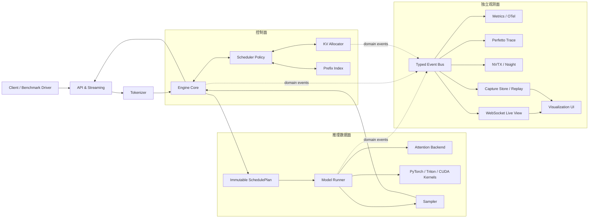
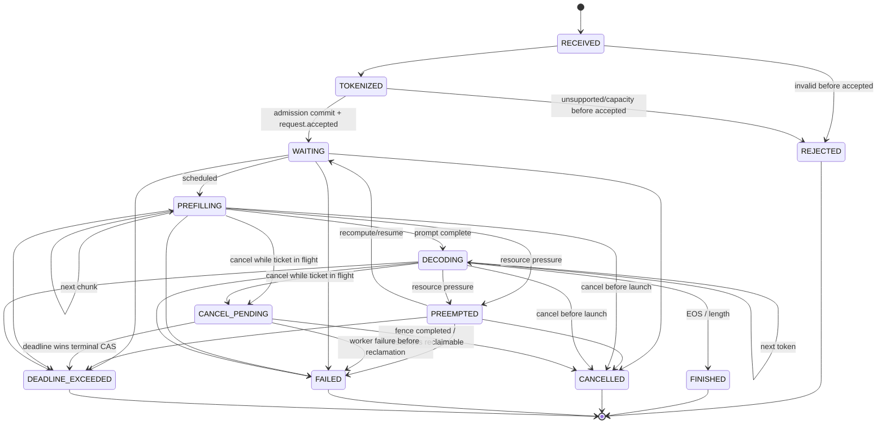

# iLLM：可观测、可回放、可优化的 LLM 推理引擎项目方案

> 工作名：`iLLM`（Inspectable LLM Runtime，可自行替换）<br>
> 文档版本：Proposal v0.4（已同步 17 版 SPEC、跨版本契约与资格状态机）<br>
> 调研基线：2026-08-18<br>
> 方案更新：2026-08-20<br>
> 目标读者：希望通过亲手实现推理引擎学习 AI Infra 的开发者<br>
> 推荐投入：每周 10～15 小时；V0.0 可运行实验室约 1～2 周，首个真实模型垂直切片 V0.2 约 5～8 周，V1.0 约 24～35 周；V1.1 后的可选生成能力与 V2/V3 分布式阶段分别独立排期

## 阅读导航

- **第一次阅读**：0 → 1 → 2.3 → 3 → 7 → 11 → 12 → 17；
- **准备开工**：3.3 → 3.4 → 5 → 6.3 → 8 → 10 → 12；
- **准备优化**：2.4 → 4 → 6 → 9 → 附录 A；
- **准备多卡/分布式**：3.2 → 11 的 M10a/M10b/M11/M12 → 16 第三阶段。
- **按版本实施**：先读 [Version SPEC Index](docs/specs/README.md)，再只接受和实现当前版本 SPEC。

缩略语 TTFT、TPOT、ITL、E2E、ISL、OSL 的严格定义见 1.4 节；没有先读该定义，不应解读 benchmark 数字。

---

## 0. 一页结论

这个项目不应从“复刻 vLLM/SGLang 的全部功能”开始，而应从一个**正确、可解释、可测量的参考引擎**开始，再沿着明确的性能证据逐步演进。

建议把 iLLM 定位为：

> 一个面向学习与性能工程的 LLM 推理引擎。它以分块式 KV 存储、连续批处理、前缀复用和 CPU/GPU 重叠为效率基础，以事件驱动的可视化、分级可验证回放和策略对比为核心差异。

核心策略：

1. **先正确，后快速**：先与 Hugging Face 参考实现逐 token 对齐，再逐层替换为高性能路径。
2. **可观测性从第一天进入架构**：执行核心只产生稳定的领域事件，UI、指标、Perfetto、OpenTelemetry、NVTX 都是可插拔消费者。
3. **Python-first，profile-guided multilingual**：Python/PyTorch 完成参考实现；确认 CPU 元数据热路径后再迁移 Rust；确认 kernel 热点后先 Triton、再 CUDA。
4. **先做模块化单体，再拆进程/分布式**：保留 API、Engine Core、Worker 的边界，但 MVP 不承担多进程通信复杂度。
5. **不承诺“普遍快于 vLLM/SGLang”**：只在固定模型、硬件、工作负载和延迟 SLO 下追求可复现的 Pareto 改进。
6. **V1 聚焦单机单卡 dense decoder-only**：TP、PD 分离、MoE、量化、多模态等进入 V2/V3。

项目采用可独立结束的版本分层，不把全部路线绑成一个 7～10 个月的“大 V1”：

| 版本 | 对应阶段 | 预计累计投入 | 独立完成定义 |
|---|---|---:|---|
| **V0.0 Bootstrap Lab** | M0 | 1～2 周 | 空仓库成为有 CPU CI、事件、capture、toy R0/R1 replay 的可复现实验室 |
| **V0.1 Reference Runner** | M1 | 3～5 周 | 精确模型/权重契约、full-context eager 和 sampling oracle 可逐 op 对齐 |
| **V0.2 Stateful Streaming** | M2 | 5～8 周 | prefill/decode、contiguous KV、streaming/cancel 构成首个真实垂直切片 |
| **V0.3 Batched Engine** | M3 | 8～12 周 | continuous batching、hard admission、取消与 reason code 形成批处理服务 |
| **V0.4 Paged Memory** | M4a | 11～16 周 | paged allocator 与 Attention ABI 正确可观测，暂不引入抢占 |
| **V0.5 Preemptible Memory** | M4b | 12～18 周 | recompute preemption、forward progress 与异步安全释放闭环 |
| **V0.6 Chunked Prefill** | M5a | 14～21 周 | mixed AttentionPlan 与 decode reservation 形成可验证 Pareto 实验 |
| **V0.7 Prefix-Aware Core** | M5b | 17～25 周 | exact radix prefix cache、lease 与 eviction 形成完整同步单卡核心 |
| **V0.8 Visual Replay** | M6 | 21～31 周 | 三个核心视图从同一 capture 完成 full-engine R0/R1 因果教学和诊断 |
| **V1.0 Stable Single-GPU** | M7 Gate + M8 | 24～35 周 | API/CLI/兼容/发布工程稳定，单卡通过 release qualification |
| **V1.1 Performance Season** | 零或一个 M7a～M7d 分支 | 26～40 周 | `NoCandidate`、`Adopt`、`No-go` 都允许发布；只有 Adopt 才形成 selected fast path |
| **V1.2 Structured Outputs（可选）** | M9a | V1.1 + 2～3 周 | byte-level regex/有限 JSON grammar 与约束采样语义闭环 |
| **V1.3 Speculative Decoding（可选）** | M9b | V1.2 + 3～5 周 | lossless proposal/verify、RNG 与 KV transaction 严格 rollback |
| **V2.0 Single-Node Tensor Parallel** | M10a | V1.1 + 4～6 周 | TP、collective、rank 一致性与通信可视化；V1.3 仅条件式合入 |
| **V2.1 Data Parallel Routing** | M10b | V2.0 + 2～4 周 | 多 replica 路由、原子 AdmissionLease 与唯一 accepted |
| **V3.0 Disaggregated Runtime** | M11 | V2.1 + 8～12+ 周 | P/D 分离、KV transfer、双资源接单、背压与故障控制 |
| **V3.1 Reliable Operations** | 稳定化 | V3.0 + 8～14 周 | 升级/回滚、drain、chaos/soak、支持矩阵和长期运行证据完整 |

V1.0 的支持边界是一个由 `SupportedModelSpec` 精确定义的 dense decoder-only architecture/revision、FP16/BF16、单 NVIDIA GPU。其必须能力为 streaming、continuous batching、paged KV、chunked prefill、prefix cache、capture、事件播放、控制面回放，以及 Guided Request Story、Scheduler Lab、KV Cache Explorer 三个核心入口。

首个垂直切片必须从命令行端到端闭环，而不是若干孤立 demo：

```text
illm run --model fixture:tiny-decoder --prompt "hello" --stream --capture out/run
illm replay out/run --mode trace
illm inspect request out/run --request req-0001
```

它必须串起：

```text
prompt → tokenizer → model → prefill/decode → stream
       → capture → R0 event playback → CLI Request Story
```

V1.1 及后续性能版本的成功标准不是“必须赢”：V1.1 的 `selected_branch` 基数固定为 0..1，`NoCandidate`、`Adopt`、`No-go` 都是可发布结果；三者都必须交付与冻结版本 vLLM/SGLang 在等预算条件下的可复现 gap report。V1.2/V1.3 是可选生成能力线，V2.0 可以直接从 V1.1 开始；若合入 V1.3，必须使用独立的 `v1.3-merged` identity 与 qualification profile。每个版本的具体增量与验收以对应 Version SPEC 为准。

---

## 1. 项目目标、非目标与成功标准

### 1.1 目标

#### G1：学习完整推理链路

亲手实现并观察：

- tokenizer、prefill、decode、sampling、streaming；
- KV cache 的布局、增长、复用和回收；
- request state machine、continuous batching、admission、preemption；
- CPU 输入准备、H2D、GPU kernel、同步和通信；
- TTFT、TPOT、ITL、E2E、throughput、goodput 与显存之间的权衡。

#### G2：形成可扩展的引擎内核

- 调度策略、KV 分配、prefix index、attention backend、sampling backend 可替换；
- 领域层不依赖 FastAPI、React、Prometheus、某个具体 CUDA kernel；
- 单卡与多卡共用相同的核心请求/计划/事件模型；
- Python 参考路径长期保留，作为 Rust/CUDA 优化路径的正确性 oracle。

#### G3：形成独特的可视化闭环

可视化不仅“展示指标”，还要支持：

- 因果关联：`Request → Scheduler Step → Batch → Model Op → CUDA Kernel`；
- 决策解释：记录选中、延迟、抢占、驱逐的 reason code；
- 时间回放：用时间游标重建队列、batch、页表、radix tree；
- What-if preview：对同一 trace 离线比较 scheduler/cache policy 的模型化估计；当前列车统一标 `what_if_preview/estimated`，不宣称 R3；
- A/B 对比：同工作负载下比较 baseline 与 candidate；
- 教学模式与专家模式共享同一份事实数据。

#### G4：在明确场景中追求更好的效率

优先选择最可能形成差异的三类场景：

1. **共享前缀高的多轮对话、few-shot、agent 工作负载**；
2. **长 prefill 与交互式 decode 混合、对 next-token latency/ITL 敏感的工作负载**；
3. **长度分布离散、突发到达、KV 压力高的在线工作负载**。

### 1.2 非目标

V1.0 明确不做：

- 覆盖所有 Hugging Face 模型；
- 一开始支持多 GPU、多节点、MoE、多模态；
- 从第一版就写完整 CUDA attention；
- 兼容 vLLM/SGLang 的所有 CLI 与内部 API；
- 生产级鉴权、计费、Kubernetes 编排；
- 用 full trace 模式跑正式性能对比；
- 以论文或博客中的峰值倍数作为项目承诺。

### 1.3 可验收的成功标准

| 维度 | V0.1 基线 | V1.0 Must | V1.1 Performance / V1.2+ Optional |
|---|---|---|---|
| 正确性 | greedy 单请求 token 对齐 | batching/cache/chunking 组合对齐；基础 sampling 满足 RNG/differential/distribution contract | V1.1 保持 reference differential；V1.2 验证 grammar，V1.3 验证 lossless speculation |
| 可解释性 | 单请求阶段时间线 | scheduler、KV、模型、GPU 可跨页关联 | V1.1 trace-based critical path；后续 preview 仍标 `estimated`，正式 R3 需独立 SPEC |
| 稳定性 | 无 crash 的短测试 | 长压测无 KV 泄漏、悬空页或丢请求 | 故障注入、取消/抢占/恢复全覆盖 |
| 性能 | 参考 eager runner 可复现 | 完成固定 baseline 与 Profile Gate | V1.1 产出 `NoCandidate/Adopt/No-go`；Adopt 目标为同 SLO goodput ≥ baseline 1.10× 或延迟降低 ≥10% |
| 观测开销 | 有 Noop 路径 | always-on metrics 实测吞吐影响目标 <1% | sampled request trace 影响 <3% |
| 扩展性 | backend Protocol | 新 policy/backend 不修改 Engine Core | Python/Rust 双实现 differential test |

> 上表中的性能数字是**工程目标，不是保证**。若未达到，应交付可复现数据、瓶颈证据和下一步假设，仍视为有效学习成果。

### 1.4 Metric Contract 与 goodput

在实现指标前先固定语义；服务端和客户端时间必须分开保存。

| 名称 | 本项目定义 | 统计总体与边界 |
|---|---|---|
| ISL / OSL | input/output sequence length，均以 token 计 | 记录实际值和请求上限 |
| server TTFT | Engine accepted 到首个 token 可交付 | accepted 且实际产生首 token 即形成 latency 样本，不因其随后 FAILED/CANCELLED/DEADLINE_EXCEEDED 而删除；包含 server queue/tokenize；未产首 token 的 accepted request 单列 failure/censor，不伪造为 TTFT |
| client TTFT | 客户端发送开始到收到首个 chunk | 包含网络、客户端与服务端 buffering；未产首 chunk 的 accepted request 单列 censor |
| ITL_i | 第 i-1 个与第 i 个 token 到达/可交付时间之差 | accepted request 每形成一个相邻 token interval 就产生一个 token-weighted 样本，不按最终 terminal outcome 删除 |
| TPOT_request | `(last_token_time - first_token_time) / (output_tokens - 1)` | accepted 且至少产生 2 个输出 token 时每请求一个样本；不足 2 token 单列 censor |
| E2E | 请求开始到最后响应/stream close | 每个 accepted 且 terminal 的请求一个样本；按 FINISHED/FAILED/CANCELLED/DEADLINE_EXCEEDED 分层，不只保留成功请求 |
| SLO attainment | 同时满足本实验 TTFT、ITL/TPOT、E2E 阈值的成功请求比例 | request-weighted |

percentile 必须写明是：

- request-weighted（例如每请求一个 TPOT 后求 p99）；
- 还是 token-weighted（例如所有 ITL interval 求 p99）。

失败、取消、timeout 不得从分母静默删除；已经形成的 TTFT/ITL/TPOT 样本必须保留，尚未形成的样本写入对应 censor counter，并在实验卡中声明是否计入 SLO violation。streaming 的 server-ready、socket-write 与 client-received 时间分开记录。

单纯 tokens/s 容易通过牺牲尾延迟换取，单一 output-token goodput 又会偏爱长输出。因此同时报告：

```text
request_goodput
= 满足全部 SLO 的成功请求数 / 秒

output_token_goodput
= 满足全部 SLO 的成功请求所产生的输出 token 数 / 秒
```

并将 `SLO attainment rate`、最大 waiting age、按 prompt-length bucket 的 slowdown 作为 starvation/fairness guardrail。

同时报告：

- TTFT、TPOT、ITL、E2E 的 p50/p95/p99；
- request/s、input/output/total token/s；
- GPU 显存峰值、KV 使用率、碎片率、prefix hit tokens；
- preemption、eviction、OOM、取消和失败数；
- GPU busy、HBM bandwidth、kernel launch gap；
- 可选：能耗/token。

核心指标注册表应是版本化文件，而不是只写在 UI 中。首批建议：

| 指标 | 类型/单位 | 计算约定 |
|---|---|---|
| `illm.server.ttft.request_weighted.p99.v1` | Derived distribution / s | accepted 且产生首 token 即采样；未产首 token 单列 `ttft_censored_before_first_token` |
| `illm.client.ttft.request_weighted.p99.v1` | Derived distribution / s | accepted 且产生首 chunk 即采样；未产首 chunk 单列 censor |
| `illm.server.itl.token_weighted.p99.v1` | Derived distribution / s | accepted request 的全部相邻 output-token interval 等权；不足 2 token 单列 censor |
| `illm.server.tpot.request_weighted.p99.v1` | Derived distribution / s/token | accepted 且 output≥2 时每请求一个派生样本；不足 2 token 单列 censor |
| `illm.scheduler.queue.depth.current.v1` | Observable Gauge / request | 按有限 state 属性聚合 |
| `illm.kv.pages.used.current.v1` | Observable Gauge / page | denominator 是该 rank 的 usable pages |
| `illm.kv.prefix.queried_tokens.total.v1` | Counter / token | 单调累计 |
| `illm.kv.prefix.hit_tokens.total.v1` | Counter / token | hit ratio 由两个 counter 按窗口求得 |
| `illm.kv.internal_fragmentation.allocated_slot_ratio.v1` | Gauge / ratio | 已分配页中的未使用 token slots / 已分配 slots |
| `illm.kv.evictions.total.v1` | Counter / eviction | 只带有限 reason enum |
| `illm.scheduler.preemptions.total.v1` | Counter / preemption | 只带有限 reason enum |
| `illm.scheduler.recomputed_tokens.total.v1` | Counter / token | preemption/resume 导致的重复计算 |
| `illm.scheduler.steps_without_progress.request_weighted.v1` | Distribution / step | 按请求聚合后导出，不带 request label |
| `illm.scheduler.max_waiting_age.current.v1` | Gauge / s | 当前已接纳 waiting request 最大年龄 |
| `illm.engine.overload_recovery.request_weighted.p99.v1` | Derived distribution / s | 从 overload 进入到 queue 回落至 low watermark |

所有 duration histogram 统一使用秒；`request_id/batch_id/tenant` 禁止作为 label，只能通过采样 trace/exemplar 关联。外部碎片若 backend 存在，作为独立指标定义，不与页内碎片混合。

---

## 2. 从 vLLM 与 SGLang 各取所长

### 2.1 调研版本边界

本方案调研时：

- vLLM 最新稳定版为 [v0.26.0](https://github.com/vllm-project/vllm/releases/tag/v0.26.0)；
- SGLang 最新稳定版为 [v0.5.17](https://github.com/sgl-project/sglang/releases/tag/v0.5.17)。

`main/latest` 文档可能领先稳定版，内部 API、默认调度参数和兼容矩阵变化很快。实现与 benchmark 必须记录：

- baseline tag 与 commit；
- 容器镜像 digest；
- 模型与 tokenizer revision；
- PyTorch、CUDA、driver、attention backend；
- 完整启动参数与 workload seed。

调研时的版本脉络只用于帮助理解，不应变成未经固定 tag 的运行时假设。下表版本是本 Proposal 的 research snapshot，不是数月后 V1.1 的预选 benchmark baseline；V1.1 只在其 SPEC 从 draft 进入 accepted 时按可安装性、共同支持矩阵与截止日规则签发 `ExternalBaselineManifestV1`，之后才不可替换：

| 项目节点 | 与本方案相关的变化 |
|---|---|
| vLLM v0.26.0 | 本次架构调研 snapshot；Model Runner V2 需按该 tag 核对 completeness，不预先锁定未来 V1.1 benchmark |
| SGLang v0.4 | overlap/“zero-overhead” scheduler 进入公开架构说明 |
| SGLang v0.5.11 | Speculative Decoding V2、PD decode-side radix cache 等路径演进 |
| SGLang v0.5.16 | UnifiedRadixTree 在相关 hybrid 路径中进一步统一 |
| SGLang v0.5.17 | session-aware Unified Radix Cache、Rust frontend 初期能力 |

### 2.2 借鉴矩阵

| 来源 | 借鉴的稳定思想 | iLLM 中的落点 | 不直接照搬的部分 |
|---|---|---|---|
| vLLM | 分块/分页式 KV 物理存储与逻辑 block table | `KVAllocator + PageTable` | 先不支持 hybrid KV、多种 attention group |
| vLLM | iteration-level continuous batching | `SchedulerPolicy.plan()` | 不复制快速变化的内部对象模型 |
| vLLM | 统一 token budget、decode-first chunked prefill、KV 可分配性检查 | `StepBudget + SchedulePlan` | admission 参数与 chunk size 不写成架构常量 |
| vLLM | API / Engine Core / GPU Worker 分层 | 模块化单体的接口边界 | MVP 不直接上 ZMQ/多进程 |
| vLLM | 持久请求状态、预分配 buffer、CPU/GPU overlap | V1.1 fast path | 不追随尚在演进的全部 Model Runner 细节 |
| vLLM | TTFT/TPOT/KV 等指标与 benchmark discipline | `illm-bench` | 不用不同配置做不公平比较 |
| SGLang | RadixAttention 的最长前缀匹配、叶节点 LRU | `PrefixIndex/RadixIndex` | prefix index 不与 allocator/kernel 耦合 |
| SGLang | overlap scheduler | `prepare → launch → resolve` pipeline | 同步 scheduler 永久保留为 oracle |
| SGLang | structured output backend | V1.2 `GrammarBackend` | 只做 regex/DFA 或有限 JSON 子集 |
| SGLang | request dump/replay 思路 | `CaptureBundle + ReplayEngine` | 不直接序列化内部 Python 对象 |
| SGLang | PD disaggregation 的独立 P/D 资源思想 | V3 `PrefillService/DecodeService` | 单卡 MVP 不做 KV 网络传输 |
| 两者共同 | speculative decoding、并行、量化、LoRA | 后续插件接口 | 不进入最短闭环 |

关键资料：

- [vLLM PagedAttention 论文](https://arxiv.org/abs/2309.06180)
- [vLLM v0.26.0 Architecture 源文档](https://github.com/vllm-project/vllm/blob/v0.26.0/docs/design/arch_overview.md)
- [vLLM v0.26.0 Prefix Caching 源文档](https://github.com/vllm-project/vllm/blob/v0.26.0/docs/design/prefix_caching.md)
- [vLLM v0.26.0 Model Runner V2 源文档](https://github.com/vllm-project/vllm/blob/v0.26.0/docs/design/model_runner_v2.md)
- [SGLang 论文](https://arxiv.org/abs/2312.07104)
- [SGLang RadixAttention 官方介绍](https://www.lmsys.org/blog/2024-01-17-sglang/)
- [SGLang overlap scheduler 官方介绍](https://www.lmsys.org/blog/2024-12-04-sglang-v0-4/)
- [SGLang PD Disaggregation](https://docs.sglang.io/docs/advanced_features/pd_disaggregation)

### 2.3 iLLM 的组合设计

#### A. 物理 KV 分页，逻辑前缀树索引

- 物理层：固定大小 page pool，按需 reserve/commit_allocation/release；
- 请求层：每个 sequence 持有逻辑 token → 物理 page 的映射；
- 前缀层：压缩 radix tree 存 token edge 与**完整可复用 page extent**；
- 活跃路径：引用计数保护；
- 空闲缓存：基于 LRU/成本的叶驱逐；
- 命名空间：model、tokenizer/chat template、LoRA、tenant/cache salt 全部进入 key。

radix edge 保存 token span，node/value 保存 KV page 引用。prompt prefill 与请求完成后的 generated tokens 都可以进入缓存，从而支持分支对话的后续复用。

首版只共享完整 page：匹配长度向下对齐到 page 边界，尾部不足一页的 suffix 重新计算，且不得覆盖共享页。为了产生 next-token logits，`max_reusable_tokens` 必须满足 `0 <= max_reusable_tokens <= prompt_len - 1`；当 prompt 恰好按页对齐且完整命中时，首版可以重新计算最后一个完整 page，但不能让 query token 数变成 0。1-token prompt 必须复用 0 token；prompt logprobs 等需要不同 query 覆盖范围的能力必须单独声明。capture 同时记录 `matched_tokens`、`reused_tokens` 与 `forced_recompute_tokens`。

这是 **iLLM 为降低首版复杂度采用的 page-aligned 策略**，不是对所有 SGLang/RadixAttention 版本的定义；具体 page/cache 行为随版本和 backend 变化。

不要一开始同时维护 hash index 与 radix index。应定义统一 `PrefixIndex`，用 feature flag 做：

- `NoPrefixIndex`；
- `HashBlockIndex`；
- `RadixPrefixIndex`。

通过真实 trace 比较 CPU lookup 成本、hit tokens、显存驻留和端到端收益，再决定默认策略。

#### B. SLO-aware token-budget scheduler

每一步计划同时考虑：

- 可计算 token budget；
- 最大 active sequence 数；
- 当前/未来 KV page 预算；
- decode deadline 与 waiting age；
- prefix hit 后的剩余 prefill；
- chunked prefill 大小；
- preemption/eviction 成本。

每个 active decode 在 `EngineSnapshot` 中携带 `next_token_deadline_ns`，它由上一个 token 的 server-ready 时间和 ITL SLO 推导；不要用请求级平均 TPOT 直接充当逐 step deadline。

推荐默认策略：

1. 为即将违反 next-token/ITL SLO 的 decode 保留预算；
2. 按 aging 后的优先级安排其余 decode；
3. 用剩余预算填充 prefix hit 后的 prefill chunk；
4. admission 预估完整输入或安全水位，避免 cache thrashing；
5. 所有未选请求记录 `reason_code` 和约束快照。

#### C. 同步 oracle + 异步 fast path

同步路径：

```text
resolve(N-1) → schedule(N) → prepare(N) → launch(N) → wait(N)
```

优化路径：

```text
GPU: launch(N) ─ execute(N) ─ event_N
CPU: resolve(N-1) ─ schedule(N+1) ─ prepare(N+1)
                         │
                         └─ 只消费显式 ready/deferred 的状态
```

四类对象必须分开：

- `SchedulePlan`：纯逻辑、不可变、可回放；
- `PreparedBatch`：已绑定 shape bucket/device buffer 的输入；
- `ExecutionTicket`：`CompletionFence`、future/result relay 和状态 mutation 结果；
- `DeviceBufferLease` / `WorkspaceLease` / `KVWriteLease`：描述 GPU 仍可能读写的地址、所属 stream 和最后一个 `CompletionFence`，由 ticket 持有，不得按 Python 对象生命周期提前回收。

EOS、取消、grammar、speculative commit/rollback 与 KV mutation 都必须经过 ticket resolve，不能假设 launch 后结果已可用。取消先逻辑屏蔽结果，相关 lease 标记 `pending_free`；只有最后一个 reader/writer `CompletionFence` 完成后地址才能返回 pool。同步和异步路径消费相同 `SchedulePlan`，通过 trace replay 做 differential test。所谓“zero-overhead scheduler”应理解为 CPU 开销被 GPU 工作覆盖，而不是 CPU 工作消失。

### 2.4 性能假设与证伪方式

| 假设 | 目标 workload | 实验 | 失败判据 |
|---|---|---|---|
| H1：radix index 提升前缀复用净收益 | 共享前缀 25%～90% | 固定 paged allocator，No/Hash/Radix ablation | lookup/排序开销抵消 saved prefill |
| H2：paged allocator 提升固定显存下的容量/goodput | 长度离散、KV 压力高 | 固定 attention 语义，contiguous/paged 的碎片与最大并发对比 | 间接寻址成本超过容量收益 |
| H3：SLO-aware chunking 改善混合流量 goodput | 长 prefill + 短交互 decode | 固定/自适应 chunk、不同 token budget | p99 ITL 或 TTFT 恶化且无吞吐收益 |
| H4：prepare/launch overlap 减少 GPU bubble | 小 batch、decode-heavy | sync 与 overlap trace diff | 正确性复杂度高且 bubble 无显著下降 |
| H5：持久 buffer/shape bucket 降低 CPU 与 launch 开销 | 低并发低延迟 | eager/compile/CUDA Graph 分桶对比 | compile/replay 成本或显存占用过高 |
| H6：可视化回放加速策略迭代 | scheduler/cache 调参 | 同 trace 的 `what_if_preview/estimated` 与线上验证；不声明 R3 | 模拟结果与真实执行偏差不可控 |

---

## 3. 总体架构

### 3.1 三条平面



### 3.2 进程演进

| 阶段 | 形态 | 原因 |
|---|---|---|
| MVP | 单进程、单 GPU、模块化单体 | 便于调试、断点与 R1 control-plane replay |
| V1 | API/telemetry 可独立线程，GPU 仍单 worker | 隔离 UI/IO，不引入复杂 IPC |
| V2 | API Process + Engine Core + 每 GPU Worker | 学习进程隔离、故障边界、TP |
| V3 | Router + Prefill/Decode Services + Transfer Engine | 研究 PD 分离与跨节点 |

V2 必须区分两种 scheduler 所有权：

- **TP group**：一组 GPU 只有一个逻辑 `SchedulePlan`。可以由 leader 广播，也可以由各 rank 确定性复现，但绝不能各 GPU 独立 admission；所有 rank 必须执行一致的 collective 顺序。
- **DP replica**：每个 replica 有独立 scheduler 与 KV cache；全局 router 负责负载、cache affinity、限流和故障摘除。

V2 trace 增加 `tp_group_id`、`dp_replica_id`、`global_rank`、collective sequence 与 timeout/failure propagation。

V3 的 PD 不是简单多两个进程，而是一套事务化传输协议：

- `KVTransferManifest`：model revision、KV dtype/layout、page size、layer/head mapping、position、TP degree/mapping；
- Decode 端先 reserve 目标页，Prefill 端才开始传输；
- `TransferTicket`：PREPARED → TRANSFERRING → COMMITTED/CANCELLED/FAILED；
- request/transfer ID 幂等，具备 timeout、heartbeat、backpressure 和失败清理；
- 顺序固定为：同机、同 TP、同 layout、mock/memcpy → async copy → NIXL/Mooncake/RDMA → 异构 TP。

PD 的验收必须对比 unified engine 的 TTFT/ITL，并归因重复权重与 KV transfer 的时间、带宽和显存成本。

### 3.3 核心模块与依赖边界

| 模块 | 高内聚职责 | 只允许依赖 | 明确不负责 |
|---|---|---|---|
| `api` | 协议、校验、streaming、取消 | engine facade | 调度、显存 |
| `tokenizer` | 文本/token、chat template | model metadata | GPU 执行 |
| `engine` | 请求生命周期、step loop、组件编排 | domain interfaces | HTTP、具体 kernel |
| `scheduler` | 根据不可变状态生成 `SchedulePlan` | domain、KV capacity view | 直接分配 GPU 内存 |
| `kv_cache` | page pool、page table、事务、allocation epoch、request/in-flight lease | device memory abstraction | 选择请求优先级 |
| `prefix_cache` | match/insert/acquire/release/evict | KV handle protocol | attention 计算 |
| `model` | 模型结构与权重映射 | backend interfaces | 服务协议 |
| `executor` | 将计划变成 device work | model/backends | 调度 policy |
| `backends` | attention、linear、sampling、collective | tensor/device API | 请求状态 |
| `observability` | schema、sink、sampling、export | domain events | 修改引擎状态 |
| `replay` | R0 事件播放、R1 状态 reducer；条件式 R2 执行适配与未来 R3 扩展点 | schema、checkpoint、pure reducer；R2 经 engine facade | 静默降级、修改在线请求；无独立 SPEC 时实现 R3 |
| `benchmark` | workload、load generation、报告 | public API/metrics | 修改 engine config |
| `web` | 教学与诊断 UI | generated schema/API | 读取 Python 内部对象 |

### 3.4 关键接口草图

```python
@dataclass(frozen=True)
class StepBudget:
    max_tokens: int
    max_sequences: int
    # 只来自冻结的 MemoryPlan/KV pool，不包含 graph/workspace 可用显存。
    free_pages: int
    now_ns: int


@dataclass(frozen=True)
class SchedulePlan:
    step_id: int
    snapshot_version: int
    admissions: tuple[Admission, ...]
    prefill_chunks: tuple[PrefillChunk, ...]
    decodes: tuple[DecodeWork, ...]
    reservations: tuple[ReservationIntent, ...]
    evictions: tuple[EvictionIntent, ...]
    decisions: tuple[DecisionRecord, ...]


class SchedulerPolicy(Protocol):
    def plan(
        self,
        state: EngineSnapshot,
        budget: StepBudget,
    ) -> SchedulePlan: ...


class KVAllocator(Protocol):
    def reserve(
        self,
        request: KVRequest,
        expected_version: int,
    ) -> Reservation: ...
    def commit_allocation(self, reservation: Reservation) -> KVHandle: ...
    def rollback(self, reservation: Reservation) -> None: ...
    def begin_write(self, handle: KVHandle, ranges: tuple[TokenRange, ...], ticket_id: int) -> KVWriteLease: ...
    def commit_write(self, write: KVWriteLease, completion: CompletionFence) -> None: ...
    def abort_write(self, write: KVWriteLease) -> None: ...
    def release(self, handle: KVHandle, after: CompletionFence | None = None) -> None: ...
    def snapshot(self) -> KVSnapshot: ...


class PrefixIndex(Protocol):
    def match(
        self,
        key: PrefixKeyV1,
        snapshot: PrefixSnapshot,
    ) -> PrefixMatch: ...
    def insert(self, key: PrefixKeyV1, handle: KVHandle) -> None: ...
    def acquire(self, match: PrefixMatch) -> Lease: ...
    def release(self, lease: Lease) -> None: ...
    def select_evictions(
        self,
        snapshot: PrefixSnapshot,
        required_pages: int,
    ) -> tuple[EvictionIntent, ...]: ...
    def apply_evictions(
        self,
        intents: tuple[EvictionIntent, ...],
        expected_version: int,
    ) -> tuple[Eviction, ...]: ...


@dataclass(frozen=True)
class KVLayoutSpec:
    layout_version: int
    layout_id: str
    key_axes: tuple[str, ...]
    value_axes: tuple[str, ...]
    key_strides: tuple[int, ...]
    value_strides: tuple[int, ...]
    page_size_tokens: int
    alignment_bytes: int
    dtype: DType
    num_layers: int
    num_kv_heads: int
    head_dim: int
    stores_rope_applied_keys: bool
    quantization: FrozenJson | None


@dataclass(frozen=True)
class AttentionPlan:
    # 同一步可同时包含 ragged prefill chunk 与 decode row。
    step_id: int
    layer_id: int
    request_ids: tuple[RequestId, ...]
    query_indptr: IntTensor
    query_lens: IntTensor
    context_lens_before_step: IntTensor
    sequence_lens_after_step: IntTensor
    absolute_positions: IntTensor
    block_tables: IntTensor
    block_table_lens: IntTensor
    write_slots: IntTensor
    valid_sequence_mask: BoolTensor
    valid_token_mask: BoolTensor
    q_to_kv_head: IntTensor
    causal: bool
    sliding_window: int | None
    scale: float
    softcap: float | None


@dataclass(frozen=True)
class AttentionCapabilities:
    backend_id: str
    dtypes: tuple[DType, ...]
    head_dims: tuple[int, ...]
    page_sizes: tuple[int, ...]
    supports_mixed_prefill_decode: bool
    supports_chunked_prefill: bool
    supports_prefix_cache: bool
    supports_sliding_window: bool
    capture_safe: bool
    deterministic: bool


class AttentionBackend(Protocol):
    def capabilities(self) -> AttentionCapabilities: ...
    def supports(self, plan: AttentionPlan, layout: KVLayoutSpec) -> SupportResult: ...
    def workspace_bytes(self, plan: AttentionPlan, layout: KVLayoutSpec) -> int: ...
    def execute(
        self,
        plan: AttentionPlan,
        qkv: QKVView,
        kv: KVView,
        workspace: WorkspaceLease,
    ) -> Tensor: ...


class EventSink(Protocol):
    def emit(self, event: DomainEvent) -> None: ...
```

设计约束：

- `SchedulerPolicy.plan` 只读带版本号的 `EngineSnapshot/KVSnapshot/PrefixSnapshot`，输出 intent，保持纯函数；
- reserve/commit-allocation 两阶段避免分配一半失败后破坏页表；
- Engine 按 `validate snapshot version → acquire/reserve/apply eviction → commit_allocation` 执行计划；
- 版本校验或任一副作用失败时 rollback 并 replan，避免 overlap 下的 TOCTOU；
- `PrefixIndex.match/select_evictions` 无副作用；`acquire/apply/insert/release/evict` 才能更新 request lease、LRU、index 与 cache owner；
- `RequestLease` 只表示 active request 对共享页的借用，`cache_owner` 单独表示 cache retention ownership；二者都不代替 DeviceBufferLease/KVWriteLease。所有 lease 必须显式 release 或由 ticket/fence 回收，不得依赖 GC，也不得压成 generic refcount；
- allocator 的页所有权 commit 与 KV 数据可见性是两个阶段；allocation state、cache metadata、`valid_tokens/pending_write/last_use_fence/pending_free` 三个维度正交；
- cancel/OOM/kernel error 时输出先失效，仍被 stream 使用的 page/buffer/workspace 标记 `pending_free`，等待最后一个 `CompletionFence` 后再复用；
- `AttentionPlan` 不允许 backend 猜测 position、mask、head mapping 或 block-table 单位；启动时必须用 capabilities 校验 model/layout/graph mode，不能静默 fallback 到不同语义；
- 每个 attention backend 必须通过同一 conformance suite：mixed prefill/decode、GQA、页边界、非对齐长度、padding/valid mask、毒化空闲 slot、跨 backend differential；
- 跨模块只传 ID、不可变值对象和小型 handle，不传可变内部对象；
- GPU Tensor 只在 executor/backend 边界出现；
- 所有 reason、state、event 使用稳定枚举；
- 配置启动后冻结，动态策略变更生成新 version；
- 禁止全局可变状态和隐式 monkey patch。

`AttentionPlan` 是 mixed prefill/decode 的统一 ABI：decode 只是 `query_len=1`，prefill chunk 是 `query_len>1`，两者可存在于同一步。必须满足 `query_indptr[-1] = 有效 query token 数`、`context_lens_before_step + query_lens = sequence_lens_after_step`，且每个有效 query token 恰好对应一个 absolute position 与 write slot。prefix/page/chunk 边界不得重置 position；partial page/padding 由 valid length/mask 排除。backend 不得静默 cast、transpose 或更换 KV layout；fallback 必须在任何 KV/RNG 副作用前选择并记录 reason。

backend registry 的选择结果以 `BackendSelection{selected_backend, support_result, fallback_backend, fallback_reason, conversion_cost}` 进入 capture 与 benchmark manifest；unsupported shape/dtype/layout 只能显式回退到 reference backend，不能运行“最接近”的 kernel。

### 3.5 模型支持与权重加载契约

V1 不使用“Llama/Qwen 风格”作为可执行规范。M0 必须通过 ADR 固定一个真实模型的 architecture、不可变 revision、tokenizer revision、dtype、最大上下文和最低显存；仓库另带一个 tiny config + 确定性权重 fixture，用于 CPU、CI 和逐 op golden test。

`SupportedModelSpec` 至少冻结：

```yaml
spec_version: 1
architecture: exact_decoder_architecture
model_revision: immutable_commit_or_digest
tokenizer_revision: immutable_commit_or_digest
vocab_size: required
hidden_size: required
num_layers: required
num_attention_heads: required
num_kv_heads: required
head_dim: required
intermediate_size: required
activation: required
rms_norm_eps: required
rope_theta: required
rope_scaling: explicit_or_none
qkv_bias: required
mlp_bias: required
tie_word_embeddings: required
max_position_embeddings: required
weight_layout_id: required
kv_layout_id: required
supported_dtypes: [bf16, fp16]
spec_id: sha256_of_canonical_spec
```

loader 必须生成版本化 `WeightLoadManifest`，包含 `spec_id`、整体 `weights_digest`，并逐 tensor 记录 canonical name、source shard/byte range、shape、dtype、checksum、transpose/fusion 变换、最终 storage bytes 以及 tied-weight group，并满足：

- config 采用语义字段白名单；未知且可能影响执行的字段 fail closed；
- 不允许 missing、unexpected、duplicate tensor，所有 shard 都有唯一覆盖；
- shape/dtype、QKV 与 gate-up 融合顺序、transpose、weight tying 显式验证；
- golden 覆盖多个绝对位置、短/长上下文、GQA head mapping、RoPE 边界和 tied embeddings；
- reference、optimized backend 与 benchmark 消费同一 spec；spec、weights digest 或运行 dtype 改变后，prefix/compile/Graph cache 与旧 capture 均不得继续复用；
- `trust_remote_code` 默认关闭；需要自定义代码时必须在 ADR 中记录审计范围与固定 digest。

### 3.6 Engine Facade 与最小服务边界

M2 提供稳定的 `Engine.generate()` / `Engine.stream()` facade；M3 的 workload driver 和 batching 集成只依赖该 facade，不依赖内部 step loop。OpenAI-compatible HTTP 子集仍在发布稳定化阶段实现。

学习型服务可以不做生产鉴权，但不能没有资源边界。启动配置必须定义 request body、prompt tokens、output tokens、queued requests、queued tokens、并发连接、admission wait 的硬上限，并统一错误语义：

| 场景 | Engine 结果 | HTTP 映射 |
|---|---|---|
| 参数或模型能力不支持 | `INVALID_ARGUMENT` | 400 |
| body/prompt 超过硬上限 | `PAYLOAD_TOO_LARGE` | 413 |
| 队列或 token budget 过载 | `OVERLOADED` + 可选 retry hint | 429 |
| worker 未 ready、draining 或 fail-stop | `UNAVAILABLE` | 503 |
| client disconnect | 幂等 cancel；输出失效，异步资源延迟回收 | stream close |
| CUDA OOM/kernel async error | 当前请求显式失败；若状态可信性未知则 worker fail-stop | 503 |

readiness 只有在模型校验、MemoryPlan、KV pool 和所选 graph bucket 完成初始化后才通过；shutdown 先停止 admission，再 drain，超时后按 ticket/event 安全释放，而不是直接复用地址。

`request.accepted` 之后必须且只能产生一个 terminal event；从 M2 起跨版本 enum 固定为 `FINISHED | CANCELLED | FAILED | DEADLINE_EXCEEDED`，尚未实现 deadline 的版本保留但不产生最后一项。pre-accept 的 `REJECTED/OVERLOADED` 不产生 accepted/terminal。finish/cancel race 由原子 terminal transition 决定先成功者。streaming headers 已发送后不能伪造新的 HTTP status，必须发送结构化 terminal error、停止输出并关闭 stream。预计的 KV 不足在 admission/reserve 阶段处理，不能把 CUDA OOM 当流控；telemetry exporter stall 只允许丢弃低优先级事件并标记 capture incomplete，不得让推理请求失败。

streaming 的 token ID 是 canonical commit；`text_delta` 必须由每请求 stateful incremental detokenizer 产生。byte-BPE、多 token UTF-8、special token 等边界允许某个 delta 暂时为空，但按序拼接全部 delta 必须等于对最终 committed token prefix 的 canonical decode；不得逐 token 独立 decode 后拼接。

### 3.7 GPU 异步资源生命周期

CPU 上的页所有权 commit 不等于 GPU 数据已经有效。三个维度必须正交：

```text
allocation_state: FREE | RESERVED | ALLOCATED | PENDING_FREE
cache_metadata:   cache_indexed/cache_owner/hash/last_touch/...
borrows:          request_lease_count + inflight_reader_writer_count
device_data:      valid_tokens + pending_write + last_use_fence
```

`PENDING_FREE` 只属于 allocator/lease 的回收状态：它禁止新 borrow/reuse，并等待 `last_use_fence`；device-data 维度不再维护第二个同名布尔值。一个 partial page 可以已有若干 `valid_tokens`，同时追加新的 token，因此不要把 WRITING 当作整页互斥状态。`PreparedBatch` 持有 input/output/workspace lease，`ExecutionTicket` 持有 `CompletionFence` 与 `KVWriteLease`，直到 resolve/reclaim 完成。

```text
validate snapshot
→ reserve / commit_allocation
→ acquire buffer/workspace leases
→ begin_write
→ launch and record CompletionFence
→ resolve ticket
   ├─ success: commit_write → publish output → optional PrefixIndex.insert
   ├─ logical cancel: suppress output → wait fence → release
   └─ failure: abort_write/invalidate → fail request or worker
→ fence satisfied
→ reclaim leases/pages
```

关键规则：

- `PrefixIndex.insert` 只能发生在 `commit_write` 成功之后；
- launch 后的 cancel 只能逻辑取消，不能假设正在执行的 CUDA kernel 被撤销；
- page、input、workspace、logits 和 sampling scratch 在最后一个 reader/writer fence 前不得复用；
- graph-pinned buffer 在 GraphInstance 销毁前不得进入普通 pool；
- PyTorch allocator 路径使用正确的 stream lifetime tracking；自研池使用显式 fence；
- async kernel error 在 ticket resolve 时归属到明确 request/step，并触发受控失败或 worker fail-stop。

压力测试覆盖双 stream overlap、地址快速复用、launch 后取消、OOM、kernel failure、partial-page append 和异常回滚。

---

## 4. 技术栈与多语言策略

### 4.1 推荐技术栈

| 层 | MVP | 性能演进 | 选择理由 |
|---|---|---|---|
| 引擎与模型 | Python + PyTorch | `torch.compile` / custom op | 生态成熟，便于逐步验证 |
| 调度/KV 元数据 | Python dataclass/array | Rust + PyO3/maturin | CPU 热路径、内存安全、低分配 |
| GPU kernel | PyTorch ops | Triton → CUDA C++/CUTLASS | 先快速试验，再获取底层控制 |
| API | FastAPI/Starlette | 独立进程或 Rust gateway | MVP 开发快 |
| 事件 schema | Python typed model + JSONL | 编码无关的版本化 schema registry；按证据选择可选 codegen/二进制编码 | 先冻结逻辑契约，再由 ADR 选择编码，不把 Protobuf 写成版本承诺 |
| 实时 UI | React + TypeScript + Vite | WebGL/Canvas 按需 | 类型安全、交互生态丰富 |
| 图表 | ECharts + React Flow/Cytoscape | 自定义 timeline canvas | 覆盖指标、图和拓扑 |
| Trace | Chrome Trace JSON | Perfetto TrackEvent `.pftrace` | MVP 可快速打开，V1 可 SQL 分析 |
| Metrics/Trace | Prometheus + OpenTelemetry | OTLP Collector | 生产观测与跨进程标准 |
| GPU profiling | PyTorch Profiler + NVTX | Nsight Systems/Compute、可选 CUPTI | 从系统级到 kernel 级逐层缩小 |
| 离线分析 | JSONL/Parquet + DuckDB | PerfettoSQL | 本地、可回放、低运维 |
| 测试 | pytest + Hypothesis | cargo test/proptest、Compute Sanitizer | 不变量与并发错误覆盖 |

#### 手搓边界：什么自己实现，什么复用

| 能力 | V1 决策 | 学习/工程理由 |
|---|---|---|
| tokenizer 与 chat template | 复用固定 revision 的成熟库；验证 token IDs | 自写 tokenizer 对推理核心学习收益低、兼容成本高 |
| safetensors 解析与基础 tensor/GEMM | 复用库与 PyTorch/CUDA | 避免把文件格式和通用矩阵乘法当成主线 |
| Transformer forward 与 weight mapping | 自己实现 reference module/loader contract | 直接学习 shape、RoPE、GQA、Norm、MLP 和布局 |
| scheduler、请求状态机、admission | 自己实现 | 项目的控制面核心 |
| paged allocator、page table、PrefixIndex | 自己实现元数据与不变量 | 项目的内存/缓存核心 |
| attention | 先写可信 gather/reference；optimized backend 可复用或自写 | 先固定语义，再比较 backend/kernel |
| sampling | 自己定义 `SamplingSpec`/RNG；tensor primitive 可复用 | 保证 batching 下可复现 |
| event、capture、replay、visual schema | 自己实现 | 项目的核心差异 |
| HTTP、UI 框架、图表和 trace viewer | 复用生态 | 把时间留给推理与诊断语义 |

任何第三方 backend 都必须经 iLLM adapter、capability check 和 conformance suite，不能让第三方内部对象穿透 domain 边界。

### 4.2 何时才引入 Rust

只有满足任一触发条件才迁移：

- CPU scheduler/metadata 时间持续占 step wall time 的 10% 以上；
- GPU timeline 出现可归因于 Python 的稳定空洞；
- event ring buffer/serialization 造成可测开销；
- radix lookup、LRU、page bookkeeping 成为热点。

迁移规则：

- Python 版本永久保留为 reference；
- Rust 只处理 token/page/ID 等 POD 元数据，不持有 PyTorch Tensor；
- 两实现消费同一 capture，比较 `SchedulePlan` 与 allocator snapshot；
- FFI 一次传批量数组，禁止逐 token/逐 page 高频调用；
- panic 不得跨 FFI，错误映射为显式 domain error。

### 4.3 何时才写 Triton/CUDA

决策门：

1. profiler 证明某 op/kernel 占稳态时间 >10%；
2. 已排除 shape、同步、launch、错误 batching 等系统问题；
3. PyTorch/`torch.compile`/现成 attention backend 无法满足目标；
4. 有简单、可信的 reference implementation 和数值测试。

优先顺序：

```text
PyTorch eager → torch.compile → Triton prototype → CUDA C++/CUTLASS
```

CUDA kernel 进入主路径前必须：

- 多 shape/dtype 数值对齐；
- 边界条件与非对齐长度测试；
- `compute-sanitizer` 的 memcheck/racecheck/synccheck；
- Nsight Compute 的 roofline、occupancy、memory workload 证据；
- 在端到端 workload 中有净收益，而不只是 microbenchmark 更快。

### 4.4 Compile/CUDA Graph 正确性契约

同一执行路径只能选择一种模式，禁止含糊叠加：

1. `eager`；
2. `compile_only`；
3. `compiler_cudagraph`；
4. `manual_cudagraph`。

`GraphKey` 至少包含 model/weight revision、device、dtype、attention backend、`KVLayoutSpec.layout_id`、page size、shape bucket、sampling mode 和 compiler/runtime version。backend、权重、layout、bucket 或 SamplingSpec 改变时必须失效并重新 warmup/capture。

capture/replay 约束：

- 输入、输出、block table、write slots、workspace 使用固定地址；每次 replay 只更新动态 metadata；
- padding row/token 必须由 `valid_token_mask` 屏蔽，batch grow/shrink 与 row reuse 不得让旧 metadata 参与；
- captured region 内禁止动态 allocation、host sync、依赖 tensor 值的 host control flow 和未声明的 RNG 消费；
- graph pool 与 eager/compile workspace pool 分离计量，fallback 不能复用仍在 flight 的地址；
- differential test 覆盖 bucket 边界、batch grow/shrink、row reuse、mixed chunk/decode、prefix hit、cancel、OOM 与 fallback。

### 4.5 开发环境建议

主支持环境建议设为：

- Linux x86_64；
- NVIDIA CUDA GPU；
- 固定的 Python/PyTorch/CUDA lockfile 与容器；
- Windows 开发机通过 WSL2 或远程 Linux GPU 运行 CUDA 路径；
- CPU/CI 可运行 scheduler、allocator、replay、UI 和 toy-model 测试。

硬件分层：

| 级别 | 用途 |
|---|---|
| 无 GPU / CPU | 领域逻辑、状态机、replay、UI、toy model |
| 12～24 GB 消费级 GPU | 0.5B～3B 模型、单卡功能与初步性能 |
| 40～80 GB GPU | 7B、长上下文、公平 baseline |
| 2～4 GPU | V2 TP/DP、V3 PD 实验 |

KV 容量估算公式：

```text
KV bytes / token
= 2 × num_layers × num_kv_heads × head_dim × bytes_per_element
```

GQA/MQA 会显著降低 `num_kv_heads`。UI 应展示“理论 KV/token、已分配、实际占用、内部碎片”四个值。

### 4.6 GPU Memory Planner

KV pool 不能仅由理论 `KV bytes/token` 推导。启动时先生成不可变 `MemoryPlan`：

```text
usable_KV_bytes
= total_device_bytes
- model_weights
- profiled_peak_activations
- attention_and_sampling_workspaces
- compiler_and_graph_private_pools
- input_output_and_telemetry_buffers
- allocator_fragmentation_reserve
- safety_headroom
```

执行顺序固定为：加载并校验权重 → warmup 支持的最大 bucket/backend → profile 最坏非 KV 峰值 → 预留 graph/workspace/观测 buffer 与 headroom → 一次性预分配 per-layer KV pool。稳态热路径禁止 `cudaMalloc`；若 warmup 或分配失败，应降低 bucket/backend/上下文上限并重新生成 plan，不能留下半初始化池。

`RunManifest` 记录 total/reserved/usable KV bytes、各 reserve 项、page 数、实际峰值、headroom、allocator backend 和 graph pool。MemoryPlan 是 admission、`StepBudget.free_pages` 与 UI 容量解释的唯一容量事实源。

---

## 5. 推荐仓库结构

```text
illm/
├─ pyproject.toml
├─ Cargo.toml                         # Rust 阶段再加入
├─ README.md
├─ docs/
│  ├─ design/
│  ├─ tutorials/
│  ├─ adr/
│  └─ experiments/
├─ schemas/
│  ├─ event-envelope.schema.json
│  └─ generated/                       # 仅在选定 codegen profile 后生成
├─ python/illm/
│  ├─ api/
│  ├─ domain/                        # 纯状态、计划、枚举、错误
│  ├─ engine/
│  ├─ scheduler/
│  │  ├─ reference.py
│  │  └─ policies/
│  ├─ kv_cache/
│  │  ├─ allocator.py
│  │  ├─ page_table.py
│  │  └─ invariants.py
│  ├─ prefix_cache/
│  │  ├─ none.py
│  │  ├─ hash_index.py
│  │  └─ radix_index.py
│  ├─ model/
│  ├─ executor/
│  ├─ backends/
│  │  ├─ attention/
│  │  ├─ kernels/
│  │  ├─ sampling/
│  │  └─ collective/
│  ├─ observability/
│  │  ├─ events.py
│  │  ├─ bus.py
│  │  ├─ sampling.py
│  │  └─ sinks/
│  ├─ replay/
│  └─ benchmark/
├─ crates/
│  ├─ illm-scheduler/
│  ├─ illm-kv/
│  └─ illm-telemetry/
├─ csrc/
│  ├─ triton/
│  └─ cuda/
├─ web/
│  ├─ src/
│  └─ tests/
├─ tests/
│  ├─ unit/
│  ├─ property/
│  ├─ integration/
│  ├─ golden/
│  ├─ stress/
│  └─ performance/
├─ benchmarks/
│  ├─ workloads/
│  ├─ baselines/
│  └─ reports/
└─ tools/
   ├─ capture/
   ├─ replay/
   └─ profiling/
```

依赖方向：

```text
api / web / exporters
        ↓
application orchestration
        ↓
domain interfaces and values
        ↑
PyTorch / Rust / CUDA adapters
```

`domain` 不得反向 import FastAPI、PyTorch profiler、Prometheus 或 UI。

---

## 6. 可观测性与事件协议

### 6.1 不用一种格式承载所有观测数据

| 通道 | 适用内容 | 推荐输出 |
|---|---|---|
| 生产观测通道 | 请求 SLO、服务健康、跨进程链路 | OpenTelemetry Trace/Metrics + Prometheus/OTLP |
| 引擎时间线通道 | scheduler、batch、KV、CPU→GPU 因果链 | MVP Chrome Trace JSON；V1 Perfetto TrackEvent |
| 深度硬件通道 | CUDA API、kernel、memcpy、occupancy、stall、roofline | NVTX + Nsight Systems；定点 Nsight Compute |

不要把每个 token、每个 KV page touch 或每个 CUDA kernel 都建成 OpenTelemetry Span。引擎内部先产生稳定的领域事件，再由 sink 转换：

```text
Inference Core
    │ typed domain events
    ▼
bounded Telemetry Bus
    ├─ NoopSink       → benchmark-off
    ├─ MetricsSink    → Prometheus / OTel
    ├─ TraceSink      → coarse OTel spans
    ├─ PerfettoSink   → timeline / PerfettoSQL
    ├─ NvtxSink       → Nsight Systems
    ├─ CaptureSink    → replay bundle
    └─ LiveSink       → WebSocket UI
```

一个 scheduler batch 同时包含多个 request，是多对多关系。OTel 中应让 `scheduler.batch` 成为独立 span，再通过 Span Links 关联请求，而不是伪造成父子树。参考 [OpenTelemetry Trace API](https://opentelemetry.io/docs/specs/otel/trace/api/)。

生产 OTel 只输出 request root 与少量粗粒度 phase span。逐 step 的 batch span/link 仅在采样 request 或短 engine capture 中产生；完整 continuous-batching 因果关系保存在 canonical event log/Perfetto。超过 SDK link cap 时记录 `links_truncated`，不能让 UI 误认为关系完整。

### 6.2 分层观测模型

| 层级 | 回答的问题 | 核心视图 |
|---|---|---|
| L0 模型静态层 | 模型由什么组成、参数放在哪里 | module tree、tensor shape/dtype/bytes、分片图 |
| L1 请求层 | 一个请求为什么慢 | arrival→queue→prefill→decode→stream waterfall |
| L2 调度层 | 为什么进入/没进入这个 batch | queue lanes、request×step 矩阵、token budget |
| L3 KV/内存层 | KV 是否命中、碎片化、被谁占用 | page grid、page table、radix tree、LRU |
| L4 算子/编译层 | 哪个 op 慢、哪里 graph break | module→ATen→fusion group→kernel |
| L5 CUDA/kernel 层 | GPU 是算力、带宽、launch 还是同步受限 | CPU/GPU timeline、roofline、occupancy、stall |
| L6 实验层 | 改动是否真的更好 | baseline/candidate diff、置信区间、回归 |

模型图 MVP 从 config + module tree 构建；ATen/FX 图通过版本隔离 adapter 导入。`torch.export` 与 compiler debug 接口仍可能变化，不能成为领域层依赖。参考 [torch.export API](https://docs.pytorch.org/docs/stable/user_guide/torch_compiler/export/api_reference.html)。

### 6.3 统一事件 schema

V0 使用 typed Python model + JSONL 建立可审计 reference；V0.8 冻结逻辑 envelope/schema，V1.0 稳定的是字段语义、identity、enum/code 与 compatibility，而不是某一种 wire encoding。若跨语言规模证明需要 Protobuf、FlatBuffers 或其他 codegen，必须用 ADR 选择新 artifact/encoding version，生成 Python、Rust/C++、TypeScript 类型，并保留 JSON/JSONL reader、migration fixture 与 rollback；不能原地替换 Bundle v1。

```yaml
schema_version: 1
event_id: bytes16
capture_session_id: string
producer_id: string
producer_seq_no: uint64

kind:
  oneof:
    - span_edge: {phase: begin | end, status: ok | error | unset}
    - complete_span: {duration_ns: uint64, status: ok | error | unset}
    - instant: {}
    - counter: {value: double, unit: string}
    - flow: {phase: start | step | end, flow_id: uint64}
category: request | scheduler | kv_cache | model | compile | cuda | collective
name: string

time:
  clock_id: monotonic_cpu | cuda | unix
  timestamp_ns: uint64

resource:
  engine_version: string
  model_id: string
  model_revision: string?
  host_id: string
  pid: uint32
  tid: uint32?
  worker_id: uint32?
  global_rank: uint32?
  device_id: uint32?

execution:
  stream_id: uint64?
  track_uuid: uint64?

trace:
  trace_id: bytes16?
  span_id: bytes8?
  parent_span_id: bytes8?
  links: repeated TraceLink

correlation:
  request_id: string?
  sequence_id: uint64?
  batch_id: uint64?
  scheduler_step_id: uint64?
  graph_id: string?
  op_id: string?
  cuda_correlation_id: uint64?

sampling:
  level: metrics | request | engine | operator | kernel
  sampled: bool

attributes:
  typed_bounded_payload: oneof
  error_type: enum?
```

硬约束：

- duration 只用单调时钟计算；wall clock 只做跨服务锚点；
- CPU 与 GPU 时间必须保留 clock domain，禁止直接混算；
- 独立 `clock_snapshot` 记录 source/target timestamp pair、uncertainty 和 calibration sequence，不在每个 event 重复 wall-clock anchor；
- `request_id`、`batch_id` 不进入 metric label；
- event name 和枚举低基数且静态；
- prompt/output 默认不采集，只记录 token count；确需关联时仅使用 capture-local keyed HMAC；
- 每个 producer 有连续 `seq_no`；
- bus 满时优先丢低优先级事件，并递增 `telemetry.events_dropped`；
- UI 必须显示 capture 是否丢事件，不能伪装成完整事实。

协议还必须定义：

- span begin/end 配对、重复 end、未闭合 span 与丢事件的处理；
- 已发布 schema 的 enum/code/field ID 永不复用；采用支持 `reserved` 的编码时删除项必须进入 reserved 集合，否则由独立 registry 永久保留 tombstone；
- schema migration 与最低可读版本；
- request/batch 的重叠区间使用 async track/flow，不写到会产生错误嵌套的普通 track；
- request virtual track 只对采样请求创建。

Perfetto 的 slice、counter、flow 与自定义 track 非常适合表达这种时间线，参考 [Perfetto TrackEvent](https://perfetto.dev/docs/instrumentation/track-events)。

### 6.4 事件目录

```text
request.accepted
request.rejected
request.tokenized
request.enqueued
request.phase_changed
request.first_token
request.output_chunk
request.completed
request.cancelled
request.deadline_exceeded
request.failed

engine.overloaded
engine.draining
worker.unhealthy
worker.restarted

scheduler.step
scheduler.batch_formed
scheduler.request_selected
scheduler.request_deferred
scheduler.request_preempted
scheduler.request_resumed

kv.prefix_lookup
kv.page_reserved
kv.allocation_committed
kv.write_started
kv.write_committed
kv.write_aborted
kv.page_released
kv.page_evicted
kv.snapshot

model.forward
model.layer
model.attention
model.mlp
model.collective

compile.region
compile.graph_break
compile.recompile
compile.fusion_group

cuda.api
cuda.kernel
cuda.memcpy
cuda.synchronize
```

生产 metrics 模式不记录逐 token span 或逐 page touch；使用 output chunk、周期 counter 和压缩的 `kv.snapshot delta`。详细事件只对采样 request 或短 capture window 开启。

### 6.5 决策解释协议

结构化 `DecisionRecord` 是 scheduler 自然决策过程的输出，不能为观测重新跑一次判定：

```yaml
request_id: req-42
step_id: 108
decision: deferred
reason_code: KV_WATERMARK
priority_before_aging: 17
priority_after_aging: 26
estimated:
  compute_tokens: 512
  additional_pages: 33
snapshot:
  token_budget_remaining: 384
  free_pages: 28
  protected_decode_tokens: 96
```

推荐 reason code：

- `SELECTED_DECODE_DEADLINE`
- `SELECTED_PREFIX_HIT`
- `SELECTED_AGING`
- `DEFERRED_TOKEN_BUDGET`
- `DEFERRED_KV_CAPACITY`
- `DEFERRED_KV_WATERMARK`
- `DEFERRED_MAX_SEQUENCES`
- `PREEMPTED_FOR_SLO`
- `EVICTED_LRU_LEAF`
- `EVICTED_RECOMPUTE_CHEAPER`

记录策略按 profile 分级：

- `metrics`：只聚合 defer reason counter 与 waiting-age histogram；
- `request`：只记录采样请求及其状态变化；
- `engine`：短窗口记录全部或 top-K candidate；
- bus/导出压力过高时保留 selected/preempted 与最老等待请求。

这样避免 `O(queue_depth × scheduler_steps)` 的观测开销。UI 只解释记录下来的事实，不能重新猜测 scheduler 当时的理由。

### 6.6 Profile 等级与开销预算

| 等级 | 默认数据 | 用途 |
|---|---|---|
| `off` | 无；NoopSink | 纯 benchmark 基线 |
| `metrics` | 低基数 counter/histogram | always-on 健康与 SLO |
| `request` | 采样请求 waterfall、batch links | 慢请求诊断 |
| `engine` | scheduler/KV/model step 深度事件 | 短窗口调优 |
| `kernel` | profiler/NVTX/Nsight/CUPTI | 定点根因分析 |

热路径规则：

- 固定大小 typed event；
- 不格式化字符串、不做文件 IO、不获取全局锁；
- 每 worker/thread-local 有界 ring buffer；
- 批量异步导出；
- 不为测时间插入 `cudaDeviceSynchronize()`；
- benchmark 同时报告 telemetry-off 与 telemetry-on；
- full shape/stack/memory history 与正式 benchmark 分开运行。

开销目标必须绑定固定 workload、采样率、exporter 状态和测量窗口：`<1%` 指 metrics 模式对全局 throughput 与 p99 的影响；`<3%` 指既定采样率 request trace 对全局运行的影响。`kernel` 等级不设正式性能预算，只标记为扰动性诊断。

### 6.7 Capture Bundle

一次可回放实验是一个不可变目录。下列名称表达**逻辑工件**，不是提前冻结物理编码；`manifest.json` 必须为每个工件记录 schema、media type、encoding、compression、checksum 和 reader capability：

```text
capture/
├─ manifest.json
├─ engine-config.json
├─ environment.json
├─ workload.json
├─ model-graph.json
├─ replay-manifest.json
├─ sampling-specs.json
├─ checkpoints/                    # versioned checkpoint objects
├─ events/                         # canonical event stream
├─ state-digests/                  # step/barrier digests
├─ opaque-workload/                # equality_only 时可选
├─ private-inputs.enc              # numerical replay 显式 opt-in
├─ trace/                           # 由 canonical events 派生
├─ metrics/
├─ output-summary.json              # 默认只有长度/状态
├─ profiler/
└─ checksums.txt
```

V0.8 的 Bundle v1 可以选择 JSON/JSONL + Zstd、Chrome Trace JSON 等最简单的可审计编码；Protobuf/Parquet/Perfetto TrackEvent 是以后由 profile/规模证明必要时的迁移候选。改变编码必须升 bundle/artifact version，保留版本化 reader、golden migration fixture 和 rollback；不能把本表中的示例扩展名当成未实现的承诺。

`manifest` 至少包含 git SHA、dirty state、模型 revision、GPU/driver/CUDA、`SamplingSpec` 与 RNG scheme version、clock snapshots、观测等级、丢事件数、隐私策略和 `replay_capability`。

控制面确定性 replay 还要求：

- capture 开始时有完整 scheduler/KV/prefix checkpoint；
- step 内记录 plan → validate → commit/rollback 的事务顺序；
- 长 capture 周期性 checkpoint，并用 ordered delta 衔接；
- 关键事件丢失时将 bundle 标成 `non_replayable`；
- `events/` 中由 manifest 指定 schema/encoding/checksum 的 canonical stream 是事实源；`trace/` 与 `metrics/` 都是派生物。

原始输出默认不保存。若本地实验确需跨事件关联敏感文本，只允许使用 capture-local keyed HMAC，且密钥不跨 capture 复用；普通 hash 可能被字典攻击。

### 6.8 Replay 能力分级

“打开一次 capture”不等于“重新运行模型”。CLI/UI 必须显示 bundle 实际支持的最高等级：

| 等级 | 名称 | 能回答什么 | 最小数据要求 |
|---|---|---|---|
| R0 | Event Playback | 当时发生了什么 | 有序 canonical events；缺关键事件时只能局部播放 |
| R1 | Control-plane Replay | queue、plan、reservation、KV/prefix 状态能否重建 | 初始/周期 checkpoint、ordered delta、policy/config version、完整事务事件 |
| R2 | Numerical Re-execution | 相同输入与 RNG 下能否重新执行并比较 logits/tokens | R1 + input token IDs、模型/tokenizer digest、SamplingSpec、每请求 RNG key/counter、backend/layout manifest |
| R3 | Counterfactual What-if | 换 scheduler/cache policy 可能怎样 | R1 + 可供精确 prefix equality 的 token IDs 或不泄露内容的稳定 opaque equivalence ID、完整 workload arrival/deadline |

命令必须显式选择 bundle 已声明的能力；当前列车只把 trace/state 和条件式 execute 暴露为 replay mode：

```text
illm replay CAPTURE_DIR --mode trace
illm replay CAPTURE_DIR --mode state --assert-state-digest
illm replay CAPTURE_DIR --mode execute
```

请求等级超出 bundle 能力时直接失败并列出缺失字段，不能静默降级。

`illm replay ... --mode what-if` 名称保留给未来正式 R3；当前 17-version 列车不得注册该 mode，也不得让 preview 通过 R3 capability check。`illm lab what-if-preview ... --result-kind estimated` 仅是 post-V3.1 conceptual/stretch 的候选语法，不是当前列车交付的可执行 CLI；当前 UI 中的静态教学预览也只能标 `estimated/what_if_preview`。

`input_capture.mode` 只有三种：`metadata_only`（长度/状态）、`equality_only`（capture-local 不透明 token/prefix 等价标识）和 `encrypted_tokens`（显式 opt-in；密钥不与 bundle 同存）。前两者在当前版本列车只支持 R0/R1；`equality_only` 可以驱动标为 `what_if_preview/estimated` 的教学实验，但不能声明 R3。只有第三种才具备 R2 的必要输入条件。

R1 为每个 scheduler step 保存 canonical `EngineStateDigest`。reducer 从最近 checkpoint 应用 ordered delta 并逐 step 比较 digest；首次不一致时报告 request/page/index 的结构化路径，而不只报告最终 hash 不同。

R0/R1 是 V1.0 默认能力。R2 首次只在 V1.3 的 `encrypted_tokens` qualification profile 中条件式出现；V2+ 也只有同时通过 `v1.3-merged` 功能 profile 与 `encrypted_tokens` capture tier 才能继承 R2。保存 token IDs 仍可能泄露内容，应加密静态文件、限制目录权限并设置自动过期。默认隐私模式没有 token IDs 时，不得声称支持数值重执行。

当前 17 个版本没有正式 R3；要引入 R3 必须另写 Version SPEC 与模拟器校准契约。现有 scheduler/cache preview 是**模型化估计**：策略变化会改变 batch shape、kernel 组合与 GPU 时间，界面必须把时间标为 `estimated` 或 `unknown`，并用选定候选做真实执行验证。R2 也不承诺跨 GPU、driver、compiler/backend 版本 bitwise 一致；它按版本化 tolerance 和 token/distribution contract 判定。

### 6.9 观测数据预算与保留策略

每个观测等级在配置中声明 `max_event_bytes_per_sec`、`ring_buffer_bytes`、`max_capture_duration`、`max_bundle_bytes`、采样率、溢出策略与保留期。默认规则：

- ring buffer 有界；低优先级事件可采样，状态迁移/事务/错误等 replay-critical 事件不可静默丢弃；
- 达到 bundle 上限时先停止深度 capture 并产生显式 `CaptureTruncated`，不能占满磁盘；
- exporter 慢或失败不得阻塞执行核心；dropped events 按类型计数；
- 本地 capture 默认有过期/清理提示；删除前展示 bundle 路径、大小和敏感级别；
- 性能报告记录实际事件速率、导出吞吐、drop rate 和 capture 大小。

---

## 7. 可视化产品设计

### 7.1 双模式

- **学习模式**：允许暂停、逐 step、动画、概念解释、公式与标为 `what_if_preview/estimated` 的模型化比较；可接受较高开销，但不宣称 R3。
- **诊断模式**：真实时间比例、筛选、跨视图跳转、baseline diff、证据导出。
- **Benchmark 模式**：UI 不在热路径，仅加载运行后的 capture。

不要把“正在播放动画的运行”当成性能结果。

### 7.2 页面信息架构

| 页面 | 核心交互 | 回答的问题 |
|---|---|---|
| Inference Playground | 输入 prompt、暂停、单步、切换优化开关 | 一次推理经历什么 |
| Model Explorer | module/ATen/fusion/kernel 分层展开 | 模型结构与耗时在哪里 |
| Request Trace | waterfall、token 时间线、参与过的 batch | 这个请求为什么慢 |
| Scheduler Lab | queue lanes、step cards、request×step 矩阵 | 谁被选中，为什么 |
| KV Cache Explorer | page grid、page table、radix tree、time scrubber | KV 如何分配/复用/驱逐 |
| GPU & Kernel | CPU→CUDA→GPU flow、kernel table、roofline | GPU 瓶颈是什么 |
| Compare Runs | 指标、trace、kernel mix、KV diff | 改动是否真的更好 |
| Capture Center | 采样、过滤、时长、profiler 级别 | 如何安全抓取证据 |

M6 只交付三个主入口：**Guided Request Story、Scheduler Lab、KV Cache Explorer**。Guided Request Story 合并首版 Playground、Request Trace 和静态 module/shape 摘要；Model/Compiler/GPU/Compare/Capture 独立高级页属于第 15.3 节 Stretch，只有真实数据与用户任务出现后再解锁。每个视图固定展示“发生了什么、为什么重要、证据来源、下一步实验”，避免 UI 先于引擎能力膨胀。

统一因果导航（不是严格父子层级）：

```text
Request → Scheduler Step → Batch → Model Op → CUDA Kernel
```

一个 request 会跨多个 batch，一个 batch 也包含多个 request。`timestamp` 是唯一主游标；`request_id/batch_id/step_id` 是独立筛选与高亮条件。拖动时间时，各页面同步到相同时刻，再高亮与当前筛选条件相关的多对多因果边。

### 7.3 MVP 仪表盘线框

```text
┌─────────────────────────────────────────────────────────────────────┐
│ Run: baseline-042  Model: 1.5B  Profile: engine  Dropped events: 0 │
├──────────────┬──────────────────────────────────┬───────────────────┤
│ Requests     │ Scheduler / GPU Timeline         │ Live Metrics      │
│ WAITING  4   │ CPU: plan ─ prepare ───── plan   │ TTFT p95  82 ms   │
│ RUNNING  7   │ GPU:      prefill ─ decode ───   │ TPOT p95  19 ms   │
│ PREEMPT  1   │ Req: r1 ███  r2  █████           │ tok/s       812   │
├──────────────┴──────────────────────────────────┼───────────────────┤
│ KV pages: [shared][owned][free][evicting]       │ Decision          │
│ ███████████████░░░░░  usage 73% / hit 41%       │ req-42 deferred   │
│ Radix: root ─ system ─ chat-turn-1              │ KV_WATERMARK      │
└─────────────────────────────────────────────────┴───────────────────┘
```

线框中的 `ms` 只是 UI 对 registry 规范秒值的显式显示换算；原始 metric、阈值和 evidence 始终保存为秒，不生成第二套毫秒口径的 metric ID。

### 7.4 教学实验

每个概念提供一键对照：

1. no KV vs contiguous KV；
2. static batch vs continuous batching；
3. contiguous/paged allocator：固定 attention 语义看碎片与容量；
4. reference/optimized attention：固定 block table 看 kernel 成本；
5. prefix cache off vs hash vs radix：固定 allocator；
6. full prefill vs chunked prefill；
7. FCFS vs prefix-aware + aging；
8. sync scheduler vs overlap scheduler；
9. eager vs `torch.compile` vs CUDA Graph；
10. normal decode vs speculative decode；
11. telemetry off vs metrics vs deep trace。

每个实验都展示：

- 机制动画；
- 理论预期；
- 实测结果；
- 代价与反例；
- 可下载 capture；
- “结论只适用于本次配置”的提示。

### 7.5 证据驱动的瓶颈提示

| 观测证据 | 候选原因 | 下一步实验 |
|---|---|---|
| queue 高且 GPU 持续饱和 | 容量不足或 SLO/批策略 | concurrency/token budget sweep |
| queue 低但 prefill 长、prefix hit 低 | prompt/prefix 复用不足 | shared-prefix workload、cache index |
| GPU 有空洞且 CPU plan/prepare 忙 | CPU scheduler/launch bound | overlap、Rust metadata、persistent buffer |
| tiny kernel 多、launch 占比高 | fusion/CUDA Graph 机会 | compile/shape bucket ablation |
| roofline 靠近带宽上限 | memory-bound | KV dtype/layout/attention backend |
| KV usage、eviction、preemption 同升 | 容量/碎片/cache thrashing | page size、水位、admission sweep |
| graph break/recompile 高 | compiled graph 不稳定 | shape bucket、移除 data-dependent control |
| collective 占比高、rank 不均 | TP/拓扑/通信受限 | TP degree、分片、overlap |

提示文案必须写成“候选原因”，同时附证据、反证条件和可执行实验，不能输出没有证据的确定结论。

### 7.6 专家工具互操作

- PyTorch Profiler：采集 CPU/CUDA op，并导出 Chrome trace；
- Perfetto：打开引擎时间线、flow、counter，并用 PerfettoSQL 分析；
- NVTX：为 request/scheduler/KV/model/collective 定义 domain；
- Nsight Systems：先回答“时间去了哪里”；
- Nsight Compute：只对已筛出的少数 kernel 回答“为什么慢”；
- CUPTI：V2 后作为可选插件，同一 capture 不与冲突的 profiler 同开。

参考：

- [PyTorch Profiler](https://docs.pytorch.org/tutorials/recipes/recipes/profiler_recipe.html)
- [Perfetto in-app tracing](https://perfetto.dev/docs/getting-started/in-app-tracing)
- [Nsight Systems](https://docs.nvidia.com/nsight-systems/UserGuide/)
- [Nsight Compute Profiling Guide](https://docs.nvidia.com/nsight-compute/ProfilingGuide/)

Profiler 兼容矩阵：

| 采集器 | 可保留 NVTX | 是否用于真实延迟 | 备注 |
|---|:---:|:---:|---|
| PyTorch Profiler（CPU/CUDA） | ✓ | 仅短窗口、标记扰动 | shape/stack/memory 会额外增负 |
| Nsight Systems | ✓ | 用于系统时间线归因 | 与其他主 CUDA collector 分开 |
| Nsight Compute | ✓ | 否 | 可能 replay kernel，只做定点 kernel 分析 |
| 自研 CUPTI subscriber | ✓ | 后期、需单独验证 | 可能与 Nsight/PyTorch profiler 冲突 |

每次 capture 只选择一种主 CUDA 采集器。manifest 保存工具版本、metric set、pass/replay 信息；只有硬件 counter 数据可以标记 `measured roofline`，静态 FLOPs/bytes 或框架估算必须标记 `estimated`。

---

## 8. 推理语义与关键不变量

### 8.1 请求状态机



`TOKENIZED → WAITING` 的 admission commit 与 `request.accepted` 是同一线性化点；其前的 `REJECTED` 不是 request terminal，也不进入 accepted-request 分母。accepted 后公开 terminal 只能是 `FINISHED | CANCELLED | FAILED | DEADLINE_EXCEEDED`，由同一个 compare-and-set 仲裁，任何内部 plan/ticket 状态都不得冒充第五种 terminal。

所有状态迁移都必须：

- 由一个显式 command 触发；
- 产生领域事件；
- 有幂等处理规则；
- 在取消/失败时先逻辑终止请求；reservation 可立即 rollback，但仍被 `CompletionFence` 引用的 KV/device/workspace lease 只能标记 `pending_free`，完成后才物理释放；
- 能从 capture 中重建。

该图是最终状态语义，不代表 M3 一次实现全部路径：M3 容量不足只 backpressure/wait；Paged KV 稳定后再实现 preemption/recompute，prefix cache 稳定后再实现 cache eviction。

### 8.2 Prefill 与 Decode

- Prefill：一次处理多个 prompt token，通常计算密集；
- Decode：每步为每个 sequence 生成少量 token，随着上下文增长更偏 KV/HBM 访问；
- chunked prefill：将长 prompt 拆进多个 scheduler step，控制其对 decode ITL 的干扰；
- prefix hit：只跳过命中的 prefill token，不直接加速后续 decode；
- speculative decoding：必须将 draft、verify、commit/rollback 作为独立事务。

还必须区分 `committed_output_count` 与 `kv_valid_token_count`：prefill 最后 prompt position 的 logits 产生首个输出；刚 commit 的 `output[i]` 通常要到下一次 decode 作为 query 后才进入 KV，而该 decode 又产生 `output[i+1]`。因此两者允许相差一个 output token；EOS/length 终结 token 可以永不写入 KV。resume、preemption、replay、prefix 与 speculation 都必须显式携带 `kv_valid_through_input_index`，不能把“已向客户端发布”误当成“KV 已覆盖”。

### 8.3 KV allocator 不变量

任何 step 后都检查：

1. `free_pages ∩ owned_pages = ∅`，且 FREE page 必须 `cache_indexed=false`；
2. page 分开维护 `request_lease_count` 与 `inflight_reader_writer_count`；`cache_indexed/cache_owner` 是缓存身份而不是借用计数。物理复用要求两个 count 均为 0、所有 fence 完成且缓存身份已移除；
3. page 的 allocation state 只能处于 FREE、RESERVED、ALLOCATED、PENDING_FREE 之一；所有外部引用使用 `PageHandle{allocator_instance_id, page_id, allocation_epoch}`。page 在最后 fence 完成并线性化进入 FREE 时递增 epoch，达到 uint64 上限则 drain/fail-stop；下一次 reserve 使用已递增值，旧 instance/epoch 操作 fail closed；`valid_tokens/pending_write/last_use_fence` 与 allocation state 正交；
4. reservation 要么全部 commit，要么完整 rollback；
5. request page table 的逻辑 token 区间单调且无重叠；
6. PrefixMatch 返回的 token 必须精确等于请求前缀；
7. eviction 不得驱逐 active lease；
8. request 结束或取消后无不可达 page；
9. allocator 总页数守恒；
10. OOM 不得留下半写状态；带 `pending_write` 的 token range 不得进入 prefix index，失败写入恢复 `valid_tokens` 并失效未提交 range；
11. `valid_tokens`、prefix hash/index 只能在对应 writer `CompletionFence` 成功后更新；
12. 任一 buffer/page 地址在最后一个 reader/writer `CompletionFence` 完成前不得被新 ticket 复用。

`cache_indexed/cache_owner/hash/last_touch` 是与 request lease 正交的 metadata，但 cache-indexed page 仍由 cache owner 持有，不能同时位于 allocator free queue。cache eviction 的线性化顺序固定为：锁定/校验 index version → 检查 `request_lease_count=0`、`inflight_reader_writer_count=0` 与全部 fence → 从 radix/index 删除 extent → 清除 cache owner/identity → allocation epoch 递增并进入 FREE。任一步验证失败都放弃并重试，不能让仍可由 index 命中的 page 被复用。request preemption 只释放活跃请求的 request lease，不自行删除 cache identity。

### 8.4 Prefix cache 安全边界

prefix cache 使用两层 identity。run/pool 创建时先冻结：

```text
CachePoolIdentityV1 = software/model numerical contract
+ SupportedModelSpec.spec_id + WeightLoadManifest.weights_digest/load_manifest_digest
+ runtime dtype + KVLayoutSpec.layout_id + position/RoPE config
+ attention backend numerical contract + LoRA/adapter identity
```

每次 lookup 的 prefix key 至少包含：

```text
CachePoolIdentityV1.digest
tokenizer revision + chat/input template digest
exact token IDs
multimodal input hash（后续）
tenant/cache namespace or salt
```

SamplingSpec/RNG 不属于 KV key；K/V 由 exact input token sequence 与模型执行 identity 决定，而不是由这些 token 的采样来源决定。

#### 全前缀命中与 logits 规则

KV cache 保存 K/V，不保存最终 hidden state 或 next-token logits。生成请求必须至少执行一个 query token：

```text
max_semantic_reuse = max(0, prompt_length - 1)
page_aligned_reuse
= floor(max_semantic_reuse / page_size_tokens) × page_size_tokens
query_tokens = prompt_tokens[page_aligned_reuse:]
```

因此 prompt 长度为 1 时复用 0 token；全命中且恰好页对齐时，page-aligned V1 重算最后一整个 page；空 prompt 必须由 tokenizer/input contract 注入明确 BOS 或在 API 层拒绝。请求 prompt logprobs 时，除非另行缓存所需 hidden/logits，否则必须重算所有需要返回 logprob 的位置。

事件和 UI 分开显示 `matched_prefix_tokens`、`reused_prefix_tokens`、`forced_recompute_tokens` 与 `locally_computed_prompt_tokens`。正确性测试覆盖长度 1、`page_size-1`、`page_size`、`page_size+1`、多 page 全命中以及仅最后一页不同。

跨租户共享默认关闭。原始 prompt 不进入 metrics/trace；默认只记录 token count。确需本地关联时使用 capture-local keyed HMAC，不使用可被字典攻击的普通 hash；只有显式 opt-in 的本地学习 capture 才能保存内容，并应提示敏感数据风险。

### 8.5 SamplingSpec 与随机数契约

`fixed seed` 不能单独保证 continuous batching 下复现。sampling 必须由版本化 `SamplingSpec` 描述，并冻结 processor 的顺序与计算 dtype：

```yaml
schema_version: 1
mode: greedy | sample
temperature: float
top_k: int          # 0 表示关闭
top_p: float        # 1.0 表示关闭
actual_seed: uint64
processor_order_version: required
rng_algorithm: philox4x32-10
rng_contract_version: required      # key/counter packing、lane、uniform/CDF 都属于版本
```

```text
raw logits
→ repetition/frequency/presence penalties
→ grammar/allowed-token mask
→ temperature
→ top-k
→ FP32 softmax normalization（sample path）
→ top-p cumulative-probability prefix
→ retained-probability renormalization
→ sample or greedy select
```

V1 只承诺 greedy、temperature、top-k、top-p 和每请求 seed；presence/frequency/repetition penalty、logit bias、`min_p` 与 grammar mask 在其计数范围、顺序和 dtype 被版本化前必须 fail closed，不能静默忽略。已支持 processor 的顺序不能由 backend 自行解释。还必须定义 greedy tie-break、temperature=0、NaN、正负 Inf、全 `-Inf` 行和空候选集的结果/错误语义。

V1 canonical sampler 将 raw logits 转为 FP32；raw NaN/+Inf/-Inf 或无有限候选产生 `NUMERICAL_ERROR`。后续 grammar/top-k 等 canonical processor 可以用 `-Inf` 表示**被排除**候选，检查必须区分 raw numerical error 与 processor exclusion，且最终 active candidate 至少有一个有限值。greedy 选择最大值，tie 时选最小 token ID且不消耗 RNG。sample 要求 `temperature>0`，按 score 降序做 top-k（tie 按 token ID），FP32 softmax 后按 probability 降序做 top-p，保留累计概率首次达到阈值的最小非空前缀，再归一化并用一个 `[0,1)` uniform 选择。optimized sampler 必须与该 reference contract differential。

随机 sampling 使用 per-request counter-based RNG。`actual_seed:uint64` 按 little-endian 拆成 Philox key 两个 uint32；逻辑 draw identity 为 `(absolute_output_pos:uint64, draw_kind:uint32, draw_index:uint32)`，按 little-endian 打包成 128-bit counter，避免不同位置/子抽样相加产生碰撞。V1 token draw 固定 `draw_kind=0, draw_index=0`；每个 counter 只使用 Philox output lane 0，`uniform=lane0_uint32×2^-32`，CDF 选择第一个满足 `uniform < cumulative_probability` 的 token。known-answer vectors 必须冻结 key/counter bytes、四个 output lanes、uniform/CDF 边界和 selected token。客户端未提供 seed 时，服务端在 admission 生成 actual seed，并通过 request metadata 返回。不得使用随 batch 行号、scheduler step、CUDA stream 或全局调用次数推进的 RNG；加入、取消、重排或抢占其他请求不得改变本请求的 RNG 流。capture 记录 SamplingSpec version、seed 的安全表示、counter identity 范围和 sampler backend；R2 capture 才保存可重执行所需的完整值。

正确性判定分开：greedy 检查 logits tolerance 与 token 完全一致；随机 sampling 检查固定 RNG 流的 differential 结果，并对分布做统计检验，不能要求不同 backend/GPU 无条件 bitwise 一致。

### 8.6 调度活性、过载与抢占边界

“waiting request 最终获得服务”只在以下前提下成立：请求已经通过 admission，接受集合有界，或 offered load 长期不超过系统可持续服务率。持续过载时必须拒绝新请求，不能用无限排队伪造活性。

- scheduler 为 prefill 保留可配置的最小 token share，或保证等待超过阈值后的 aging 能压过普通 decode 优先级；即将违反 ITL SLO 的 decode 仍可使用紧急预算；
- admission 使用 high/low watermark hysteresis，限制 queued requests/tokens，并把拒绝与延迟分开计量；
- victim policy 考虑已计算 token、年龄、KV 占用、历史 preemption 和重算成本；
- 每请求有最大连续 preemption 次数与最小运行驻留期，超过时要么获得 forward-progress 预算，要么显式失败，不能 thrash；
- 增加 `recomputed_tokens`、`preemptions_per_request`、`steps_without_progress`、`max_waiting_age` 和 overload recovery time 指标。

---

## 9. Benchmark 与性能工程方法

### 9.1 Workload 矩阵

| 工作负载 | ISL/OSL 特征 | 主要验证 |
|---|---|---|
| single-stream decode | 中等输入、长输出、并发 1 | kernel/launch 低延迟 |
| throughput saturation | 多并发、混合长度 | continuous batching 极限 |
| interactive mixed | 长 prefill + 短 decode | TTFT/TPOT 公平性 |
| prefix-heavy chat | 高共享 system/history | radix/hash prefix reuse |
| long-context burst | 长输入、突发到达 | chunking、admission、KV 压力 |
| low-prefix random | 几乎无共享 | prefix index 负收益边界 |
| cancellation/failure | 中途取消、超时 | 资源回收与尾延迟 |
| structured output（V1.2，可选） | grammar 复杂度 sweep | mask/compile cache 成本 |
| speculative（V1.3，可选） | acceptance sweep | 净加速与额外显存 |

每类 workload 都 sweep：

- input sequence length（ISL）；
- output sequence length（OSL）；
- concurrency 与 request arrival rate；
- shared-prefix ratio；
- KV pressure；
- feature flags；
- page/chunk/token budget；
- telemetry level。

负载模型必须分开：

- **closed-loop concurrency**：客户端收到完成后再补请求，适合找 saturation，但会隐藏真实排队压力；
- **open-loop arrival**：按固定 trace 或 Poisson rate 到达，适合 SLO/goodput；必须记录客户端排队、timeout 与未完成请求。

### 9.2 公平比较清单

跨引擎发布两组结果：

1. **feature-matched**：尽可能固定 attention backend/compile/graph，用来隔离 scheduler/KV 差异；
2. **best-tuned system**：各引擎使用其固定版本支持的最佳生产配置，用来比较完整系统。

两组都必须相同：

- GPU 型号、数量、功耗模式、拓扑；
- 模型 revision、tokenizer/chat template；
- dtype、量化、max sequence length；
- prompt/output token 分布、EOS/ignore-EOS 规则；
- arrival process、request rate、concurrency；
- warmup、测量窗口、随机种子；
- API/streaming 与客户端计时定义；
- 成功请求定义与 SLO；
- prefix cache 的初始状态、预热 trace 与 reset policy。

attention backend、CUDA Graph/compile 状态必须完整公开；feature-matched 组尽量相同，若某引擎不支持则明确标记，不应强迫其运行明显非最佳或不可能的配置。

`best-tuned system` 不允许为某一引擎反复手调、其他引擎只跑默认配置。正式实验开始前冻结：

- tuning suite 与 held-out evaluation suite 的 digest；held-out 只用于配置选择完成后的最终评价；
- 每个引擎事先公开的合法 search space；
- 相同的 GPU-hour、trial、failed-trial 与 timeout 预算；
- 唯一 primary selection metric、SLO 与 guardrails；
- 配置选择后冻结 engine version、candidate commit、config digest，再运行 held-out。

官方推荐配置可以作为一个 trial。失败、OOM 和 timeout 仍消耗预算；不能在看到 held-out 结果后追加搜索。若 held-out 不支持假设，ExperimentCard 规则结果写 `no_go`，签发到 ReleaseManifest 时规范化为 `performance_outcome=No-go`；继续研究必须创建新 `study_id` 和新的 held-out suite，旧集合转入 tuning history。

必须公开：

- baseline tag/commit 和完整命令；
- candidate git SHA；
- 原始 JSONL、manifest、统计脚本；
- 失败/OOM/取消数；
- telemetry-off 结果；
- 所有不等价配置。

vLLM 与 SGLang 官方 benchmark 都报告 TTFT、TPOT/ITL、throughput 等指标，可作为兼容输出参考：

- [vLLM Benchmark CLI](https://docs.vllm.ai/en/latest/benchmarking/cli/)
- [SGLang Benchmark and Profiling](https://docs.sglang.io/docs/developer_guide/benchmark_and_profiling)

### 9.3 等预算调优协议

```yaml
study_id: required
tuning_suite_sha256: required
held_out_suite_sha256: required
search_space_manifest: required
selection:
  primary_metric: illm.benchmark.request_goodput.slo.v1
  guardrails: [illm.server.ttft.request_weighted.p99.v1, illm.server.itl.token_weighted.p99.v1, illm.gpu.memory.peak_bytes.v1, illm.request.terminal.failure_rate.accepted_request_weighted.v1]
tuning_budget_per_engine:
  max_gpu_hours: fixed_before_run
  max_trials: fixed_before_run
  max_failed_trials: fixed_before_run
  per_trial_timeout_minutes: fixed_before_run
selected_config_digest: pending
```

预算数值由可用硬件通过 ADR 固定，公平性要求是每个被调引擎采用相同预算。报告公开全部 trial（包括失败/timeout）、实际预算消耗、选中理由、tuning 与 held-out 差距。未调优配置只能标为 `default`，不能标为 `best-tuned`。

最终评价报告完整的 offered-load → goodput/SLO Pareto 和 overload collapse/recovery，不只选择最佳单点。配置运行顺序随机化；记录 GPU 温度、时钟、功耗与后台干扰；测量结束需 drain 或明确处理未完成请求。

### 9.4 统计流程

1. 冷启动单独记录，不混入稳态；
2. 完成 compile/CUDA Graph warmup；prefix/KV cache 单独按下述实验状态处理；
3. 每个配置至少 5 次独立运行；
4. 报告 median 与 bootstrap 95% confidence interval；对独立 run summary 或时间 block 做 bootstrap，不把同一时间序列中的请求错误当成独立样本；
5. latency 报 p50/p95/p99，不只报均值；
6. request arrival 使用固定 trace 或明确的 Poisson seed；
7. 性能差异小于噪声带时写“无显著差异”；
8. 先 microbenchmark 定位，再用端到端 workload 验证净收益。

cache 状态分三组，不可无条件“预热”：

- **cold cache**：每轮清空；
- **controlled warm cache**：使用固定 seed 的前置 trace；
- **steady state**：明确丢弃窗口、起始/结束 cache snapshot 和驻留状态。

每组记录 queried/hit tokens、eviction、预热流量、运行时长、独立 run 数与自相关处理。

### 9.5 优化实验模板

每个优化写一份实验卡：

```yaml
question: 自适应 chunk 是否改善 mixed workload goodput？
hypothesis: decode 接近 next-token deadline 时缩小 prefill chunk 可降低 token-weighted p99 ITL
study_id: ...
tuning_suite_sha256: ...
held_out_suite_sha256: ...
search_space_manifest: ...
baseline: fixed chunk = 2048
candidate: adaptive chunk policy v2
controls:
  model: ...
  hardware: ...
  workload_seed: ...
primary_metric: illm.benchmark.request_goodput.slo.v1
guardrails:
  - illm.server.ttft.request_weighted.p99.v1
  - illm.server.itl.token_weighted.p99.v1
  - illm.gpu.memory.peak_bytes.v1
  - illm.request.terminal.failure_rate.accepted_request_weighted.v1
ablation:
  - scheduler_only
  - cache_off
result: pending
evidence:
  - capture path
  - report path
decision_rule_result: pending | success | no_go
signed_performance_outcome: pending | Adopt | No-go
```

单个优化假设默认 timebox 为 1～2 周或一个固定 GPU-hour budget。先跑短 pilot；只有高于噪声的候选进入正式重复。每份报告最多保留 8～12 个 candidate config，禁止把模型、page、chunk、负载、prefix、telemetry 等维度默认做全笛卡尔积。

### 9.6 性能回归门

- correctness gate 先于 performance gate；
- GPU CI 使用固定硬件池和功耗设置；
- 设绝对 SLO + 相对 baseline 两类阈值；
- 小于历史噪声带的变化不阻断；
- 失败时自动保存慢请求 trace、scheduler/KV snapshot；
- baseline 只按明确流程更新，禁止“追着回归改基线”。

外部 baseline 优势不是 V1.0 merge/release gate；性能回归门只阻止相对最近已接受 iLLM baseline 的非预期退化。预注册优化未产生正收益时走 M7 No-go 退出，不通过修改 held-out、SLO 或 baseline 掩盖结果。

---

## 10. 测试与质量体系

### 10.1 测试金字塔

| 类型 | 重点 |
|---|---|
| Unit | state transition、priority、page math、sampling |
| Property | allocator 守恒、radix exact match、任意取消顺序 |
| Golden | logits/token 与 Transformers reference 对齐 |
| Differential | sync vs overlap、Python vs Rust、cache off/on |
| Integration | API→scheduler→worker→streaming 全链路 |
| Stress | burst、OOM、取消、preemption、长时间 cache churn |
| Fault injection | exporter 慢/挂、worker error、超时、部分 reservation |
| Kernel | shape/dtype/boundary 数值与 sanitizer |
| Visual | UI component、Playwright、关键页面 screenshot |
| Performance | micro + offline throughput + online serving |

### 10.2 正确性基线

最初只做：

- 一个固定 `SupportedModelSpec + WeightLoadManifest` 的 decoder-only dense model；
- batch size 1；
- FP32 或 BF16/FP16 可控 tolerance；
- greedy decoding；
- 对齐 embedding、每层输出、final logits、selected token。

模型 golden 还覆盖绝对位置、RoPE/page/chunk 边界、长上下文、GQA head mapping、tied embeddings、fused/unfused weight mapping 和 vocab 边界 token；loader 必须断言 missing/unexpected/duplicate tensor 均为空。

随后按以下顺序扩展组合测试：

```text
KV cache
→ variable batch
→ continuous batching
→ paged KV
→ chunked prefill
→ prefix cache
→ preemption/recompute
→ compile/CUDA Graph
→ overlap
→ sampling
→ speculative
```

每新增一项，都要跑“功能关闭的 reference path”。

sampling 测试额外验证：

- reference 与 fast sampler differential；
- 同一请求在单独运行、mixed batch、cache/chunk/overlap 开关和其他请求取消下 RNG 流不变；
- greedy tie、`top_k=1`、top-p 边界、极端/non-finite logits 与空候选；
- 固定 logits + 大量 seed 的经验分布落入预声明统计容差；
- R2 replay 后 RNG counter 与 selected token 一致。

### 10.3 Scheduler 性质测试

用 Hypothesis 生成 arrival/cancel/length/page budget 序列，验证：

- 不超过 token/page/sequence budget；
- 在已接纳的有界请求集合或 admissible load 下，decode 不会永久饥饿；
- 在相同活性前提下，waiting request 通过 prefill share/aging 最终获得服务；持续过载由 admission 拒绝测试覆盖；
- 被 defer 的请求有 reason；
- preempt/resume 不丢 token；
- 同一 snapshot + policy version 生成同一计划；
- replay 后状态与在线 capture 一致。

### 10.4 GPU kernel 验证

- 与 PyTorch reference 比较；
- 覆盖最短、非整除、最大、随机 shape；
- FP16/BF16 tolerance 分开定义；
- 检查 NaN/Inf；
- 引入自写 Triton/CUDA/custom op 时使用 [Compute Sanitizer](https://docs.nvidia.com/compute-sanitizer/ComputeSanitizer/index.html)；
- 性能报告包含 compile time、warmup、内存与端到端影响。

### 10.5 CI cadence、性能门与算力预算

| 层级 | 触发 | 内容 | 默认预算 | 是否阻断 |
|---|---|---|---:|---|
| PR CPU | 每个 PR | lint/type、unit/property、tiny model、schema、R0/R1 replay | 15 分钟、0 GPU | 是 |
| Merge GPU Smoke | merge queue/主分支 | tiny golden、sampling invariance、最小 API、sync/reference differential | 20 分钟、1 GPU | 是 |
| Nightly GPU | 每晚或资源可用时 | 组合正确性、cancel/OOM/fault、graph/overlap、短 soak | 2 GPU-hours | 正确性阻断；性能先告警 |
| Weekly Benchmark | 每周或 milestone | 固定硬件、held-out、5 次独立运行、telemetry overhead | 8 GPU-hours | 复核后阻断 |
| Release Qualification | release candidate | 长 soak、条件式 sanitizer、完整 held-out、安装与文档 | 预算单列 | 是 |

预算是初始上限，保存在版本化 `ci-budget.yaml`；资源变化通过 ADR 调整。资源不足时减少 case，不减少单个 case 的正确性断言，也不能降低 baseline 公平性。GPU 暂不可用时 job 标记 `not_run_resource_unavailable`，不能显示为 pass。

correctness gate 永远先于 performance gate。noisy nightly 先在同一固定硬件复跑；只有连续失败或确认复跑仍超过历史噪声带才形成 regression。GPU SKU、driver、功耗、温度或后台干扰异常的 run 标记 invalid。baseline 更新必须保存审批原因、旧/新结果和 raw artifacts；PR 不接触 held-out suite。

---

## 11. 分阶段路线图

下面按每周 10～15 小时估算；时间包含学习与常规调试，但新手还应为环境和硬件排障预留 25%～40% buffer。全职开发可压缩，不建议跳过证据门。

| 阶段 | 预计 | 交付物 | 主要学习点 | 退出门 |
|---|---:|---|---|---|
| M0 实验室与规范 | 1～2 周 | repo、ADR、env lock、model/bench manifest、event v0、error registry、CI budget | 可复现工程、指标定义 | PR CPU gate；toy R0/R1 replay digest 一致 |
| M1 正确性 reference | 2～3 周 | tiny decoder、SupportedModelSpec、loader manifest、greedy/sampling reference | Transformer forward、RNG | golden 对齐；其他请求不改变本请求 RNG |
| M2 单请求 KV/stream | 2～3 周 | Engine facade/CLI、prefill/decode、contiguous KV、streaming/capture | KV 与垂直切片 | V0.2 命令闭环，多长度/取消无泄漏 |
| M3 同步 continuous batching | 3～4 周 | native workload driver、FCFS、状态机、token budget、hard admission、错误码、cancel race | iteration scheduling、SLO | trace 排空且不越界；每请求唯一 terminal event |
| M4a Paged KV（V0.4） | 3～4 周 | allocator、page table、allocation epoch、write lease、gather attention | 分页、碎片、ownership、防 ABA | property/fault/stress 与 Attention ABI conformance 全过 |
| M4b Preemption/recompute（V0.5） | 1～2 周 | retract、延迟释放、恢复重算 | 资源压力与活性 | token 不丢；preemption/progress 上限满足 |
| M5a Chunked prefill（V0.6） | 2～3 周 | mixed AttentionPlan、decode reservation、prefill chunks | TTFT/ITL 权衡 | chunk off/on 等价；Pareto 可复现 |
| M5b Prefix cache（V0.7） | 3～4 周 | No/Radix index、lease、LRU/aging/eviction | cache-aware scheduling | exact hit、隔离、全命中 logits、eviction 正确 |
| M6 可视化核心（V0.8） | 4～6 周 | Guided Request Story、Scheduler Lab、KV Explorer、full-engine R0/R1 | trace/metrics/UX | state digest 重建；核心跨视图链接完整 |
| M7 Profile Gate | 1 周 | 固定 workload profile、瓶颈分类、DecisionRecord | critical path、证据决策 | 最多选择一个分支，或记录“不进入” |
| M7a Persistent input（V1.1 条件式） | 2～3 周 | state rows、buffer/shape bucket | CPU 输入准备 | success/no-go 双退出门 |
| M7b Compile/Graph（V1.1 条件式） | 2～3 周 | eager reference + 三种互斥 candidate mode、GraphKey、pinned buffers | graph correctness、launch | differential/MemoryPlan 通过或 no-go |
| M7c Overlap scheduler（V1.1 条件式） | 2～3 周 | prepare/launch/resolve、ticket/fence | CPU/GPU pipeline | sync/overlap differential 通过或 no-go |
| M7d Kernel/backend（V1.1 条件式） | 3～5 周 | attention backend 或 Triton prototype | roofline、kernel bottleneck | 数值/sanitizer/端到端均通过或 no-go |
| M8 稳定化与 V1.0 发布 | 2～3 周 | OpenAI-compatible completions 子集、文档、GPU CI、报告 | 发布与回归 | V1.0 Must 全部满足；M7 Gate DecisionRecord 完成 |
| M9a Structured outputs（V1.2，可选） | 2～3 周 | byte-level regex/DFA 或有限 JSON、mask cache | FSM | grammar、EOS/dead-end、超时/配额测试 |
| M9b Speculative decode（V1.3，可选） | 3～5 周 | standalone draft、shifted-logit verify、原子 rollback | lossless speculation | target-only differential 与 transaction 矩阵 |
| M10a Tensor parallel（V2.0） | 4～6 周 | tensor distribution、RankManifest、CollectivePlan、TP | NCCL、分片、rank 协调 | 多卡对齐、all-rank commit 与通信可视化 |
| M10b Data parallel routing（V2.1） | 2～4 周 | replica router、AdmissionLease、overload/retry | 接单线性化、负载路由 | 同一请求唯一 accepted；路由/lease fault matrix 通过 |
| M11 PD/高级（V3） | 8～12+ 周 | P/D service、AdmissionBundle、KV transfer、故障控制 | 分布式系统、拓扑 | 双资源接单正确；传输成本与 SLO 收益可归因 |
| M12 Reliable operations（V3.1） | 8～14 周 | compatibility/support matrix、drain/upgrade/rollback、chaos/soak、runbook | 可靠性工程、变更管理、容量与运维 | S1～S8 逐 checkpoint 签发 evidence；长期运行、故障与升级证据满足 V3.1 SPEC |

V1.0 的必经路径是 M0～M6 → M7 Profile Gate → M8；Gate 只产生“推荐至多一个 V1.1 分支或不进入”的决策，不要求 V1.0 等待实现。V1.1 是一次单假设 Performance Season：可以形成 Adopt、No-go，或在无可信候选时形成 NoCandidate。后续若新 profile 证明另一个分支值得实现，必须另写新的 Performance Season SPEC，不能在同一 release 叠加多个 fast path；本文不预先承诺把 M7a～M7d 全部实现。

### 11.1 依赖、最低硬件与 fallback

| 阶段 | depends_on | minimum hardware | fallback | evidence artifact |
|---|---|---|---|---|
| M0 / V0.0 | 无 | CPU clean-room | tiny deterministic fixture | ToolchainManifest、toy replay、test report |
| M1～M3 / V0.1～V0.3 | 上一 release | CPU tiny；正式 real fixture 用固定单 GPU | 缩短 context/bucket，不改变语义 | loader/golden、CLI capture、state digest |
| M4a～M6 / V0.4～V0.8 | 上一阶段 correctness gate | 固定单 GPU；UI/reducer 可 CPU 离线 | allocator/scheduler/reducer simulator；不授予 GPU qualification | invariant/fault、KV capture、R0/R1、截图 |
| M7 + M8 / V1.0 | V0.8 | 固定单 NVIDIA GPU + 有限 qualification matrix | 无固定 runner 时只能是 release candidate | tag、compatibility、stress、evidence bundle |
| M7a～M7d / V1.1 | V1.0 + Profile Gate | 与冻结外部 baseline 相同的 GPU/功耗/预算 | 离线 gap 诊断；不得声称 Adopt | DecisionRecord、raw profile、vLLM/SGLang gap report |
| M9a～M9b / V1.2～V1.3 | V1.1；V1.3 另依赖 V1.2 | CPU grammar/transaction simulator；正式集成用固定 GPU | 学习/模拟 artifact，不替代 lossless qualification | conformance corpus、RNG vectors、transaction capture |
| M10a / V2.0 | V1.1；V1.3 可选 profile | 至少 2 张同构 GPU，固定 PCIe/NVLink 拓扑 | collective simulator/design ADR；不是 TP release | rank manifests、collective trace、all-rank fault report |
| M10b / V2.1 | V2.0 | 至少 2 个可独立 admission 的 replica/TP group | router simulator；不是 DP release | AdmissionLease audit、routing/failure report |
| M11 / V3.0 | V2.1 | 至少 1 个 prefill worker + 1 个 decode worker 的声明拓扑 | mock transfer/fault simulator；不是 P/D release | AdmissionBundle、transfer/cost/failure capture |
| M12 / V3.1 | V3.0 + fixed previous stable | support matrix 每种拓扑的升级/回滚路径 | 缩小拓扑仅可完成演练，不授予稳定/LTS | journal、chaos/soak、upgrade/rollback、support matrix |

资源不足时 job 必须标 `not_run_resource_unavailable`，不能显示为 pass。统一区分 `learning_complete`、`functionally_qualified`、`performance_outcome` 与 `stable_released`；定义和 promotion 规则见 [Version SPEC Index](docs/specs/README.md)。

### 11.2 版本与能力矩阵

| Version SPEC | 执行/数据面新增 | 控制/内存新增 | 可观测/回放新增 | 稳定性边界 |
|---|---|---|---|---|
| [V0.0](docs/specs/versions/v0.0-bootstrap-lab.md) | toy engine | pure scheduler | event/capture、toy R0/R1 | 工程与证据格式 experimental |
| [V0.1](docs/specs/versions/v0.1-reference-runner.md) | full-context reference model、sampling | single request | model/op trace | 模型与采样 oracle |
| [V0.2](docs/specs/versions/v0.2-stateful-streaming.md) | prefill/decode、contiguous KV | lifecycle、stream/cancel | 单请求 KV/timeline | Engine facade experimental |
| [V0.3](docs/specs/versions/v0.3-batched-engine.md) | dynamic homogeneous prefill/decode batches | continuous batching、admission | scheduler reason/queue | native workload interface |
| [V0.4](docs/specs/versions/v0.4-paged-memory.md) | paged/gather attention ABI | PageHandle、allocator、page table | page/epoch/lease | layout `format_frozen_for_v0` |
| [V0.5](docs/specs/versions/v0.5-preemptible-memory.md) | recompute resume | victim/progress/fence | preempt/release causality | preemption experimental |
| [V0.6](docs/specs/versions/v0.6-chunked-prefill.md) | mixed chunk/decode | AttentionPlan、decode reservation | chunk/Pareto trace | plan `format_frozen_for_v0` |
| [V0.7](docs/specs/versions/v0.7-prefix-aware-core.md) | exact prefix reuse | radix、cache owner、leases/eviction | hit/eviction causality | prefix contract candidate |
| [V0.8](docs/specs/versions/v0.8-visual-replay.md) | 不改变数值路径 | reducer/link index | 三个核心视图、full-engine R0/R1 | event/capture candidate |
| [V1.0](docs/specs/versions/v1.0-stable-single-gpu.md) | 单卡 release path | API、limits、drain | release/overhead evidence | V1 public contract stable |
| [V1.1](docs/specs/versions/v1.1-performance-season.md) | 零或一个 selected fast path | Profile Gate 决策 | critical path/ablation + 外部 gap | NoCandidate/Adopt/No-go 均可发布 |
| [V1.2](docs/specs/versions/v1.2-structured-outputs.md) | grammar-constrained sampling | byte DFA、SamplingSpec v2 | grammar state/mask | 约束解码契约 versioned |
| [V1.3](docs/specs/versions/v1.3-speculative-decoding.md) | draft proposal/target verify | `SpecTxnV1`、p/q、双 KV | transaction commit/rollback | speculative 契约 versioned |
| [V2.0](docs/specs/versions/v2.0-single-node-tensor-parallel.md) | TP/collective | RankManifest、CollectivePlan | communication/rank trace | 单机 TP 协议 |
| [V2.1](docs/specs/versions/v2.1-data-parallel-routing.md) | replica execution | router、AdmissionLease | routing/lease causality | DP 接单协议 |
| [V3.0](docs/specs/versions/v3.0-disaggregated-runtime.md) | P/D worker、KV transfer | AdmissionBundle、credit/backpressure | cross-service causality | wire/transfer 协议 |
| [V3.1](docs/specs/versions/v3.1-reliable-operations.md) | 不扩主功能 | journal、epoch、drain/upgrade | chaos/soak/runbook | LTS candidate；条件 promotion |

### 11.3 M7 Profile Gate

使用固定 target workload、`metrics` 观测等级和至少 3 次稳态 pilot。阈值在运行前写入 ExperimentCard，运行后不得为追求成功而修改。

| 分支 | 进入触发条件 | Success 退出 | No-go 退出 |
|---|---|---|---|
| M7a Persistent input | host prepare ≥10% step time，且与 GPU idle 稳定相关 | 预注册主指标达到 minimum effect，correctness 全过 | timebox 到期或收益低于阈值 |
| M7b Compile/Graph | CUDA API/launch/gap ≥10%，≤8 buckets 覆盖 ≥80% target tokens | 端到端改善，fallback/动态 shape 正确 | graph break/显存/replay 成本抵消收益 |
| M7c Overlap | scheduler+prepare ≥10%，相关 GPU idle ≥5% | differential 全过且端到端改善 | 复杂度增加但 bubble/主指标无改善 |
| M7d Kernel/backend | 单个 op/kernel ≥20% GPU time，现成 backend/compile 不满足目标 | 数值、sanitizer、端到端三门全过 | 只有 microbenchmark 收益或维护超预算 |
| 不进入 | 没有分支满足触发条件 | no-op DecisionRecord 后进入 M8 | 禁止为了“必须优化”硬选技术 |

默认 `pilot_runs=3`、`confirmation_runs=5`、`branch_timebox_weeks=3`；`minimum_effect` 与 guardrail tolerance 由实验前的噪声研究确定。Success 与 No-go 都必须保存原始数据、trace、假设、结论和 revisit trigger。

### 11.4 可量化退出门与证据包

阈值只约束固定 milestone fixture，不是所有硬件的通用 SLA。fixture、seed 和 tolerance 在阶段开始前提交；变更需要新 ExperimentCard/ADR。每个阶段都交付 `manifest + commands + test report + capture + state digest + 一页结论 + known limitations`。

| 阶段 | 可量化退出门 |
|---|---|
| M0 | 干净 CPU 环境 test 全过；toy online/replay 最终 digest 相同；schema validation 0 error |
| M1 | 至少 20 个固定输入 greedy token 一致；FP32 fixture 默认 `atol≤1e-4, rtol≤1e-3`；低精度使用预注册 tolerance profile |
| M2 | cache off/on 至少 50 case 一致；连续 100 次完成/取消后 active/reservation/KV bytes 回基线；V0.2 CLI 闭环 |
| M3 | 固定 100-request trace 的 lost/duplicate/double-terminal 均为 0；队列排空；并发 admission 不越界 |
| M4a | 至少 1,000 条 allocator property sequence 和 100 次 fault injection；无 double-free/dangling/half-commit |
| M4b | 可完成请求均 forward progress；preemption 不超过预注册上限；输出与无 preemption oracle 一致 |
| M5a | chunk off/on 输出一致；至少 3 个 chunk size × 5 次确认；交付 TTFT/ITL/goodput Pareto |
| M5b | expected hit tokens 精确一致；active lease 不驱逐；跨 namespace 命中 0；cache on/off 输出一致 |
| M6 | 每个 checkpoint 重建相同 queue/batch/page/radix digest；fixture 的预期因果链接覆盖 100%；三个页面 smoke 全过 |
| M7 | 产生 DecisionRecord；选中分支满足 Success 或 No-go；无 trigger 时允许不实现 fast path |
| M8 | 干净安装/quickstart；固定 GPU smoke；≥30 分钟且 ≥1,000 请求 stress 中 lost/duplicate/leaked page 为 0；tag/evidence 完成 |
| M9a / V1.2 | grammar 输出全部被 byte-level recognizer 接受；EOS/dead-end/incomplete、超时/配额与 unconstrained differential 全覆盖 |
| M9b / V1.3 | greedy exact 与随机 lossless differential 通过；shifted logits、p/q、EOS/budget、RNG、双 KV/grammar rollback 边界全覆盖 |
| M10a / V2.0 | 单卡/TP token 对齐；leader token 仅在 all-rank ack 后 commit；任一 rank error 使 group 有界失败而非 hang |
| M10b / V2.1 | AdmissionLease CAS 与 accepted 同点原子提交；duplicate accepted=0；过载/重试/replica failure 有界且可回放 |
| M11 / V3.0 | AdmissionLease + FutureDecodeCredit 原子接单；KV transfer 完整校验后 commit；deadline/retry 有界；成本可归因 |
| M12 / V3.1 | 固定 support matrix 下完成 journal recovery、soak/chaos、drain、upgrade/rollback；无 silent corruption、双 terminal、无界队列或资源泄漏 |

### 11.5 学习地图

| 里程碑 | AI Infra 知识 |
|---|---|
| M1 | Transformer、RoPE、RMSNorm、GQA、weight layout、SamplingSpec |
| M2 | prefill/decode、KV cache、显存估算、streaming |
| M3 | iteration scheduling、queueing、SLO、backpressure |
| M4 | virtual memory、paging、fragmentation、ownership/fence |
| M5a | chunked scheduling、mixed attention、TTFT/ITL Pareto |
| M5b | radix tree、hash、LRU、cache locality |
| M6 | tracing、metrics、clock、causality、R0/R1 replay |
| M7 Gate / selected branch | critical path，以及 persistent state、graph、overlap 或 kernel 中被选中的一项 |
| M9a | automata、grammar mask |
| M9b | rejection sampling、transaction/rollback |
| M10a | tensor parallel、tensor distribution、collective、NCCL、拓扑 |
| M10b | data parallel、routing、admission linearization、lease fencing |
| M11 | service disaggregation、RDMA/transfer、故障与一致性 |
| M12 | failure domain、graceful drain、rolling upgrade、rollback、capacity plan、runbook |

---

## 12. 首个 5～8 周：V0.0 → V0.2 最小垂直切片

下面的 Week 1～4 是四个顺序 work package，不承诺每个只占一个自然周。对每周投入 10～15 小时的新手，从空项目到 V0.2 预计 5～8 周：V0.0 建实验室，V0.1 建数值 reference，V0.2 再加入 KV/streaming。

V0.1 起固定两套 fixture，并由 V0.2 在 KV/streaming 路径复用：

| Fixture | 用途 | 硬件 | 约束 |
|---|---|---|---|
| `tiny` | CPU/CI、逐 op 精确测试、无网学习 | CPU 必须可运行 | config 与确定性权重随仓库保存 |
| `real` | 真实 tokenizer/权重/GPU 路径 | 单 NVIDIA GPU | 唯一 revision、dtype、context、最低显存写入版本化 config |

对外入口先稳定为 `Engine.generate(request)` 与 `Engine.stream(request)`；CLI、workload driver 和未来 HTTP adapter 只依赖 facade，不直接调用 scheduler/runner/KV 内部对象。

V0.2 的验收命令：

```text
illm run --model fixture:tiny-decoder --prompt "hello" --max-new-tokens 8 --stream --capture out/v0.2-tiny
illm run --model-config configs/models/v0_1.yaml --prompt "explain KV cache" --max-new-tokens 16 --stream --capture out/v0.2-real
illm replay out/v0.2-real --mode trace
illm inspect request out/v0.2-real --request req-0001
```

验收同时要求：tiny 在干净 CPU 环境可运行；real 在声明的最低 GPU 上可运行；R0 事件顺序与 capture 完整性可验证；取消后资源回到基线；CLI/Chrome Trace 能解释 prefill/decode、KV 增长和 TTFT/ITL/TPOT。完整 engine R1 reducer 与三视图 Web UI 留到 V0.8。

接口节奏：V0.1 交付同步 `Engine.generate`；V0.2 交付 `Engine.stream` + CLI；V0.3 增加 native `/generate` 或等价 workload driver 以支持并发/open-loop；V1.0 再交付 OpenAI-compatible completions/streaming 子集。chat template、完整 chat API 和更多协议兼容不阻塞 V1.0。

### Week 1：建立可复现实验室

- 初始化 Python package、lint/type/test；
- 固定容器或 lockfile；
- 定义 `RunManifest`、基础指标和 `DomainEvent v0`；
- 写最小 capture writer/reader；
- 写一个不依赖 GPU 的 scheduler/trace toy demo；
- 建立 ADR：
  - ADR-001 Python-first；
  - ADR-002 modular monolith first；
  - ADR-003 event-first observability；
  - ADR-004 Linux/NVIDIA primary。

验收：

```text
illm demo toy-scheduler --capture out/demo
illm replay out/demo --mode state --assert-state-digest
```

二者输出相同 step/state 摘要。

### Week 2：实现最小 decoder reference

- 实现仓库内 `tiny` fixture；
- 在 `configs/models/v0_1.yaml` 固定唯一真实模型的 architecture、model/tokenizer revision、dtype、context 与最低显存；M1 不适配第二模型族；
- 从 fail-closed config 构建 `SupportedModelSpec` 和 module；
- 从 safetensors 加载权重并生成 `WeightLoadManifest`；
- 实现 embedding、RMSNorm、RoPE、attention、MLP、LM head；
- greedy 单 token 生成；
- 与 Transformers 比较中间层与 logits；
- Guided Request Story 先嵌入静态 module tree、shape、参数量摘要；不单独建设 Model Explorer。

验收：多个短 prompt 的 token 序列一致；误差超限能定位到首个不一致 op。

### Week 3：拆分 prefill/decode 与 contiguous KV

- 提供稳定 `Engine.generate/stream` facade 与 `illm run` CLI；
- 请求状态机；
- prefill 一次写入 KV；
- decode 每步追加 KV；
- streaming callback；
- cancellation；
- 采集 request phase、KV bytes、每 token time；
- CLI Request Story 与 Chrome Trace 展示单请求 waterfall 和 KV 增长事实。

验收：cache off/on 结果一致；取消后 KV 回到基线。

### Week 4：建立第一个可观测闭环

- Chrome Trace JSON exporter；
- CLI Request Story 的 request/token/KV 表；
- R0 trace 筛选与 recorded/derived/unknown 标记；
- 有 checksum、drop/incomplete 声明的最小 capture；
- baseline/candidate 两次运行对比；
- 第一份实验文档：`contiguous KV 是否减少重复计算？`

验收：新手能从页面回答：

1. prefill 和 decode 的区别是什么；
2. 每生成一个 token，KV 如何增长；
3. TTFT、ITL 与 TPOT 分别如何定义、由哪些阶段组成；
4. 打开 KV cache 后省掉了什么计算。

工程验收：四条 V0.2 命令从干净环境执行成功；trace/inspect 对完整 capture 退出码为 0，对缺失 critical event 的 capture fail closed；V0.0、V0.1、V0.2 分别生成 release tag、capture、测试结果和一页学习总结组成的 evidence bundle。

### 建议的前 13 个 Issue

1. scaffold and environment manifest
2. domain IDs and event schema v0
3. capture writer/reader
4. SupportedModelSpec and tiny decoder reference
5. fail-closed safetensors loader manifest
6. golden logits/token tests
7. Engine facade and CLI vertical slice
8. prefill/decode state machine
9. contiguous KV cache
10. streaming and cancellation
11. Chrome trace exporter
12. Guided Request Story MVP
13. first reproducible experiment report

---

## 13. 风险、触发信号与应对

| 风险 | 触发信号 | 应对 |
|---|---|---|
| Scope 爆炸 | 同时做模型、CUDA、多卡、UI | 严格 V1 非目标；每阶段只有一个新复杂度 |
| 过早 Rust/CUDA | 代码复杂但 profiler 无证据 | 使用触发门；保留 reference path |
| Python 调度瓶颈 | GPU 有稳定空洞、plan 占比高 | 批量数据结构、持久 buffer、overlap，再迁 Rust |
| 可视化干扰性能 | 开 trace 后结果显著变化 | Noop/分级采样/ring buffer；benchmark-off |
| Async 正确性错误 | sync/overlap 输出或状态不同 | 不可变 plan、显式 event、differential replay |
| KV 泄漏/悬空 | 长压测 usage 单调增长 | reservation 事务、不变量、property/fault test |
| Prefix cache 安全 | 跨租户 timing/cache reuse | namespace/salt、默认隔离、内容不入 metrics |
| Baseline 漂移 | “最新版”结果不可复现 | 固定 tag/commit/image digest |
| 性能过拟合 | 单一 synthetic workload 提升 | workload matrix、guardrail、真实 trace |
| 论文倍数误用 | 报告直接引用 2×/6× | 只做机制证据，不当预期 |
| UI 变成独立大项目 | 页面多于引擎能力 | 每个页面绑定一个已实现机制与验收问题 |
| GPU 资源不足 | CI/benchmark 排队 | CPU/toy tests 常态化；GPU 阶段批量实验 |
| 多语言构建复杂 | FFI/ABI 问题占据主要时间 | 单一 workspace、codegen、批量 FFI、延后迁移 |
| 模型版本多样 | 每个架构都需特例 | V1 只支持一族；ModelAdapter 后续扩展 |
| Profiler 数据误读 | 深度 profile 被当作真实延迟 | capture 标记扰动；先 Systems 后 Compute |
| 正向结果绑架发布 | M7 收益未超过噪声导致无限延期 | success/no-go 双退出门；V1.0 只要求 DecisionRecord |
| 首个可运行版本过晚 | 连续数月只有模块没有端到端 demo | V0.2 完成真实垂直切片；V0.0/V0.1 仍可独立教学停靠 |

### 13.1 Go / De-scope / Stop Gate

风险应对必须带 timebox，而不只是“以后优化”：

| 阻塞项 | De-scope/fallback | Stop/Revisit 规则 |
|---|---|---|
| 自写 loader/forward 超过一个额外 sprint | 临时包裹固定 HF reference，继续 scheduler/KV 主线 | M1 后用 ADR 决定是否重开 |
| optimized paged attention 调试阻塞 | 保留 allocator/page table，退回可信 gather attention | Attention ABI conformance 未通过不得进入主路径 |
| UI 连续两周占用 >25% 时间 | 退回 Perfetto/static HTML/单页 Guided Story | 引擎证据稳定后再扩页 |
| 外部 baseline 硬件不可得 | 先做 iLLM eager/optimized 内部对照 | 外部结论标记延期，不伪造公平比较 |
| 没有 2+ GPU/多角色拓扑 | M10a/M10b/M11 只做 simulator、接口和 design ADR，并标 `not_run_resource_unavailable` | 获得对应 SPEC 的固定硬件后才恢复正式 qualification |
| 任一优化实验超时 | 最多延期一个 sprint | 必须生成 ADR：继续、降级或停止 |

每两周一个 sprint，同时最多一个 engine issue + 一个 docs/UI issue。每个 milestone 结束生成 tag、可运行命令、测试结果、capture、截图/短 demo 和一页实验/学习卡；每两个 milestone 预留一周 stabilization/buffer，只详细规划未来两周。

---

## 14. 架构决策记录（ADR）建议

本方案默认“借鉴公开思想、独立实现”。若直接复用 vLLM、SGLang、Mini-SGLang、kernel 或第三方 UI 代码，必须在固定 tag 上核对 `LICENSE/NOTICE`、保留 attribution、记录来源文件与修改，并为依赖生成 SBOM；模型权重与数据集许可证单独审查。不要因当前仓库许可证看似宽松，就假设所有子目录、权重和 vendored 代码条件相同。

| ADR | 决策 |
|---|---|
| 001 | Python-first，Rust/CUDA 由 profiler 触发 |
| 002 | 物理 paged KV 与逻辑 PrefixIndex 分离 |
| 003 | 事件是可视化与观测的唯一事实源 |
| 004 | 模块化单体先于多进程 |
| 005 | 同步 scheduler 永久作为正确性 oracle |
| 006 | benchmark 模式不启用 full trace |
| 007 | 单 GPU dense decoder-only 是 V1 支持边界 |
| 008 | 所有调度决策必须有 reason code |
| 009 | Prefix cache 默认租户隔离 |
| 010 | 性能采用固定 baseline 与 goodput-under-SLO |
| 011 | 编译器/profiler 私有 API 必须版本隔离 |
| 012 | 分布式前先完成单卡 capture/replay |
| 013 | 每个 Version SPEC 都必须可独立安装、运行、观察、验证和回退 |
| 014 | V1 仅支持显式 SupportedModelSpec；loader fail closed |
| 015 | AttentionPlan/KVLayoutSpec 是 backend ABI；GPU 资源由 ticket/fence 管理 |
| 016 | SamplingSpec、processor 顺序和 per-request counter RNG 是版本化模型语义 |
| 017 | Replay 分为 R0/R1/R2/R3；命令不允许静默降级 |
| 018 | M7 由 profile 触发；V1.0 只需 Gate；V1.1 的 `NoCandidate/Adopt/No-go` 都是有效且可发布结果，只有 Adopt 产生 selected branch |
| 019 | best-tuned 比较使用等预算、冻结的 tuning/held-out suite |
| 020 | CI 按 PR/merge/nightly/weekly/release 分层并受版本化算力预算约束 |

每个 ADR 记录 context、decision、alternatives、consequences 和 revisit trigger。

---

## 15. V1.0 Definition of Done

- **Must**：任一项未完成都不能发布 V1.0；
- **Conditional**：只有相应 trigger/ADR/M7 DecisionRecord 选择后才成为 blocker；
- **Stretch**：不阻塞 V1.0，进入 V1.1 或更后版本。

### 15.1 Must

#### 引擎与语义

- [ ] 仓库内 tiny fixture 与唯一固定 revision 的 real `SupportedModelSpec`；
- [ ] fail-closed config、`WeightLoadManifest`，无 missing/unexpected/duplicate tensor；
- [ ] greedy 与基础 temperature/top-k/top-p `SamplingSpec`；per-request counter RNG 不受 batching/scheduler 影响；
- [ ] `Engine.generate/stream`、CLI、streaming、幂等 cancellation；
- [ ] hard admission、稳定错误码、queue backpressure、唯一 terminal event；
- [ ] prefill/decode 分离与 eager reference path；
- [ ] 同步 continuous batching、FCFS + aging、token/page/sequence budget；
- [ ] paged KV allocator/page table、write lease、CompletionFence 和异步延迟回收；
- [ ] preemption/recompute 与 forward-progress 上限；
- [ ] 统一 mixed `AttentionPlan`、chunked prefill；
- [ ] `NoPrefixIndex` 与 `RadixPrefixIndex`；全前缀命中仍产生 logits；
- [ ] 所有 defer/preempt/evict/reject 产生稳定 reason code；
- [ ] OpenAI-compatible completions/streaming 子集。

#### Capture、Replay 与可视化

- [ ] Capture manifest 明确声明 R0/R1/R2/R3 能力，不支持的模式 fail closed；
- [ ] R0 Event Playback 与 R1 Control-plane Replay；逐 checkpoint state digest 一致；
- [ ] Guided Request Story（包含输入、stream、请求时间线和静态 module/shape 摘要）；
- [ ] Scheduler Lab；
- [ ] KV Cache Explorer（page table、radix tree、lease/eviction）；
- [ ] 三个入口共享时间游标和 Request→Step→Batch→KV 因果跳转；
- [ ] Chrome Trace JSON/Perfetto 导出；
- [ ] `measured/estimated/unknown/dropped/incomplete` 有明确标识；
- [ ] 敏感输入只在显式 opt-in 的加密 capture 中保存；
- [ ] 至少一份 baseline/candidate 对比报告；不要求首版是独立高级页面。

#### 质量、性能与交付

- [ ] model/attention/sampling golden 与 conformance tests；
- [ ] scheduler、allocator、prefix property tests；
- [ ] admission/cancel-finish race/OOM/exporter/shutdown failure matrix；
- [ ] graph 或 overlap 未启用时仍有 sync/reference differential；
- [ ] PR CPU、Merge GPU Smoke、Nightly/Weekly/Release CI 策略及实际可用层级说明；
- [ ] tuning/held-out suite 分离、等预算 baseline protocol；
- [ ] metrics-off/metrics-on 观测开销报告；
- [ ] M7 Profile Gate 与 DecisionRecord；
- [ ] 至少一份可复现的性能季结论：无候选为 `NoCandidate`，候选成功为 `Adopt`，候选未达门为 `No-go`；三者均保留完整规则与证据；
- [ ] quickstart、用户教程、架构文档、known limitations；
- [ ] 干净环境安装、release stress、tag 和 evidence bundle；
- [ ] 版本化 event schema 与 capture compatibility policy。

### 15.2 Conditional

以下项目只在 V1.1 已选出候选分支时适用。`NoCandidate` 以完整 Profile Gate、外部 gap report 和 DecisionRecord 完成本版，不产生实现 blocker；有候选时，只有 ADR 明确把某项纳入 release 且对应 trigger 成立后它才成为 blocker，`No-go` 报告满足该分支的完成条件：

- [ ] M7 选择的一个 fast path 及其 reference differential；
- [ ] CUDA Graph 的 GraphKey、bucket、invalidation/fallback，仅当选择 M7b；
- [ ] overlap ticket/fence/delayed-result stress，仅当选择 M7c；
- [ ] Attention/backend 端到端收益与 Compute Sanitizer，仅当引入自写 Triton/CUDA/custom op；
- [ ] NVTX/Nsight 深度 capture，仅当 Profile Gate 需要 GPU 深度证据；
- [ ] capture migration implementation，仅当已发生 breaking schema change；否则只需 policy；
- [ ] 自动 GPU performance CI，仅当存在固定、可独占且功耗可控的 runner；否则使用可复现人工 release qualification。

### 15.3 Stretch / V1.1+

- [ ] 独立完整 Model Explorer、Compiler/GPU/roofline 页面；
- [ ] 独立交互式 Compare Runs 与高级统一游标；
- [ ] R2 Numerical Re-execution（V1.3 的 encrypted-token qualification profile）；
- [ ] R3 What-if simulator（当前 17-version 列车不实现，需后续独立 SPEC）；
- [ ] 自适应 SLO-aware/prefix-aware policy；
- [ ] HashBlockIndex 与更多 cache policy；
- [ ] 完整 OpenAI chat API 与更多 chat template；
- [ ] structured outputs、speculative decoding；
- [ ] Rust hot path、自写 Triton/CUDA kernel；
- [ ] TP/DP/PD、多节点、MoE、多模态、量化、LoRA。

---

## 16. 推荐阅读顺序

阅读采用 just-in-time 原则，不要求开工前读完全部论文。每个 milestone 只选 1～2 个必读章节、一个 toy exercise、一页 teach-back，并以“能实现当前退出门”为停止标准；阅读与练习时间已经计入路线估算，新手另加环境 buffer。

开工前自检：Python typing/dataclass/async 基础、PyTorch tensor shape 与 autograd-off inference、Transformer forward、Linux/WSL、进程/线程、GPU/HBM/stream/event 基本概念。缺项不阻塞开工，但先用 tiny CPU exercise 补齐。

| Milestone | 最小学习包 | Toy exercise | 读到这里即可开工 |
|---|---|---|---|
| M1 | decoder forward、RoPE/GQA、safetensors mapping | 手算一个 tiny attention layer | 能写出每个 tensor shape 与 reference diff |
| M3 | iteration scheduler 状态流、queue/admission | CPU batching simulator | 能解释一个 step 为何选择/延迟请求 |
| M4 | PagedAttention allocator 部分、ownership | page allocator property test | 能写出守恒/refcount/rollback 不变量 |
| M5 | chunked prefill 与 radix prefix 思想 | trace 上模拟 hit/chunk | 能区分 saved compute、lookup cost、ITL 代价 |
| M6 | tracing/metrics/clock/replay | event→state reducer | 能从事件重建 queue/KV digest |
| M7 | Nsight/CUDA async 仅按 Gate 选择 | 对一条 timeline 做 critical-path 注释 | 能用证据选择或拒绝一个优化分支 |

### 第一阶段：先读最小系统

1. [Mini-SGLang](https://github.com/sgl-project/mini-sglang)
2. [Mini-SGLang 架构说明](https://github.com/sgl-project/mini-sglang/blob/main/docs/structures.md)
3. [vLLM PagedAttention 论文](https://arxiv.org/abs/2309.06180)
4. [SGLang 论文](https://arxiv.org/abs/2312.07104)

Mini-SGLang 适合作为阅读伴侣和行为参考，不建议直接当作本项目生产骨架。

### 第二阶段：调度、KV 与异步

1. [vLLM v0.26.0 Prefix Caching](https://github.com/vllm-project/vllm/blob/v0.26.0/docs/design/prefix_caching.md)
2. [vLLM v0.26.0 Metrics Design](https://github.com/vllm-project/vllm/blob/v0.26.0/docs/design/metrics.md)
3. [SGLang RadixAttention](https://www.lmsys.org/blog/2024-01-17-sglang/)
4. [SGLang zero-overhead scheduler](https://www.lmsys.org/blog/2024-12-04-sglang-v0-4/)
5. [CUDA Asynchronous Execution](https://docs.nvidia.com/cuda/cuda-programming-guide/02-basics/asynchronous-execution.html)

### 第三阶段：kernel 与分布式

1. [Triton Tutorials](https://triton-lang.org/main/getting-started/tutorials/)
2. [Nsight Systems User Guide](https://docs.nvidia.com/nsight-systems/UserGuide/)
3. [Nsight Compute Profiling Guide](https://docs.nvidia.com/nsight-compute/ProfilingGuide/)
4. [NCCL Collective Operations](https://docs.nvidia.com/deeplearning/nccl/user-guide/docs/usage/collectives.html)
5. [SGLang PD Disaggregation](https://docs.sglang.io/docs/advanced_features/pd_disaggregation)

### 可观测性

1. [OpenTelemetry Signals](https://opentelemetry.io/docs/concepts/signals/)
2. [OpenTelemetry Sampling](https://opentelemetry.io/docs/concepts/sampling/)
3. [Perfetto Track Events](https://perfetto.dev/docs/instrumentation/track-events)
4. [PyTorch Profiler](https://docs.pytorch.org/docs/stable/profiler.html)
5. [vLLM Production Metrics](https://docs.vllm.ai/en/stable/usage/metrics/)
6. [SGLang Observability](https://docs.sglang.io/docs/advanced_features/observability)

---

## 17. 最终建议

这个项目最有价值的差异，不是“再实现一遍 vLLM”，而是建立一个**可以被看见、被回放、被证伪的推理引擎实验平台**。

正确的推进节奏是：

```text
V0.0 可复现实验室
→ V0.1 reference model/sampler
→ V0.2 KV + streaming 垂直切片
→ V0.3 continuous batching
→ V0.4 paged KV
→ V0.5 preemption/recompute
→ V0.6 chunked prefill
→ V0.7 prefix cache
→ V0.8 三个核心可视化入口与 full-engine R0/R1 replay
→ M7 Profile Gate
   ├─ 选择一个有证据的 fast path
   └─ 或生成 no-go DecisionRecord
→ V1.0 发布
→ V1.1 零或一个 selected performance branch（NoCandidate/Adopt/No-go）
├─ 可选：V1.2 structured outputs → V1.3 speculative decoding
└─ 主线：V2.0 TP → V2.1 DP routing
→ V3.0 P/D disaggregation
→ V3.1 reliable operations
```

只要坚持以下三条，项目即使尚未全面追平成熟引擎，也会成为非常扎实的 AI Infra 学习成果：

1. 每个优化都有对照实验；
2. 每个调度/缓存决定都有可追溯事实；
3. 每个性能结论都能在固定环境中复现。

---

## 附录 A：首个 North Star 实验

建议 V1.1 Performance Season 的首个 North Star 实验定义为：

> 在单 GPU、一个固定 revision 的 1B～7B dense decoder 模型、混合长 prefill/短 decode 且具有 50% 可复用完整页前缀 token 的 open-loop workload 下，对比固定版本 vLLM、SGLang 与 iLLM；在相同 TTFT/ITL/E2E SLO 下最大化 request goodput 与 output-token goodput。

“1B～7B”只表示选型范围，不是一个可运行配置。实验开始前必须将下列字段全部具体化：

```yaml
model_revision: 必填且唯一
tokenizer_revision: 必填且唯一
supported_model_spec_id: 必填
weights_digest: 必填
gpu_sku_and_count: 必填
dtype_and_kv_layout: 必填
tuning_suite_sha256: 必填
held_out_suite_sha256: 必填
tuning_budget_per_engine: 必填
isl_distribution: 必填
osl_distribution: 必填
arrival_trace_or_poisson_seed: 必填
eos_policy_and_max_tokens: 必填
slo:
  - metric_id: illm.server.ttft.request_weighted.p99.v1
    threshold: {value: 必填, unit: s}
  - metric_id: illm.server.itl.token_weighted.p99.v1
    threshold: {value: 必填, unit: s}
  - metric_id: illm.client.e2e.request_weighted.p99.v1
    threshold: {value: 必填, unit: s}
shared_prefix_ratio:
  definition: 可复用完整页 token / 总 prompt token
  target: 0.50
```

按已完成阶段选择 ablation，禁止因附录清单强制实现所有 M7 分支：

1. V1.0 必做：telemetry off/metrics、目标 workload baseline、已经进入主路径机制的 off/on；
2. allocator：contiguous/paged，固定 attention 语义；
3. capacity：固定 MemoryPlan 下的最大并发与 goodput；
4. prefix index：固定 paged allocator，No/Radix；Hash 仅在已实现时加入；
5. chunked prefill：至少三个代表 chunk 配置，不做无界 sweep；
6. 只有选择 M7b 才做 eager/compile/graph；
7. 只有选择 M7c 才做 sync/overlap；
8. 只有选择 M7d 才做 reference/optimized attention kernel。

每个机制先做短 pilot，只有高于噪声的候选进入五次正式重复；最终确认优先保留低/中/高三个 offered-load 点和 0%/50% prefix 两个代表场景。单份研究最多 8～12 个 candidate config，禁止默认执行所有维度的全因子组合。

最终报告不只给总分，还要解释：

- saved prefill tokens；
- radix/hash lookup CPU cost；
- page usage 与 fragmentation；
- scheduler CPU gap；
- GPU bubble；
- preemption/eviction；
- 吞吐与尾延迟的 Pareto 曲线。

---

## 附录 B：版本敏感项

以下内容必须在实现时重新核对固定版本文档：

- vLLM chunked prefill 默认策略与参数名；
- vLLM admission/watermark、RECOMPUTE/SWAP 路径、prefix hash 默认值与 metrics 名称；
- vLLM Model Runner V2 的 feature completeness；
- vLLM hybrid KV 与 speculative compatibility；
- SGLang radix/session cache 的默认路径；
- SGLang overlap/speculative/grammar 组合限制；
- SGLang PD transfer backend 与 TP layout 约束；
- PyTorch `torch.export/torch.compile` 调试接口；
- OTel GenAI semantic conventions（当前仍会演进）；
- Perfetto/Nsight 导出格式与 schema。

稳定的做法不是依赖“最新版行为”，而是**固定版本、封装 adapter、保留 reference path、记录完整 manifest**。
