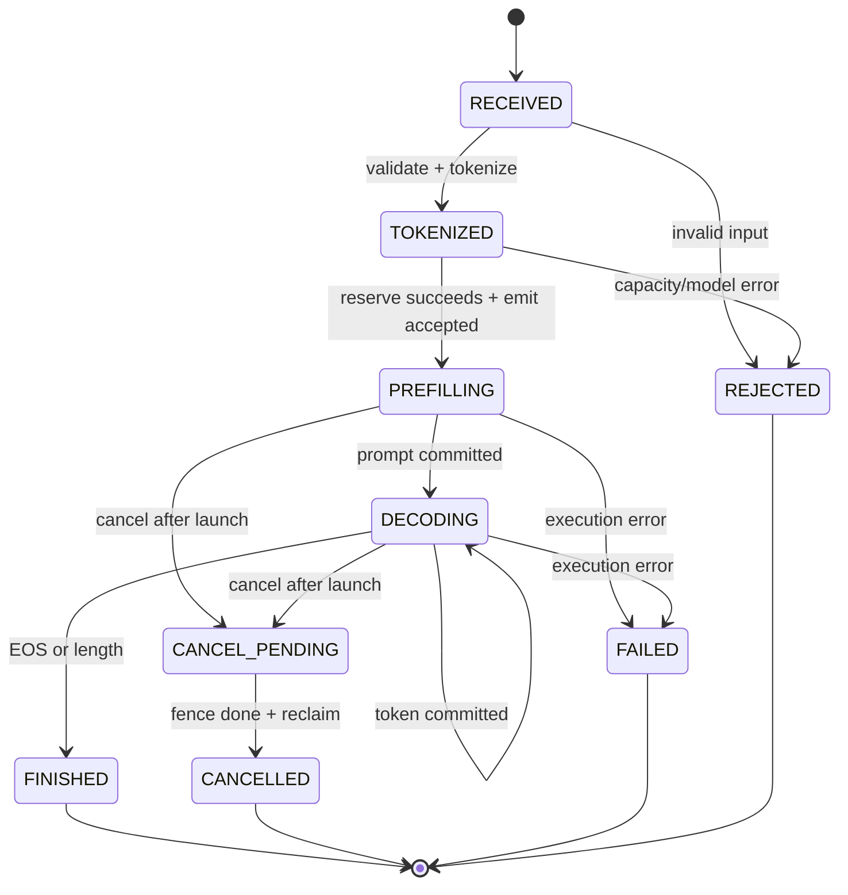

# iLLM v0.2 Stateful Streaming SPEC

```yaml
status: draft # deprecated validator mirror; MUST equal spec_status
spec_status: draft
release_stage: dev_snapshot
qualification_tier: unqualified
qualification_profiles:
  - profile_id: state-machine-cpu-v1
    result: not_run
    reason: spec_not_implemented
  - profile_id: stateful-streaming-single-gpu-v1
    result: not_run
    reason: spec_not_implemented
  - profile_id: clean-room-release-v1
    result: not_run
    reason: spec_not_implemented
performance_outcome: not_applicable
lts_state: not_applicable
spec_version: 1
target_release: v0.2.0
release_type: learning
depends_on: [v0.1.0]
project_plan: ../../../AI_INFERENCE_ENGINE_PROJECT_PLAN.md
previous_spec: ./v0.1-reference-runner.md
owners: [project-owner]
created: 2026-08-20
last_updated: 2026-08-20
```

> 本版本对应项目总方案 M2。它把 v0.1 的确定性模型 reference 组装成第一个有状态、可流式输出、可抓取证据的单请求引擎，但不引入并发队列、continuous batching、分页 KV 或 Web UI。

## 1. 本版本学习目标

### 1.1 必须掌握

- 能够解释 prefill 与 decode 的计算差异，以及 KV cache 如何把每个 decode step 从“重算全部上下文”变成“只追加一个位置”。
- 能够实现单请求 `RECEIVED → TOKENIZED → PREFILLING → DECODING → terminal` 状态机，并证明每个 accepted request 只有一个 terminal outcome。
- 能够实现有序 streaming、幂等 cancellation 和 GPU 工作完成前不得复用资源的基本 fence/lease 规则。
- 能够从 `SupportedModelSpec`、权重、activation、workspace 和 contiguous KV 推导一份不可变 `MemoryPlan`。
- 能够测量 server TTFT、ITL、TPOT、E2E，并区分 server-ready 与 client-received 时间。
- 能够从 canonical events 还原一次请求的阶段时间线，并明确 R0 Event Playback 与 R1 Control-plane Replay 的差异。

### 1.2 建议先修

- 已完成 v0.1 的 tiny decoder、权重加载 manifest、逐层 golden 和 canonical `SamplingSpec`。
- 熟悉 causal attention、RoPE、GQA、PyTorch tensor shape/dtype 和基础 CUDA stream 概念。
- 能运行 CPU PR gate；真实模型验证时具备一张满足固定 `SupportedModelSpec` 最低显存要求的 NVIDIA GPU。

### 1.3 进入门槛与预热实验

| 预热实验 | 命令/材料 | 通过标准 | 预计时间 |
|---|---|---|---:|
| No-KV/KV 手算 | 对 4-token toy attention 分别全量重算和追加 KV | 两条路径 logits 一致，并能指出第一个输出 token 来自哪里 | 2 h |
| Request state model | 用纯 Python 枚举 finish/cancel/error 的交错顺序 | 每个 accepted request 恰好一个 terminal，反例可被 property test 缩减 | 2 h |
| Fence simulation | 用 future/event 延迟一个 buffer write，再触发 cancel/reuse | fence 前复用测试必失败，fence 后回到资源基线 | 2 h |

术语见[统一学习术语表](../GLOSSARY.md)。预热只使用 tiny fixture；真实 GPU 不是理解状态/所有权门槛的前提。

### 1.4 Teach-back 产物

- `release/v0.2.0/teach-back.md`：用一张时序图解释 prompt 如何经过 tokenize、prefill、逐 token decode、stream 和资源回收，并用一次 cancellation capture 指出逻辑终止与物理释放为何可能不同步。

## 2. 用户可观察的成果

### 2.1 Release demo

```text
python scripts/bootstrap.py --profile release-verify --locked --write-manifest out/v0.2/toolchain.json
python scripts/in_env.py --manifest out/v0.2/toolchain.json -- python -m illm verify --fixture tiny-decoder
python scripts/in_env.py --manifest out/v0.2/toolchain.json -- python -m illm run --model fixture:tiny-decoder --prompt "hello" --max-new-tokens 8 --stream --capture release/v0.2.0/capture/demo
python scripts/in_env.py --manifest out/v0.2/toolchain.json -- python -m illm replay release/v0.2.0/capture/demo --mode trace
python scripts/in_env.py --manifest out/v0.2/toolchain.json -- python -m illm inspect request release/v0.2.0/capture/demo --request req-0001
```

最后两条命令必须显示 token 按 committed output index 单调输出、prefill/decode 阶段、每步 KV token 数、terminal reason 和 capture 完整性；它们不得重新运行模型。
bootstrap 只执行一次；之后所有项目命令复用 `out/v0.2/toolchain.json`，且 manifest/握手/digest 或 environment-root 校验失败时必须在项目代码运行前 fail closed。

### 2.2 用户故事

| ID | 用户故事 | 可观察结果 |
|---|---|---|
| US-01 | 当我运行一个 tiny fixture prompt | 我能逐 token 收到与 v0.1 reference greedy 结果一致的输出 |
| US-02 | 当我在第 3 个输出 token 后取消请求 | stream 只产生一个 `cancelled` terminal，KV 与临时 buffer 在 fence 完成后回到基线 |
| US-03 | 当我开启 capture | 我能离线查看 request、model、KV 和 stream 事件的有序时间线 |
| US-04 | 当我切换 `kv_cache.mode=none/contiguous` | 我得到相同 token，并能看到后者不再重复计算已缓存上下文 |
| US-05 | 当请求超出固定 context 或显存计划 | 请求在执行前被明确拒绝，错误指出违反的上限而不是触发未归因 OOM |

### 2.3 发布资产

- 可从锁文件复现的 Python 包与 `fixture:tiny-decoder`；
- 单请求 CLI、`Engine.generate()`、`Engine.stream()` 和最小配置示例；
- experimental `MetricRegistryV1` schema、最小 streaming 指标 fixture 与 registry conformance report；
- 成功、长度终止、EOS、取消、无 KV 对照五类 capture；
- correctness、100 次完成/取消循环、内存回基线和 telemetry-off/on 基线报告；
- Quickstart、KV cache 教程、已知限制和 release notes。

## 3. Scope

### 3.1 本版本新增

- 稳定的 `Engine.generate()` / `Engine.stream()` facade 和单请求 step loop。
- prefill/decode 拆分、reference eager executor、contiguous KV store 与 `kv_cache.mode=none` oracle。
- 单请求状态机、递增 output index、有序 streaming、EOS/length/cancel terminal 语义。
- 最小 `CompletionFence`、`KVWriteLease`、input/output/workspace lease 和延迟回收规则；实现仍为同步 resolve，不做 CPU/GPU pipeline overlap。
- 单请求 `MemoryPlan`、启动期 capacity validation 和确定性 `RESOURCE_EXHAUSTED`。
- typed JSONL canonical events、bounded sink、R0 trace replay、CLI Request Story。
- 首次引入 experimental `MetricRegistryV1`，冻结本版 server TTFT/ITL/TPOT/E2E 与 client E2E 的边界、单位、aggregation、weighting、分母和失败/censor 规则；同时记录 KV bytes/tokens 和 telemetry drop counter。

### 3.2 本版本保持不变

- v0.1 固定的 `SupportedModelSpec`、`WeightLoadManifest`、model/tokenizer digest 与 fail-closed loader。
- v0.1 的 eager reference model、greedy tie-break、FP32 canonical sampler 和 per-request counter RNG。
- 未支持的模型字段、sampling processor、dtype 或 context 必须 fail closed。
- Python reference path 是后续实现的 correctness oracle；本版本不修改模型数学语义。

### 3.3 Feature flags 与 fallback

| 能力 | 默认值 | Reference/fallback | 失败时行为 |
|---|---|---|---|
| `kv_cache.mode` | `contiguous` | `none` 重算 oracle | 仅在请求开始前选择；运行中不得切换 |
| `executor.mode` | `eager_reference` | 无 | backend 不支持时启动失败 |
| `telemetry.profile` | `request`（demo），`metrics`（普通运行） | `off` | sink 故障丢弃非关键事件并计数；推理继续 |
| `capture.enabled` | CLI 指定时 `on` | `off` | 无法创建 bundle 时请求尚未 accepted 则失败；已 accepted 时标记 capture incomplete |
| `stream.flush_policy` | `per_token` | `buffered` 仅测试 | 不支持值返回 `INVALID_ARGUMENT` |

## 4. Non-goals

- 多请求并发、请求队列、hard admission、continuous/static batching 或 open-loop workload driver。
- paged KV、block table、preemption/recompute、prefix cache 或 cache eviction。
- chunked prefill、mixed prefill/decode batch、SLO-aware scheduling。
- HTTP/OpenAI-compatible API、WebSocket live view 或交互式 Web UI。
- R1 状态重放、R2 数值重执行、R3 What-if；state digest 在本版只用于测试，不构成 R1 能力声明。
- `torch.compile`、CUDA Graph、异步 overlap、Rust、Triton 或自写 CUDA kernel。

任何新增需求若改变以上 Non-goals、公开契约或 DoD，必须通过 spec amendment 或 ADR，而不是直接扩大 Issue。

## 5. Architecture Delta

### 5.1 相对上一版本的变化

```text
v0.1
prompt → tokenizer → stateless reference forward → canonical sampler

v0.2
CLI / Engine facade
  → RequestContext + explicit state machine
  → prefill → ContiguousKVStore → repeated decode → canonical sampler
  → ordered StreamPublisher
  → DomainEventBus → capture / metrics / CLI Request Story
```

### 5.2 新增或修改的模块

| 模块 | 变化 | 责任边界 | 禁止事项 |
|---|---|---|---|
| `engine` | add | 单请求生命周期、step/resolve、terminal arbitration | 了解 CLI 展示或具体文件格式 |
| `executor` | change | 将 prefill/decode work 变成 eager model 调用和 completion fence | 决定请求状态或 sampling policy |
| `kv_cache.contiguous` | add | 为一个 sequence 持有连续 K/V、合法 append 与释放 | 共享跨请求前缀或自行扩容 |
| `api.cli` | add | 参数校验、stream 输出、cancel command、结果映射 | 直接访问 model/KV 内部对象 |
| `observability` | add | typed events、有界分发、capture/metrics sink | 阻塞推理或修改引擎状态 |
| `replay.r0` | add | 排序、校验并播放已记录事件 | 重跑 scheduler/model 或声称重建状态 |
| `memory` | add | 启动时计算并冻结单请求 `MemoryPlan` | 从实时 free-memory 猜测 admission 容量 |

### 5.3 数据流与状态迁移



`ExecutionTicket` 在 launch 后持有 input/output/workspace 与 `KVWriteLease`。成功 resolve 后先 commit KV，再原子 commit token、`next_output_position` 与本次可选 RNG draw accounting，最后发布 token；greedy 没有 RNG draw 可提交。取消只抑制尚未 commit 的输出，相关地址要等 fence 完成后回收。同步实现允许立即等待 fence，但不得省略这个所有权模型。

KV coverage 与逻辑输出有意相差一步，必须用两个字段表达，不能共用一个 `length`：

1. prefill 把全部 prompt token 写成 valid KV；prefill 最后一个 prompt position 的 logits 产生 `output[0]`。
2. `output[i]` commit/发布时，它通常**尚未**进入 KV。下一次 decode 以该 token 为 query，成功后才令 KV 覆盖 `prompt + output[0..i]`，并由该 step 的 logits 产生 `output[i+1]`。
3. `kv_valid_token_count` 只在 write fence 成功后增加；`committed_output_count` 只在 sampling transaction commit 后增加。EOS 或达到 length 的最后一个已发布 token不需要为了终态再写入 KV。
4. resume、preemption、replay 与后续 speculation 都以 `kv_valid_through_input_index` 和 `committed_output_count` 的显式组合判断下一步，禁止假设二者相等。

## 6. Contracts

### 6.1 API/CLI contract

- `GenerationRequest` 必填 `model_spec_id`、prompt text 或 token IDs 二选一、`max_new_tokens` 和 `SamplingSpec`；`request_id` 可由调用方提供，但同一 engine lifetime 内不可重复。
- v0.2 只允许一个 non-terminal request。第二个请求在第一个完成前返回 `OVERLOADED{reason=SINGLE_ACTIVE_LIMIT}`，且不产生 `request.accepted`；这不是 v0.3 的排队语义。
- `Engine.generate()` 返回完整 `GenerationResult`；`Engine.stream()` 依次产生一次 metadata、零个或多个 `TokenChunk{output_index, token_id, text_delta, server_ready_ns}`，最后恰好一个 `TerminalChunk`。
- output index 从 0 连续增长。token 只有在 logits、sampling、KV write、`next_output_position` 与可选 RNG draw accounting 全部 commit 后才能发布；greedy 不产生 draw，发布过的 token 不撤回、不重复。
- 每个 request 持有 stateful incremental detokenizer。`text_delta` 可以因不完整 UTF-8/byte-BPE 序列暂时为空，但按顺序拼接所有 delta 必须等于对最终 committed token prefix 执行 canonical tokenizer decode 的结果；special-token skip/保留策略进入 tokenizer/input contract。禁止逐 token 独立 decode 后直接拼接。
- accepted request 的 terminal enum 固定为 `FINISHED | CANCELLED | FAILED | DEADLINE_EXCEEDED`；V0.2 尚无 deadline API，因此最后一项是保留值且不得产生。pre-accept `REJECTED`/`OVERLOADED` 不产生 `request.accepted`，也不计入该 terminal accounting。
- cancel 以 `request_id + cancellation_id` 幂等。terminal transition 用 compare-and-set 仲裁；finish/cancel race 中只允许一个胜者，重复 cancel 返回原 terminal 结果。
- prompt 为空时由固定 tokenizer contract 注入 BOS 或返回 `INVALID_ARGUMENT`；`prompt_tokens + max_new_tokens` 超过 context 返回 `CONTEXT_LIMIT_EXCEEDED`。
- unsupported model/spec/dtype/sampling 返回 `UNSUPPORTED`；预计算 capacity 不足返回 `RESOURCE_EXHAUSTED`；数值非有限返回 `NUMERICAL_ERROR`；未知执行状态导致 engine fail-stop。
- CLI 进程收到一次中断时发起 cancel 并等待安全回收；再次中断可退出，但 release evidence 必须标记可能未完成的清理。

### 6.2 Config/manifest contract

| 字段/对象 | 稳定性 | 兼容规则 |
|---|---|---|
| `engine.max_context_tokens` | experimental | 不得超过 `SupportedModelSpec.max_position_embeddings`；减小允许，增大须重新生成 MemoryPlan |
| `kv_cache.mode` | format_frozen_for_v0 | 仅 `none/contiguous`；未知值 fail closed；到 V1.0 才 public stable |
| `kv_cache.dtype/layout_id` | candidate | 必须与 model spec 和 backend 完全匹配；禁止静默 cast/transpose |
| `memory_plan` | experimental | 每次由冻结输入生成且生成后不可改写；绑定 spec、weights、dtype、device、最大 context，任一 digest 改变即失效 |
| `sampling_spec` | format_frozen_for_v0 | 继承 v0.1；processor order、RNG algorithm/version 不得由 executor 改写 |
| `MetricRegistryV1` | experimental | V0.2 首次定义；V0.8 才可升为 candidate，V1.0 才 stable；measurement boundary、单位、aggregation、weighting、分母、failure/censor 规则任一改变都必须创建新 metric ID |
| `event_schema_version` | experimental | additive 演进；v0.2 写 typed JSONL schema v1；字段删除或语义变化必须升 schema major |
| `capture_manifest.replay_capability` | candidate | 本版本只能写 `R0`；不得根据文件存在性推测更高级别 |

`MetricRegistryV1` 的最小 streaming 集如下；ID 中的 p99 是 registry 固定的 aggregation，不得把均值或其他 percentile 写到同一 ID：

| Fully-qualified metric ID | 稳定性 | 单位 | measurement boundary | denominator / weighting |
|---|---|---|---|---|
| `illm.server.ttft.request_weighted.p99.v1` | experimental | s | `request.accepted` 单调时钟到首个 committed token 的 `server_ready_ns` | 所有 accepted 且产生至少 1 个 committed output 的请求，不区分最终 terminal outcome；每请求 1 个样本 |
| `illm.server.itl.token_weighted.p99.v1` | experimental | s | 相邻 committed token 的 `server_ready_ns` 之差 | 所有 accepted request 已形成的相邻 output-token intervals；每 interval 等权 |
| `illm.server.tpot.request_weighted.p99.v1` | experimental | s/token | `(last_server_ready-first_server_ready)/(committed_output_count-1)` | 所有 accepted 且 output≥2 的请求，不区分最终 terminal outcome；每请求 1 个样本 |
| `illm.server.e2e.request_weighted.p99.v1` | experimental | s | `request.accepted` 到 terminal 在 server 端 commit/ready | 所有 accepted 且产生唯一 terminal 的请求；每请求 1 个样本，按 terminal outcome 分层 |
| `illm.client.e2e.request_weighted.p99.v1` | experimental | s | client send start 到唯一 terminal chunk 或结构化 stream close 被 client 观测 | 所有 accepted 且产生唯一 terminal 的请求；每请求 1 个样本，按 terminal outcome 分层 |

所有时长先在同一 monotonic clock domain 内以整数 ns 相减，再除以 `1_000_000_000` 报告 SI 秒；p99 使用对完整样本升序排列后的 nearest-rank `ceil(0.99*N)`，不插值。accepted request 一旦形成首 token、相邻 interval 或 TPOT 所需的两个 token，对应样本即保留，不因随后 FAILED/CANCELLED/DEADLINE_EXCEEDED 而删除。零 output 不生成 TTFT/ITL/TPOT，并增加 `ttft_censored_before_first_token`、`itl_censored_insufficient_output` 与 `tpot_censored_insufficient_output`；output=1 不生成 ITL/TPOT，并增加后两个 censor counter。所有 accepted+terminal 请求都进入 server/client E2E，并按 terminal outcome 分层；pre-accept rejection 单列且不进入 accepted latency 分布。报告还必须列出 terminal/pre-accept reason、censor 原始计数和总体请求分母。server-ready 与 client-received timestamp 属于不同 boundary，不能相减或互换 ID；UI 若显示 ms，只能从 registry 秒值显式换算。

### 6.3 Event/capture/replay contract

- 事件最少包含 `request.accepted/tokenized/phase_changed/first_token/output_chunk/completed/cancelled/failed`、`model.forward`、`kv.allocation_committed/write_started/write_committed/page_released` 和 `clock_snapshot`。
- 每 producer 的 `producer_seq_no` 连续递增；duration 只由同一 monotonic clock domain 计算。CUDA 时间保留独立 clock domain。
- capture manifest 保存 engine/git dirty state、model/tokenizer/weights digest、SamplingSpec/RNG version、MemoryPlan digest、环境、观测等级、drop count、privacy mode 和最高 replay capability。
- 默认 `metadata_only`：不保存 prompt/output/token IDs，只保存长度、状态、token index 和可选 capture-local HMAC。R0 播放不能显示未捕获内容。
- replay 只支持 `--mode trace`。请求 state/execute/what-if 必须 fail closed，并列出缺失的 checkpoint、delta、输入或 RNG 数据。
- replay-critical terminal 与 allocation/commit/release 事件若无法写入，bundle 标记 `incomplete/non_replayable`；UI/CLI 必须显著显示。

### 6.4 资源、并发与失败 contract

- engine 同时最多有一个 accepted request；没有排队。`MemoryPlan` 必须容纳该请求允许的最坏 contiguous KV、峰值 activation、workspace、IO/telemetry buffer 与 headroom。
- contiguous KV 由 request 独占；allocation commit 与 device data valid 分离。每个 append range 只有在 completion fence 成功后增加 `valid_tokens`。
- prefill 后 `kv_valid_token_count=prompt_token_count`；每个非终结 decode query 成功后最多增加 1。`committed_output_count-kv_appended_output_count` 只能为 0 或 1，值为 1 时下一 decode 必须处理该 committed token；terminal 时允许最后一个 EOS/length token 保持未追加。
- page/buffer/workspace/logits/sampling scratch 在最后一个 reader/writer fence 前不得复用；本版本不得依赖 Python GC 释放。
- 预计容量不足在 accepted 前拒绝。CUDA OOM 若发生在已 accepted 请求上则显式失败；若 allocator/executor 状态无法证明一致，engine 进入 unhealthy/fail-stop。
- cancel-before-launch 立即 rollback；cancel-after-launch 进入 `CANCEL_PENDING`，抑制结果、等待 fence、abort 未提交 write 后释放。
- telemetry exporter stall 不得导致请求失败；有界 bus 丢弃低优先级事件并递增 drop counter，关键事件失败则 capture 降级为 incomplete。

## 7. Implementation Slices

| Slice | 垂直成果 | depends_on | 主要文件/模块 | 完成证据 |
|---|---|---|---|---|
| S1 | `Engine.generate()` 用无 KV reference 完成一次请求 | v0.1 | `engine`, `api.cli`, `domain` | command + golden token test |
| S2 | prefill/decode 拆分并以 contiguous KV 生成相同 token | S1 | `model`, `executor`, `kv_cache.contiguous` | 50-case cache off/on differential |
| S3 | `Engine.stream()` 有序发布 token 并产生唯一 terminal | S2 | `engine`, `api.cli`, `sampling` | stream transcript + property test |
| S4 | cancel race、ticket/fence 与延迟回收闭环 | S3 | `engine`, `executor`, `kv_cache` | 100-cycle stress + injected delayed fence |
| S5 | typed event、capture manifest 和 R0 replay | S3 | `observability`, `replay.r0`, `tools.capture` | checksummed capture + replay command |
| S6 | MemoryPlan、容量错误和 telemetry-off/on 基线 | S2, S5 | `memory`, `metrics`, `benchmark` | manifest + failure tests + benchmark report |
| S7 | 干净环境 quickstart 与 release evidence | S4, S6 | packaging, docs, release tooling | install transcript + evidence bundle audit |

每个 slice 保留 `kv_cache.mode=none` reference path。S2 正确性 gate 完成前，contiguous KV 不得成为 release 默认；S5 不得把 event playback 命名为 state replay。

## 8. Correctness and Invariants

### 8.1 Golden/differential

- 固定 20 个 v0.1 golden 输入比较 final logits tolerance 与 greedy token 完全一致。
- 固定至少 50 个 prompt/output-length 边界 case，对比 `kv_cache.mode=none` 与 `contiguous` 的每步 logits、token、finish reason、`next_output_position`、`rng_draws_consumed` 和 committed counter-address 集。
- 覆盖 prompt 长度 1、2、最大上下文前一位、EOS 首 token、`max_new_tokens=1`、GQA/RoPE 位置边界。
- 真实固定模型只作为 GPU smoke；tiny fixture 是逐 op、CPU 和故障注入的权威 oracle。

### 8.2 Property/state invariants

- accepted request 终态恰好是稳定 enum `FINISHED/CANCELLED/FAILED/DEADLINE_EXCEEDED` 之一，terminal event 和 terminal stream chunk 均恰好一个；本版测试还断言 `DEADLINE_EXCEEDED` 计数为 0。
- `0 <= valid_kv_tokens <= committed_sequence_tokens <= max_context_tokens`，KV append range 连续且不重叠。
- `next_output_position == committed_output_count`。`rng_draws_consumed` 等于已提交且不重复的 counter-address 数；greedy 恒为 0/空集，sample v1 的每个 committed token 恰有 `(absolute_output_pos, 0, 0)` 一个地址；未 commit token 不推进 position，也不写入 committed draw 集。
- stream output index 严格为 `0..n-1`；任一 token 的事件、stream 和 result token ID 一致。
- request terminal 且最后 fence 完成后，active request、reservation、KV bytes、buffer lease 数全部回到启动基线。
- R0 播放保持同一 producer 的顺序；检测到 seq gap、重复 terminal 或 checksum 错误必须报告 incomplete。

### 8.3 Failure/stress matrix

| 场景 | 注入方式 | 必须结果 | 禁止结果 |
|---|---|---|---|
| cancel before launch | tokenized 后注入 cancel | 无 model launch；唯一 cancelled；allocation rollback | 输出 token、KV 残留 |
| cancel after launch | fence 延迟并注入 cancel | `CANCEL_PENDING`；结果抑制；fence 后回收 | 早期地址复用、双 terminal |
| finish/cancel race | 同 barrier 并发触发 | CAS 只允许一个终态；重复操作幂等 | finished 与 cancelled 同时出现 |
| capacity exceeded | 缩小 MemoryPlan 或超长请求 | accepted 前确定性错误 | CUDA OOM 充当流控 |
| async execution error | ticket resolve 注入错误 | abort write；请求 failed；状态不可信时 engine unhealthy | half-valid KV、继续发布 token |
| exporter stall/full | 阻塞 sink、填满 ring | 推理完成；drop 计数；capture incomplete | engine 热路径无限等待 |
| 100 次完成/取消 | 固定 seed 交替运行 | 每轮后所有资源计数回基线 | 单调显存增长、悬空 lease |

所有阈值绑定 `fixture:tiny-decoder@digest`、固定 seed set、提交到 evidence 的 tolerance profile 和命令。

## 9. Visualization Learning Story

### 9.1 本版本必须回答的问题

1. 一次请求何时完成 tokenize、prefill、每个 decode step、token commit 和 stream publish？
2. 使用 contiguous KV 后，每步新写入多少 token、累计占用多少 bytes？
3. cancellation 发生时，为何 terminal 可以先确定而地址必须等 fence 后才能复用？
4. 当前展示的是 recorded fact、派生 duration 还是缺失数据？

### 9.2 视图与证据映射

| 视图 | 事实源 | 交互 | measured/estimated 边界 |
|---|---|---|---|
| CLI Request Story | request/model/KV/stream canonical events | 按 request 筛选、展开 token step | timestamp/duration 为 measured；缺事件标 dropped |
| Token/KV table | output commit 与 KV write events | 比较 no-KV/contiguous capture | token/bytes 为 measured；理论 KV 公式标 estimated |
| Cancellation sequence | state transition、ticket、fence/reclaim events | 跳至 cancel 前后事件 | recorded transitions 为 measured；无 GPU clock 时不推断 kernel 结束时刻 |
| Chrome Trace export | canonical events 派生 async track | 时间缩放和 category 筛选 | 派生轨道标 derived；不声称是独立事实源 |

本版只交付 CLI/静态 trace 学习故事，不交付 Scheduler Lab、KV Cache Explorer 或共享 Web 时间游标。

## 10. Performance Hypothesis

### 10.1 本版本性能立场

仅建立可复现基线，并验证“contiguous KV 避免重复上下文计算”这一机制是否在固定单请求长生成 workload 上可观测；性能不作为是否发布的胜负门，correctness 和资源回收优先。

### 10.2 Experiment card

```yaml
question: contiguous KV 相比每步重算是否减少已处理 query token 和单请求 decode 时间
hypothesis: 在固定 256-token prompt/64-token output 上，contiguous 模式的 prefill 后每个 decode step 只处理 1 个 query token，且 token 完全一致
primary_metric: model_query_tokens_per_decode_step
guardrails: [greedy_token_exact, illm.server.ttft.request_weighted.p99.v1, illm.server.itl.token_weighted.p99.v1, peak_device_memory_bytes, accepted_request_failure_rate]
tuning_suite: fixtures/workloads/v02-single-request-tuning.json@digest
held_out_suite: fixtures/workloads/v02-single-request-heldout.json@digest
budget: 1 GPU-hour
success: 所有 decode step 的 query_tokens=1，50-case differential 全过，并报告时间与显存差异
no_go: 任一 token/terminal 不一致或资源不回基线；回退 no-KV 并提交根因报告
```

结果必须同时报告 warmup、模型/硬件/driver digest、telemetry-off 和 request-capture；不得把 trace 动画运行当作性能数据。

## 11. Compatibility and Migration

### 11.1 Compatibility matrix

| Artifact | 读取上一版本 | 写入格式 | Breaking 条件 | 迁移/降级 |
|---|:---:|---|---|---|
| config | 是 | v0.2 config；v0.1 字段原样保留 | 未知执行字段、context 或 dtype 语义改变 | 自动补单请求/KV 默认值；歧义值 fail closed |
| public API/CLI | 部分 | 新增 `Engine.generate/stream` 与 `illm run` | stream chunk/terminal 语义改变 | v0.1 model CLI 保留为 `illm verify` |
| event/capture | 是；R0通用，v0.1有限R1按原能力只读 | typed JSONL schema v1 + v0.2 manifest | event enum/字段语义 breaking | v0.1有限R1只重放其旧request/model/sampling状态；不伪造新增KV/stream状态 |
| model/weight manifest | 是 | 不变 | spec、weights、tokenizer digest 改变 | 重新验证/加载；旧 golden 不复用 |
| cache/graph artifact | 不适用 | 无持久 KV/graph artifact | 任一进程重启 | 重建 contiguous KV；不得序列化复用 |

### 11.2 Rollback

- 请求开始前可设 `kv_cache.mode=none` 回到 v0.1 数学 reference；正在运行的请求不得热切换。
- 回退 v0.1 binary 前停止新请求、等待 terminal 与 fence、删除仅属于运行时的 contiguous KV；权重与 model manifest 可复用，前提是 digest 完全相同。
- v0.2 capture 可由 v0.1 viewer 读取的范围仅是共同 R0 envelope；未知事件必须显示 unknown/unsupported，不得忽略后声称 capture 完整。
- rollback 证据必须包含触发原因、最后一个安全 request ID、资源计数和 config/manifest digest。

## 12. Definition of Done

### 12.1 Must

- [ ] 干净环境中本 SPEC §2.1 全部命令成功，capture checksum audit 为 0 error。
- [ ] `Engine.generate/stream`、prefill/decode、contiguous KV 和 no-KV oracle 均有公开示例与类型检查。
- [ ] 至少 20 个 v0.1 golden 与 50 个 cache off/on case 的 token、`next_output_position`、`rng_draws_consumed` 和 committed counter-address 集完全一致；greedy draw 数为 0，低精度 logits 满足预注册 tolerance。
- [ ] stream output index 连续，EOS/length/cancel/error 每类只有一个 terminal；finish/cancel race 测试无 double terminal。
- [ ] byte-BPE、跨 token UTF-8、special token 和空 delta fixture 中，所有 `text_delta` 顺序拼接与 canonical whole-prefix decode 完全一致。
- [ ] prefill-first-token、连续 decode、EOS 与 length 边界的 `kv_valid_through_input_index/committed_output_count` golden 全部通过，无 off-by-one KV write。
- [ ] 连续 100 次完成/取消后 active request、reservation、KV bytes、buffer/workspace lease 回到基线。
- [ ] delayed fence、OOM、numerical error、exporter stall 和 capture truncation 故障矩阵全部通过。
- [ ] R0 capture 明确声明最高能力，state/execute/what-if 请求全部 fail closed 并列出缺失条件。
- [ ] MemoryPlan、运行环境、model/weights/sampling/event digest 写入 release manifest。
- [ ] CLI Request Story 能回答 §9.1 四个问题，且显式显示 dropped/incomplete/derived。
- [ ] telemetry-off/on 和 no-KV/contiguous 基线报告已保存，不把性能提升作为 correctness 替代。
- [ ] `MetricRegistryV1` 最小 streaming 集完成 schema/conformance vectors；每个 ID 的单位、boundary、分母、weighting 与 failure/censor 规则和 §6.2 完全一致，release manifest 记录 registry digest。

### 12.2 Conditional

- [ ] 若 release 使用真实 GPU 模型，则固定 model revision、GPU/driver/CUDA 与低精度 tolerance，并完成最小 GPU smoke；无 GPU 时清楚标记 `not_run_resource_unavailable`。
- [ ] 若实现 buffered stream fallback，则证明 token/order/terminal 与 per-token 模式一致，并记录 client-visible flush 差异。
- [ ] 若更改 v0.1 event envelope，则提供 schema amendment 和旧 toy capture 的显式迁移测试。

### 12.3 Evidence bundle

```text
release/v0.2.0/
├─ manifest.json
├─ commands.txt
├─ test-report.json
├─ qualification/
│  ├─ release-state.json
│  └─ profiles/
├─ capture/
│  ├─ success/
│  ├─ cancel-after-launch/
│  └─ incomplete-exporter/
├─ benchmark/
│  ├─ no-kv-vs-contiguous.json
│  └─ telemetry-overhead.json
├─ screenshots/
│  └─ request-story.png
├─ rollback/
│  ├─ manifest.json
│  ├─ commands.txt
│  └─ rollback-report.md
├─ teach-back.md
├─ known-limitations.md
└─ release-notes.md
```

## 13. Known Limitations

- 单进程、单设备、同一时刻一个 accepted request；并发调用返回带稳定reason的`OVERLOADED`，因此不能代表在线服务性能。
- contiguous KV 按最大 context 或请求上限保留连续空间，长度离散时容量和碎片化较差。
- 调度器尚未存在，prefill 与 decode 不形成多请求 batch，也没有 backpressure queue。
- capture 只支持 R0；没有控制面 checkpoint/delta，CLI timeline 不能证明内部状态可重建。
- 可视化是 CLI/静态 trace，没有交互式 Scheduler/KV 页面。
- executor 为同步 eager reference；lease/fence 契约已存在，但没有 overlap、compile 或 graph fast path。

### 13.1 下一版本输入

- `SINGLE_ACTIVE_LIMIT` 和单请求限制在 v0.3 由 hard admission、bounded queue 和 synchronous continuous batching 替代；`OVERLOADED`顶层错误语义保持兼容。
- v0.2 的 `Engine` facade、terminal arbitration、stream contract、MemoryPlan 和 event envelope 必须由 v0.3 保持兼容。
- v0.2 的长度分布和 contiguous KV 浪费只作为 v0.4 paged memory 的实验基线，v0.3 不提前引入 page table。
- capture 中发现的阶段事件缺口形成 v0.3 scheduler event catalog 输入，但 full-engine R1 仍留到 v0.8。

---

## Appendix A. Requirement Traceability

| Requirement | Design/contract | Test/evidence | DoD item |
|---|---|---|---|
| V02-ENG-01 单请求 facade 与显式状态机 | §5.1、§5.3、§6.1 | engine integration + state property report | §12.1 items 2, 4 |
| V02-KV-01 contiguous KV 与 no-KV 等价 | §3.1、§6.4 | 50-case logits/token/position/draw-set differential | §12.1 item 3 |
| V02-STR-01 token 有序、commit 后发布 | §6.1 | stream transcript/property tests | §12.1 item 4 |
| V02-CAN-01 cancel 幂等且 fence 后回收 | §5.3、§6.4 | delayed-fence race + 100-cycle stress | §12.1 items 4, 7, 8 |
| V02-MEM-01 容量来自不可变 MemoryPlan | §6.2、§6.4 | capacity boundary/fault report | §12.1 item 10 |
| V02-CAP-01 canonical capture 与真实 R0 声明 | §6.3 | success/incomplete capture + replay negative tests | §12.1 items 1, 9 |
| V02-VIS-01 请求故事只呈现事实 | §9 | screenshot + tutorial smoke | §12.1 item 11 |
| V02-PERF-01 可复现单请求基线 | §10 | experiment raw data/report | §12.1 item 12 |
| V02-MET-01 `MetricRegistryV1` 首次冻结最小 streaming 口径 | §3.1、§6.2 | registry schema/conformance + manifest digest | §12.1 item 13 |

## Appendix B. Open Questions

| Question | Owner | Resolve before | Resolution artifact |
|---|---|---|---|
| tiny fixture 的默认最大 context 是 128 还是 256 token | project-owner | accepted | model-fixture ADR；选择后冻结 digest |
| GPU reference smoke 使用 BF16 还是 FP16 | project-owner | implementation | hardware capability probe + tolerance profile |
| CLI 中断等待 fence 的 release timeout 默认值 | project-owner | release | cancellation ADR + stress evidence |
| R0 JSONL 是否默认使用 zstd 压缩 | project-owner | implementation | capture format amendment + reader compatibility test |
