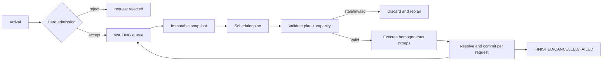

# iLLM v0.3 Batched Engine SPEC

```yaml
status: draft # deprecated validator mirror; MUST equal spec_status
spec_status: draft
release_stage: dev_snapshot
qualification_tier: unqualified
qualification_profiles:
  - profile_id: scheduler-simulator-cpu-v1
    result: not_run
    reason: spec_not_implemented
  - profile_id: batched-engine-single-gpu-v1
    result: not_run
    reason: spec_not_implemented
  - profile_id: clean-room-release-v1
    result: not_run
    reason: spec_not_implemented
performance_outcome: not_applicable
lts_state: not_applicable
spec_version: 1
target_release: v0.3.0
release_type: learning
depends_on: [v0.2.0]
project_plan: ../../../AI_INFERENCE_ENGINE_PROJECT_PLAN.md
previous_spec: ./v0.2-stateful-streaming.md
owners: [project-owner]
created: 2026-08-20
last_updated: 2026-08-20
```

> 本版本对应项目总方案 M3。它在 v0.2 单请求 facade 上加入同步 continuous batching、bounded queue、hard admission、确定性 FCFS + aging 调度与解释事件。执行仍使用 contiguous KV 和 eager reference backend；分页、抢占、chunked prefill 与 prefix cache 明确留给后续版本。

## 1. 本版本学习目标

### 1.1 必须掌握

- 能够解释 static batching 与 iteration-level continuous batching 的区别，以及请求动态加入/离开如何改变 batch shape。
- 能够从不可变 `EngineSnapshot` 和 `StepBudget` 生成无副作用、可重复的 `SchedulePlan`。
- 能够实现 queue/request/compute-token/sequence 四类硬上限、高低水位 backpressure 和明确的 overload 语义。
- 能够实现 FCFS + bounded aging，记录每个 selected/deferred request 的 `DecisionRecord`，并在 admissible load 下论证 forward progress。
- 能够处理 waiting/active/in-flight 请求的 cancellation 与 finish race，证明 accepted request 不丢失、不重复完成。
- 能够测量 offered load、queueing、TTFT/ITL/E2E、request/output-token goodput，并识别 throughput 与尾延迟的权衡。

### 1.2 建议先修

- 完成 v0.2 的单请求 prefill/decode、contiguous KV、stream、ticket/fence、R0 capture 和资源回基线测试。
- 理解队列、Little's Law、percentile、open-loop/closed-loop load generator 的基本含义。
- 能读懂 immutable value object、纯函数和 property-based test。

### 1.3 进入门槛与预热实验

| 预热实验 | 命令/材料 | 通过标准 | 预计时间 |
|---|---|---|---:|
| Queue trace | 手算 6 个请求在 FCFS、容量 2 下的到达/完成顺序 | 每步 queue/active 守恒且过载有明确结果 | 1 h |
| Pure scheduler | 从 immutable snapshot 返回 plan，不修改输入 | 同 snapshot/config 的 plan digest 完全一致 | 2 h |
| Open-loop lab | 用 toy service 对比 closed/open-loop load | 能解释为何服务变慢时 open-loop queue 会增长 | 1.5 h |

术语见[统一学习术语表](../GLOSSARY.md)。未能解释 offered load、goodput 和 hard admission 时不要开始 GPU batching。

### 1.4 Teach-back 产物

- `release/v0.3.0/teach-back.md`：选取固定 8-request trace，逐 step 解释谁被选择、谁被延迟、token/sequence budget 如何变化，以及为何持续过载必须拒绝而不能无限排队。

## 2. 用户可观察的成果

### 2.1 Release demo

```text
python scripts/bootstrap.py --profile release-verify --locked --write-manifest out/v0.3/toolchain.json
python scripts/in_env.py --manifest out/v0.3/toolchain.json -- python -m illm workload run fixtures/workloads/v03-demo-8.json --scheduler fcfs-aging --max-active-sequences 4 --max-step-tokens 64 --capture release/v0.3.0/capture/demo
python scripts/in_env.py --manifest out/v0.3/toolchain.json -- python -m illm inspect schedule release/v0.3.0/capture/demo --show-decisions
python scripts/in_env.py --manifest out/v0.3/toolchain.json -- python -m illm replay release/v0.3.0/capture/demo --mode trace
python scripts/in_env.py --manifest out/v0.3/toolchain.json -- python -m pytest tests/integration/test_v03_fixed_100_request_trace.py
```

schedule inspector 必须显示 arrival、queue lane、request state、每个 execution group 的成员、budget 使用量、selected/deferred reason 和唯一 terminal；不能通过 UI 或 inspector 重新运行调度判断。
bootstrap 只执行一次；之后所有项目与测试命令复用 `out/v0.3/toolchain.json`，任何 manifest/握手/digest/environment-root 校验失败都必须在项目代码运行前 fail closed。

### 2.2 用户故事

| ID | 用户故事 | 可观察结果 |
|---|---|---|
| US-01 | 当 8 个不同长度请求交错到达 | 我看到 decode batch 随请求完成与新请求 prefill 而变化，所有输出与逐请求 oracle 一致 |
| US-02 | 当队列超过 request/token high watermark | 新请求得到 `OVERLOADED` 与 retry hint，已 accepted 请求继续完成 |
| US-03 | 当长等待请求持续被 decode 流量挤压 | aging 最终让它获得完整 prefill execution group，DecisionRecord 说明选择原因 |
| US-04 | 当我取消 waiting、active 或 in-flight 请求 | 每个请求只得到一个 terminal，已发布 token 不撤回，资源在 fence 后回收 |
| US-05 | 当我检查固定 trace | 我能从 capture 回答某请求在哪些 step 被 defer，以及当时哪一项 budget 阻止了它 |

### 2.3 发布资产

- native in-process workload driver，支持固定 arrival trace、closed-loop 和受控 open-loop；
- synchronous continuous-batching engine、FCFS + aging policy、hard admission 配置；
- 8-request 教学 capture、100-request correctness trace、overload/cancel-race capture；
- scheduler property report、RNG independence report、queue/SLO baseline；
- batching、backpressure、DecisionRecord 教程和 release notes。

## 3. Scope

### 3.1 本版本新增

- bounded accepted queue、request/queued-token/concurrent-connection 上限与 high/low watermark hysteresis。
- 同步 iteration scheduler：不可变 `EngineSnapshot`、`StepBudgetV1`、`SchedulePlanV1`、plan validation 和确定性 commit。
- FCFS 主序、等待年龄提升、固定 decode protection；每次选择和延迟均生成稳定 reason code。
- dynamic decode batching；每个 step 最多执行一个 decode group 和一个 full-prefill group，两组分别 launch，不把 prefill/decode 混入同一个 attention invocation。
- 多请求 state machine、唯一 terminal arbitration、waiting/active/in-flight cancellation。
- native workload driver、offered-load/queue/goodput 指标和 request×step CLI inspector。
- scheduler/batch/admission/overload canonical events 与 R0 capture。

### 3.2 本版本保持不变

- v0.2 `Engine.generate/stream`、stream chunk/order/terminal、SamplingSpec 和 per-request RNG contract。
- eager reference executor、contiguous KV、single-device `MemoryPlan` 与 ticket/fence 延迟回收。
- `kv_cache.mode=none` 作为单请求数学 oracle，`contiguous` 是 batched execution 唯一支持的 KV 模式。
- fixed `SupportedModelSpec`、WeightLoadManifest、模型 golden、隐私默认和 typed JSONL event envelope。

### 3.3 Feature flags 与 fallback

| 能力 | 默认值 | Reference/fallback | 失败时行为 |
|---|---|---|---|
| `scheduler.policy` | `fcfs_aging_v1` | `fcfs_v1` | 未知 policy/version 启动失败 |
| `batching.mode` | `continuous_sync` | `single_request`（v0.2） | fallback 只在启动时选择并写 manifest |
| `scheduler.decode_protection` | `on` | `off` 仅实验 | 超出合法范围 fail closed |
| `admission.mode` | `hard_bounded` | 无 | 高水位返回 `OVERLOADED`，不得无限排队 |
| `kv_cache.mode` | `contiguous` | `none` 仅单请求 oracle | batched + none 组合返回 unsupported |
| `telemetry.profile` | `metrics` | `request/engine/off` | exporter 故障不阻塞 engine，capture 明确 incomplete |

## 4. Non-goals

- paged KV、block table、page allocator、preemption/recompute 或 cache eviction。
- chunked prefill；一个 prompt 必须在一个 full-prefill execution group 中完成，超出 `max_prefill_tokens_per_step` 的请求在 accepted 前拒绝。
- mixed prefill/decode AttentionPlan；本版本最多有两个有序、同质 execution group。
- prefix/hash/radix cache、prefix-aware priority 或跨请求 KV 共享。
- SLO-adaptive token budget、deadline scheduler、What-if simulation 或 R1 state replay。
- HTTP/OpenAI-compatible API、多进程 worker、异步 scheduler/GPU overlap、compile/graph/custom kernel。
- 对外承诺吞吐优于 vLLM/SGLang；本版只建立受控 batching 基线。

任何新增需求若改变以上 Non-goals、公开契约或 DoD，必须通过 spec amendment 或 ADR，而不是直接扩大 Issue。

## 5. Architecture Delta

### 5.1 相对上一版本的变化

```text
v0.2
one caller → one RequestContext → one prefill/decode loop

v0.3
concurrent callers / trace driver
  → HardAdmission → bounded WAITING queue
  → immutable EngineSnapshot
  → FCFS+Aging Scheduler.plan(snapshot, budget)
  → validated SchedulePlan
     ├─ decode ExecutionGroup (0..N rows)
     └─ full-prefill ExecutionGroup (0..N rows, separate launch)
  → synchronous resolve/commit → per-request streams
```

### 5.2 新增或修改的模块

| 模块 | 变化 | 责任边界 | 禁止事项 |
|---|---|---|---|
| `scheduler.reference` | add | 对 snapshot 纯函数规划、budget accounting、DecisionRecord | 分配 KV、launch GPU、读取 wall clock |
| `engine` | change | queue/state/ticket 编排、plan validation、commit/rollback | 内嵌 policy 排序规则 |
| `admission` | add | 校验硬上限、水位、retry hint 与 accepted 边界 | 用 CUDA OOM 或无限等待做流控 |
| `executor` | change | 执行有序同质 groups、按 request row 分发结果 | 将 prefill/decode 偷偷融合为 mixed ABI |
| `workload` | add | 按 trace 产生 arrival/cancel，收集 client 时间 | 修改 engine 内部 config 或 scheduler state |
| `observability` | change | scheduler/batch/decision/queue 事件与聚合指标 | 为解释重新运行 policy |
| `kv_cache.contiguous` | change | 多 request 隔离 slot 与 fence-safe release | 跨请求共享、移动或分页 |

### 5.3 数据流与状态迁移



状态集合为 `RECEIVED/TOKENIZED/WAITING/PREFILLING/DECODING/CANCEL_PENDING/FINISHED/CANCELLED/FAILED`。跨版本 terminal enum 还保留 `DEADLINE_EXCEEDED`，但本版没有 request deadline，release test 要求它不产生。本版也没有 `PREEMPTED`：active request 在 prefill 前取得覆盖其最大声明 sequence length 的 contiguous capacity；容量不足时保持 WAITING 或在 admission high watermark 拒绝新请求，不回收其他 active 请求。

## 6. Contracts

### 6.1 API/CLI contract

- 保持 v0.2 `Engine.generate/stream`。多个 coroutine 可并发调用；通过 hard admission 后产生 `request.accepted` 并进入 WAITING，否则返回 `OVERLOADED/INVALID_ARGUMENT/PAYLOAD_TOO_LARGE` 且不得产生 accepted。
- `max_queued_requests`、`max_queued_tokens`、`max_active_sequences`、`max_step_tokens`、`max_prefill_tokens_per_step`、`admission_wait_ms` 全部是硬上限。
- 因本版无 chunking，`prompt_tokens > max_prefill_tokens_per_step` 返回 `PAYLOAD_TOO_LARGE` 或 `UNSUPPORTED_WORKLOAD`；不得隐式拆分 prompt。
- workload trace 的 arrival time、request payload digest、cancel time 与 expected terminal 是输入事实；driver 不得等待前一请求完成后伪装 open-loop。
- accepted 后恰好一个 terminal。waiting cancel 立即 terminal；active/in-flight cancel 继承 v0.2 fence 规则；finish/cancel race 由原子 terminal transition 仲裁。
- engine draining 后新请求返回 `UNAVAILABLE`，已 accepted 请求在 timeout 内 drain；timeout 仅逻辑终止，地址仍按 fence 回收。
- stream 内 token 顺序和 actual seed 不受其他请求加入、取消、batch row 或 scheduler step 影响。

### 6.2 Config/manifest contract

| 字段/对象 | 稳定性 | 兼容规则 |
|---|---|---|
| `scheduler.policy/version` | experimental | 对象始终 versioned；同一 snapshot/config/version 必须产生同一 plan；未知版本 fail closed |
| `StepBudgetV1` | experimental | 包含 compute-token、sequence、contiguous-slot、now monotonic；不得用实时 free CUDA bytes |
| `SchedulePlanV1` | experimental | 包含 snapshot version、ordered groups、admission/decision intents；commit 前必须验证版本 |
| admission limits/watermarks | format_frozen_for_v0 | `low < high <= hard_limit`；不合法配置启动失败 |
| `max_prefill_tokens_per_step` | experimental | v0.3～v0.5 prompt 必须整体不超过此值；v0.6 以新 version 引入分块 |
| `DecisionReasonV1` | candidate | additive enum；enum number/code 不复用；未知 reason 可展示但不能重解释 |
| workload manifest | candidate | arrival clock、seed、request digest、load mode 与 expected count 必填 |

### 6.3 Event/capture/replay contract

- 新增 `request.enqueued/rejected`、`engine.overloaded`、`scheduler.step/batch_formed/request_selected/request_deferred` 与 queue counter。
- `scheduler.step` 保存 snapshot/policy/config version、预算起始值/消耗值、ordered execution group IDs 和 plan digest。
- 每个 accepted 且尚未 terminal 的请求在每个 relevant step 恰有 selected 或 deferred DecisionRecord；为控制体积，metrics profile 只聚合 reason，engine capture 保存完整固定 fixture 决策。
- reason 至少包含 `SELECTED_DECODE_PROTECTION`、`SELECTED_FCFS`、`SELECTED_AGING`、`DEFERRED_TOKEN_BUDGET`、`DEFERRED_CONTIGUOUS_CAPACITY`、`DEFERRED_MAX_SEQUENCES`。
- R0 支持 request/step/batch 多对多播放。本版本仍不声明 R1；缺少 checkpoint/delta 时 `--mode state` 必须失败。
- capture manifest 新增 scheduler/admission config digest、workload digest、offered-load mode、expected/accepted/rejected/terminal counts 和 event drop counts。

### 6.4 资源、并发与失败 contract

- admission queue 使用 high/low watermark hysteresis；达到 high 后拒绝，直到降至 low 才恢复，避免边界抖动。
- WAITING 请求不持有 GPU KV；被选中做 full prefill 前原子取得完整 contiguous slot。取得失败则 plan rollback/replan，不产生 half-active request。
- active request 的 contiguous slot 能容纳 `prompt_tokens + max_new_tokens`，因此本版本正常执行不得因 KV 增长触发 preemption。
- `sum(group.compute_tokens) <= max_step_tokens`，每组 sequence 数和总 active 数均不超过上限；full-prefill group 中每个 request 的 prompt 一次完整处理。
- plan 基于 `snapshot_version`；commit 前版本不一致或 cancel 到达时丢弃未产生副作用的 plan并 replan。任何 reservation 已发生则完整 rollback。
- 一个 execution group 的 backend 错误必须归属到 affected request/ticket；若 batch result 无法可靠拆分，所有组内请求失败且 worker fail-stop，不能继续使用可能损坏的 KV。
- exporter stall、client slow consumer 与 workload driver 故障不能占用无界内存；每个 stream 有 bounded channel，超时触发显式 cancel/backpressure policy。

## 7. Implementation Slices

| Slice | 垂直成果 | depends_on | 主要文件/模块 | 完成证据 |
|---|---|---|---|---|
| S1 | 两个并发调用通过 bounded queue 顺序完成 | v0.2 | `admission`, `engine`, `api` | concurrency integration + transcript |
| S2 | pure FCFS scheduler 从 snapshot 生成合法同质 groups | S1 | `scheduler.reference`, `domain.plan` | deterministic/property tests |
| S3 | dynamic decode batch 对齐逐请求 v0.2 oracle | S2 | `executor`, `model`, `kv_cache.contiguous` | variable-batch logits/token differential |
| S4 | aging、decode protection 与 full-prefill group 防止 admissible starvation | S3 | `scheduler.policies`, `metrics` | generated trace liveness report |
| S5 | high/low watermark、错误码、retry hint 和 draining | S1 | `admission`, `engine.lifecycle` | overload/recovery integration capture |
| S6 | waiting/active/in-flight cancel 与 terminal race | S3, S5 | `engine`, `streaming`, `executor` | fault matrix + resource baseline |
| S7 | DecisionRecord、R0 scheduler capture 和 request×step inspector | S2 | `observability`, `replay.r0`, CLI | 8-request screenshot + causality audit |
| S8 | 固定 100-request trace、load baseline 与 release bundle | S4, S6, S7 | `workload`, `benchmark`, release tooling | zero-loss report + evidence audit |

S1/S2 可用 CPU simulator；S3 开始必须保留逐请求 v0.2 oracle。没有通过 S3 correctness gate 前 continuous batching 不得成为默认。任何 slice 都不得用 prompt slicing 模拟 chunked prefill。

## 8. Correctness and Invariants

### 8.1 Golden/differential

- 对固定 variable-batch fixture，在逐请求 v0.2、v0.3 single-request fallback 和 continuous-sync 三条路径比较每步 token、finish reason、`next_output_position`、`rng_draws_consumed` 与 committed counter-address 集。
- 覆盖 batch size 1、最大序列数、请求不同 prompt/output length、同 step 完成/加入、EOS 与 length 混合。
- 相同 request/seed 在独立运行、不同 batch row、其他请求取消/拒绝/完成时输出完全一致。
- full-prefill group 的每个 request 与 v0.2 contiguous prefill logits 在预注册 tolerance 内一致。

### 8.2 Property/state invariants

- 任何 step 均不超过 compute token、execution group sequence、active sequence、queued request/token 和 contiguous slot 上限。
- 同一 canonical snapshot、budget、policy/config version 产生同一 plan digest 与 DecisionRecords。
- 每个 accepted request 最终且仅最终一次；`accepted = finished + cancelled + failed + deadline_exceeded + still_nonterminal`，本版 `deadline_exceeded=0`，release trace 结束时 `still_nonterminal=0`。
- request 只能出现在一个 state；同一步同一 homogeneous group 最多一次；不同 group 的顺序显式且无 mixed attention。
- 在有限 accepted 集合、无永久故障且 capacity 足够时，FCFS + aging 使所有合法 waiting 请求最终被选择；持续过载只由 rejection 测试覆盖。
- engine 排空后 queue=0、active=0、ticket=0、contiguous slot/bytes/lease 返回基线。

### 8.3 Failure/stress matrix

| 场景 | 注入方式 | 必须结果 | 禁止结果 |
|---|---|---|---|
| queue high watermark | 突发超过 request/token cap | 新请求 429-equivalent overload；accepted 集合不变 | 无限增长、静默丢弃 |
| stale plan | plan 后、commit 前取消请求 | plan validation 失败并 replan/rollback | 已取消请求被 launch |
| waiting cancel | 选中前取消 | 唯一 cancelled；不分配 contiguous slot | model launch、KV 残留 |
| in-flight batch cancel | 延迟 group fence 后取消一行 | 该行输出抑制；其他行正确完成 | 改变其他请求 RNG/terminal |
| group execution error | backend 对整组注入错误 | affected 请求明确 failed；状态不可信则 fail-stop | 部分 KV 被当作有效继续使用 |
| slow stream consumer | 填满 request output channel | 按配置 backpressure 或 cancel；内存有界 | 阻塞所有无关请求 |
| draining timeout | accepted 请求故意挂起 | 停止 admission；显式 terminal；fence 后回收 | 新请求 accepted、地址早复用 |
| fixed 100-request trace | arrival/cancel/length 混合 | lost/duplicate/double-terminal 全为 0，队列排空 | budget 越界、nonterminal 残留 |

## 9. Visualization Learning Story

### 9.1 本版本必须回答的问题

1. 每个 scheduler step 的 queue、active request 和两个 execution group 是什么？
2. 一个请求为何被选中或延迟，限制它的是 token、sequence、contiguous capacity 还是 FCFS/aging 顺序？
3. continuous batching 如何让完成的请求离开、等待请求加入下一轮 batch？
4. 过载时哪些请求从未被 accepted，哪些 accepted 请求仍在等待或执行？

### 9.2 视图与证据映射

| 视图 | 事实源 | 交互 | measured/estimated 边界 |
|---|---|---|---|
| CLI request×step matrix | scheduler step、selected/deferred、terminal events | request/step/reason 筛选 | 选择与原因均为 recorded；空白不推测 |
| Queue lane timeline | enqueue/phase/terminal events | 按时间或 arrival 排序 | queue duration 为 measured monotonic delta |
| Batch membership table | batch formed + request links | 展开 decode/full-prefill group | token/sequence budget 为 recorded |
| Overload recovery panel | admission/overload events与 queue metrics | 高低水位标记 | recovery duration measured；可持续速率未知时标 unknown |

本版 inspector 是离线 CLI/静态 HTML 工件，不是 M6 Scheduler Lab；不提供 time scrubber 状态重建或策略 What-if。

## 10. Performance Hypothesis

### 10.1 本版本性能立场

验证一个机制假设：在固定正确性和 queue/SLO guardrail 下，synchronous continuous batching 相比 v0.2 串行执行能提高多请求吞吐；结果可为负，发布仍以可复现基线与归因为完成条件。

### 10.2 Experiment card

```yaml
question: 在相同 hard admission/accepted queue 下，同步 continuous batching 是否比 max_active_sequences=1 提高 SLO 内 goodput
hypothesis: 在 8 个并发、短 prompt/decode-heavy tuning workload 上，continuous_sync 的 server_output_token_goodput_under_slo 高于相同 v0.3 queue/admission 且 max_active_sequences=1 的 baseline，同时 server_itl_token_weighted_p99 不越过预注册噪声带
primary_metric: server_output_token_goodput_under_slo
guardrails: [greedy_token_exact, server_ttft_request_weighted_p99, server_itl_token_weighted_p99, client_e2e_request_weighted_p99, peak_device_memory_bytes, offered_request_failure_rate, max_waiting_age_steps]
tuning_suite: fixtures/workloads/v03-batching-tuning.json@digest
held_out_suite: fixtures/workloads/v03-batching-heldout.json@digest
budget: 2 GPU-hours
success: token/terminal differential 全过，held-out throughput 有正向区间且所有 guardrail 在预注册容差内
no_go: 任一正确性失败，或 throughput 收益被 p99/显存/失败率代价抵消；保留 single_request 默认并提交归因
```

baseline 与 candidate 使用同一 v0.3 hard admission、accepted queue、arrival trace、timeout 与拒绝规则；baseline 只把 `max_active_sequences=1`。所有 offered requests（含 rejected/timeout/failed）进入 goodput/SLO 分母，禁止用 v0.2 的立即 overload 与 v0.3 queue 不对称比较。至少报告 batch-size 分布、padding/有效 token 比、queue depth、精确定义的 TTFT/ITL/E2E p50/p95/p99、request/output-token goodput 和 rejected count；不得只报告最大 tokens/s。

## 11. Compatibility and Migration

### 11.1 Compatibility matrix

| Artifact | 读取上一版本 | 写入格式 | Breaking 条件 | 迁移/降级 |
|---|:---:|---|---|---|
| config | 是 | v0.3 增加 scheduler/admission/workload 字段 | 调用方把v0.2 `SINGLE_ACTIVE_LIMIT` reason当作固定并发协议 | 单请求配置自动设queue=0/active=1；顶层`OVERLOADED`兼容，reason改为队列/令牌水位 |
| public API/CLI | 是 | `Engine.generate/stream` 不变；新增 workload CLI | stream/terminal/错误枚举语义改变 | `batching.mode=single_request` 回到 v0.2 行为 |
| event/capture | 是，R0 | schema v1 additive scheduler/admission events | enum 复用或 envelope 变化 | v0.2 capture 仅显示 request story；v0.3 viewer 标 unknown gap |
| model/weight manifest | 是 | 不变 | digest/dtype/layout 改变 | 重新加载并使 benchmark baseline 失效 |
| cache/graph artifact | 不适用 | contiguous KV 仅进程内 | binary/config/MemoryPlan 改变 | drain 后重建；不可跨版本复用 |

### 11.2 Rollback

- 启动时设 `batching.mode=single_request` 可在 v0.3 binary 内回到 v0.2 执行；active engine 不支持热切 scheduler/batching。
- 回退 v0.2 binary 前先停止 admission、drain accepted queue、等待所有 ticket fence；未完成请求由客户端重试，不能把 v0.3 queue 内存状态迁入 v0.2。
- v0.3 capture 可降级为 R0 request events；旧 viewer 对 scheduler events 必须显示 unsupported，不得把缺失 DecisionRecord 解释成“无延迟原因”。
- overload、drain 或 correctness 触发 rollback 时保存 queue/active counts、最后 plan digest、未终态 request 清单和资源基线。

## 12. Definition of Done

### 12.1 Must

- [ ] §2.1 干净环境命令成功；8-request demo 的 request×step、budget 和 reason 均可检查。
- [ ] fixed 100-request trace 的 lost、duplicate、double-terminal 均为 0，结束后 queue/active/ticket/KV/lease 全部回基线。
- [ ] continuous-sync 与逐请求 v0.2 oracle 在固定 variable-batch suite 上 token、finish reason、`next_output_position`、`rng_draws_consumed` 与 committed counter-address 集完全一致。
- [ ] scheduler property test 至少生成 1,000 条 arrival/cancel/length/budget 序列，所有 token/sequence/queue/capacity 上限不越界。
- [ ] 相同 snapshot/config/policy version 的 plan digest 完全一致，每个 selected/deferred 决策有稳定 reason。
- [ ] high/low watermark、overload retry、draining、slow consumer 与 stale-plan rollback 故障测试全部通过。
- [ ] waiting/active/in-flight cancel 不改变其他请求输出，finish/cancel race 无双终态。
- [ ] full-prefill 上限被 fail closed；代码与 capture 中不存在隐式 chunked prefill 或 mixed Attention invocation。
- [ ] R0 capture 声明准确，`--mode state/execute/what-if` negative tests 全部通过。
- [ ] batching experiment 保存 tuning/held-out 原始数据、分布指标与 success/no-go 结论。

### 12.2 Conditional

- [ ] 若 open-loop driver 通过网络 transport 运行，则分开保存 client/server timestamps，并证明 transport backpressure 不改变 arrival trace。
- [ ] 若启用 GPU batched smoke，则覆盖最大支持 batch、非整齐长度和 padding poisoning，低精度 tolerance 预注册。
- [ ] 若 `fcfs_aging_v1` 替代纯 FCFS 成为默认，必须保存 aging threshold 的 liveness/尾延迟证据与 ADR。

### 12.3 Evidence bundle

```text
release/v0.3.0/
├─ manifest.json
├─ commands.txt
├─ test-report.json
├─ qualification/
│  ├─ release-state.json
│  └─ profiles/
├─ capture/
│  ├─ demo-8-request/
│  ├─ fixed-100-request/
│  ├─ overload-recovery/
│  └─ cancel-race/
├─ benchmark/
│  ├─ batching-heldout.json
│  └─ queue-slo-report.md
├─ screenshots/
│  └─ request-step-matrix.png
├─ rollback/
│  ├─ manifest.json
│  ├─ commands.txt
│  └─ rollback-report.md
├─ teach-back.md
├─ known-limitations.md
└─ release-notes.md
```

## 13. Known Limitations

- contiguous KV 要为 active request 的最大声明长度保留连续空间，长度离散时并发容量低。
- 没有 preemption；active request 取得 slot 后不被回收，资源压力只能等待或拒绝新请求。
- prompt 必须一次完成 prefill；长 prompt 可能阻塞 decode，且超过 step 上限直接拒绝。
- scheduler 只提供 FCFS + bounded aging 和固定 decode protection，不做动态 SLO/prefix-aware 优化。
- R0 inspector 能显示决策，但不能从 checkpoint/delta 重建 queue/KV 状态。
- 同步 step loop 不重叠 CPU planning 与 GPU execution；性能数据只代表 reference baseline。

### 13.1 下一版本输入

- contiguous slot 浪费、capacity deferral 和长度分布成为 v0.4 paged allocator 的基线。
- v0.3 的 immutable snapshot、plan validation、DecisionRecord、terminal/admission contract 必须由 v0.4 保持。
- v0.5 才在 v0.4 paged allocator 通过资格门后加入 recompute preemption；v0.3/v0.4 不预留隐藏 victim/eviction 行为。
- v0.3 full-prefill 阻塞现象只记录为 v0.6 chunking 实验输入；v0.4/v0.5 不改变 prefill 粒度。

---

## Appendix A. Requirement Traceability

| Requirement | Design/contract | Test/evidence | DoD item |
|---|---|---|---|
| V03-ADM-01 bounded queue 与 hard admission | §3.1、§6.1、§6.4 | watermark/overload/drain tests | §12.1 items 2, 6 |
| V03-SCH-01 deterministic continuous scheduler | §5、§6.2 | 1,000-sequence property + plan digest test | §12.1 items 4, 5 |
| V03-BAT-01 dynamic homogeneous batching 正确 | §3.1、§5.3 | v0.2 oracle differential | §12.1 items 3, 8 |
| V03-LIV-01 admissible load 下 aging forward progress | §6.4、§8.2 | generated liveness traces | §12.1 items 4, 5 |
| V03-CAN-01 多状态 cancel 与唯一 terminal | §6.1、§8.3 | cancel/race capture | §12.1 items 2, 7 |
| V03-DEC-01 每个决策有 recorded reason | §6.3、§9 | causality audit + inspector screenshot | §12.1 items 1, 5 |
| V03-RNG-01 请求 RNG 不受 batching 影响 | §6.1、§8.1 | mixed/cancel independence differential | §12.1 items 3, 7 |
| V03-PERF-01 公平 batching baseline | §10 | tuning/held-out raw report | §12.1 item 10 |

## Appendix B. Open Questions

| Question | Owner | Resolve before | Resolution artifact |
|---|---|---|---|
| v0.3 一个 step 允许 decode 与 full-prefill 两个 group，还是每 step 只允许一个 group | project-owner | accepted | scheduler execution-order ADR；不得引入 mixed attention |
| aging 采用等待 step 数还是 monotonic waiting time | project-owner | implementation | policy v1 ADR + deterministic clock tests |
| slow stream consumer 默认 backpressure timeout | project-owner | release | API limit registry + failure evidence |
| overload retry hint 是固定值还是基于 low-watermark 恢复估计 | project-owner | implementation | admission ADR；估计值必须标 estimated |
