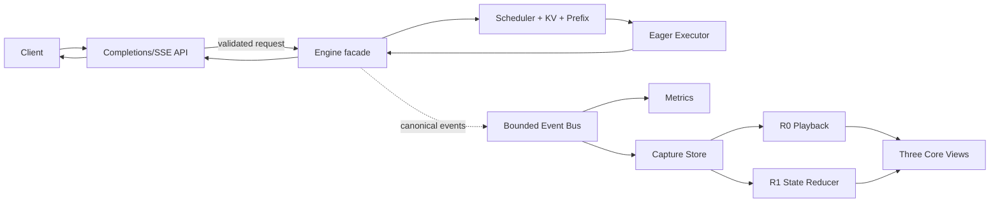

# iLLM v1.0.0 Stable Single-GPU SPEC

```yaml
status: draft # deprecated validator mirror; MUST equal spec_status
spec_status: draft
release_stage: dev_snapshot
qualification_tier: unqualified
qualification_profiles:
  - profile_id: cpu-regression-v1
    result: not_run
    reason: spec_not_implemented
  - profile_id: single-nvidia-gpu-v1
    result: not_run
    reason: spec_not_implemented
  - profile_id: clean-room-release-v1
    result: not_run
    reason: spec_not_implemented
performance_outcome: not_applicable
lts_state: not_applicable
spec_version: 1
target_release: v1.0.0
release_type: stable
depends_on: [v0.8.0]
project_plan: ../../../AI_INFERENCE_ENGINE_PROJECT_PLAN.md
previous_spec: ./v0.8-visual-replay.md
owners: [project-owner]
created: 2026-08-20
last_updated: 2026-08-20
```

> v1.0.0 将 v0.8 已具备 R0/R1 与三个核心视图的同步单卡引擎稳定为可从干净环境安装、通过稳定 API 使用并通过发布资格测试复现的正式版本。v0.x 的 API、event 与 artifact 契约均为 provisional；只有通过本 SPEC 后列入 `public-stability-manifest.yaml` 的有限表面，才从 v1.0.0 起获得公开稳定性承诺。新增工作严格对应 M7 Profile Gate 与 M8 release hardening；任何 fast path 都不是 v1.0.0 的发布前提。

## 1. 本版本学习目标

### 1.1 必须掌握

- 能解释固定模型 revision、`SupportedModelSpec`、`WeightLoadManifest`、`KVLayoutSpec` 和 `MemoryPlan` 如何共同限定一次可复现运行。
- 能实现 OpenAI-compatible completions/streaming 子集，并解释 admission、backpressure、断连取消和唯一 terminal outcome 的服务语义。
- 能从 canonical events 与 checkpoint 重建 queue、batch、paged KV 和 radix prefix 状态，并区分 R0 事件播放与 R1 控制面回放。
- 能用 Guided Request Story、Scheduler Lab、KV Cache Explorer 追踪 `Request → Step → Batch → KV` 的多对多因果关系。
- 能执行 release qualification，区分 correctness gate、stability gate、observability overhead 与 performance evidence。
- 能阅读 CPU/GPU timeline，完成 M7 Profile Gate，并用证据选择一个 v1.1 候选分支或明确选择“不进入”。

### 1.2 建议先修

- 已完成 v0.8.0：同步核心已具备 continuous batching、paged KV、preemption/recompute、chunked prefill、radix prefix cache，且 canonical Capture Bundle、R0/R1 与三个核心视图已形成闭环。
- 能解释 `SchedulePlan`、`AttentionPlan`、reservation、lease、ticket、`CompletionFence` 和 `DecisionRecord`。
- 能运行 pytest/Hypothesis、GPU smoke、open-loop benchmark，并读懂 TTFT、ITL、E2E、goodput 与显存指标。

### 1.3 预热与进入门槛（Warm-up / Entry Gate）

- 预计用时 45～60 分钟；使用已签发的 v0.8 bundle、qualification matrix 与 clean-room runner 完成，不在预热中临时扩大支持矩阵。
- `release/v0.8.0/manifest.json`、checksums、迁移报告和已知限制可由独立命令校验；任何缺失或 digest 漂移都会阻止 v1.0 qualification。
- `qualification-matrix.yaml` 已在 RC 前冻结为版本化有限集合，显式列出唯一真实模型 revision、tiny fixture、dtype、长度 bucket、cache/chunk/prefix/preemption 场景、硬件与期望结果；禁止用“所有组合”或运行时笛卡尔积扩张发布门。
- v0.8 的 reference path、R0/R1 reducer、三核心视图与 30 分钟 stress baseline 全绿；已知失败必须有 owner、到期日和明确的 non-blocking 理由。
- `public-stability-manifest.yaml` 候选只包含有 owner、schema、兼容测试、弃用策略和 rollback 的表面；未列入的 v0.x 对象继续视为 internal/provisional。
- 预热练习已完成：从一个 v0.8 capture 手工追踪 request→step→batch→KV，并对照 qualification matrix 说明“已覆盖”与“未声明支持”的边界。

### 1.4 Teach-back 产物

- `release/v1.0.0/teach-back.md`：用一条固定请求解释从 HTTP admission 到 stream close 的全过程，并附三个核心视图的证据链接。
- 一段不超过 15 分钟的演示：先在线生成并 capture，再离线逐 step 回放，最后用 Profile Gate 说明为什么 v1.1 选择或不选择某个优化分支。
- `release/v1.0.0/profile-gate/decision-record.md`：区分 measured、estimated、unknown，给出可证伪的下一步结论。

## 2. 用户可观察的成果

### 2.1 Release demo

先在 Terminal A 建立唯一环境、安装候选 wheel 并以前台方式启动服务；`illm serve` 不 daemonize：

```text
python scripts/bootstrap.py --profile release-verify --locked --artifact release/v1.0.0/dist/illm-1.0.0-py3-none-any.whl --artifact-manifest release/v1.0.0/dist/artifact-manifest.json --write-manifest out/v1.0-toolchain.json
python scripts/in_env.py --manifest out/v1.0-toolchain.json -- python -m illm doctor --require single-gpu
python scripts/in_env.py --manifest out/v1.0-toolchain.json -- python -m illm serve --config examples/v1.0/single-gpu.yaml --control-file out/v1.0-server/control.json
```

保持 Terminal A 运行，在 Terminal B 使用同一个 manifest 等待 readiness、发请求、验证并显式 shutdown：

```text
python scripts/in_env.py --manifest out/v1.0-toolchain.json -- python -m illm server wait-ready --control-file out/v1.0-server/control.json --timeout-s 180
python scripts/in_env.py --manifest out/v1.0-toolchain.json -- python -m illm completions --model illm-v1 --prompt "Explain paged KV in one sentence." --max-tokens 32 --stream --capture out/v1.0-demo
python scripts/in_env.py --manifest out/v1.0-toolchain.json -- python -m illm replay out/v1.0-demo --mode trace
python scripts/in_env.py --manifest out/v1.0-toolchain.json -- python -m illm replay out/v1.0-demo --mode state --assert-state-digest
python scripts/in_env.py --manifest out/v1.0-toolchain.json -- python -m illm release verify release/v1.0.0/manifest.json
python scripts/in_env.py --manifest out/v1.0-toolchain.json -- python -m illm server shutdown --control-file out/v1.0-server/control.json --deadline-s 60
python scripts/in_env.py --manifest out/v1.0-toolchain.json -- python -m illm ui --capture out/v1.0-demo --offline
```

`server wait-ready` 超时或 control file 的 PID/generation/config digest 不匹配时失败；`server shutdown` 必须执行 stop admission→drain→fence/lease cleanup，并等待 Terminal A 以 0 退出。最后一条是离线 UI 前台命令，完成截图/学习任务后可 `Ctrl+C`，不会影响已经关闭的推理服务。Terminal A/B transcript、control-file 生命周期和 shutdown 资源终态进入 evidence。

`illm doctor` 在模型、driver/CUDA、GPU 容量、权重 digest 或配置不满足 manifest 时失败；demo 不允许下载浮动 revision，也不允许把 CPU fallback 冒充 single-GPU qualification。除第一次 bootstrap 外，所有项目命令都必须经 `scripts/in_env.py`；PATH 中的全局 Python、uv 或 illm 即使存在也不得被调用。

### 2.2 用户故事

| ID | 用户故事 | 可观察结果 |
|---|---|---|
| US-1001 | 当我从干净 Linux/WSL 环境安装发布包 | 我能通过固定 lockfile、模型 revision 和 `illm doctor` 得到可复现的 ready/not-ready 结论 |
| US-1002 | 当我调用 completions streaming API | 我能按序收到 token chunk、usage 与唯一 finish/error 结果；断开连接会幂等取消 |
| US-1003 | 当请求排队、被分块、抢占或命中前缀 | 我能在 Scheduler Lab 看见当时的 reason code、预算与 `DecisionRecord` |
| US-1004 | 当 KV 使用率变化或发生 eviction | 我能在 KV Cache Explorer 看到 page table、lease、radix 节点和完成 fence 后的实际回收 |
| US-1005 | 当我打开一次 capture | UI 会声明其最高 replay 等级；R1 可逐 checkpoint 验证 state digest，能力不足时 fail closed |
| US-1006 | 当我想判断下一步该优化什么 | 我能复现 Profile Gate 的 target workload、原始 trace 和“不进入/选择一个分支”的结论 |

### 2.3 发布资产

- Python wheel、锁定依赖文件、Linux x86_64 单卡环境说明与容器配方。
- 一个仓库内 tiny deterministic fixture，以及一个固定 revision 的真实 dense decoder-only `SupportedModelSpec`。
- API/CLI quickstart、三个核心视图教程、capture 隐私指南、已知限制和 release notes。
- R0/R1 示例 capture、Chrome Trace/Perfetto 导出、baseline/candidate 对比报告和 M7 DecisionRecord。
- PR CPU、Merge GPU Smoke、Nightly/Weekly/Release Qualification 的实际执行状态与不可用资源标记。
- `release/v1.0.0/` evidence bundle，包含六轴资格状态、逐 profile 结果和 rollback；所有文件由 `manifest.json` 和 `checksums.txt` 固定。

## 3. Scope

### 3.1 本版本新增

- 对 v0.8 固定真实模型执行 release qualification：加载、manifest 校验、BF16/FP16 单 NVIDIA GPU 运行、GPU smoke 与干净环境复现。
- 稳定 `Engine.generate/stream` facade 上的 OpenAI-compatible `/v1/completions` 与 SSE streaming 子集。
- 有硬上限的 request validation、hard admission、429 backpressure、readiness、drain/shutdown 和 worker fail-stop 语义。
- 将继承的 `SamplingSpec` v1、R0/R1、canonical Capture Bundle、三个核心视图与共享因果导航纳入稳定兼容性和 release regression gate。
- 将 v0.8 typed JSONL/JSON checkpoint 的迁移策略、Chrome Trace/Perfetto 导出、always-on metrics 开销、capture 数据预算与隐私能力声明纳入发布资产；本版不强制迁移到 Protobuf。
- M7 Profile Gate：固定 workload 上识别 critical path，最多为 v1.1 推荐一个 M7a/M7b/M7c/M7d 分支，或记录不进入。
- M8 release qualification：干净安装、API smoke、固定 GPU stress、文档、tag 与 evidence bundle。

### 3.2 本版本保持不变

- v0.8.0 的同步 reference execution path 永久保留，仍是所有未来 fast path 的 correctness oracle。
- `SchedulePlan` 仍由纯 `SchedulerPolicy.plan(snapshot, budget)` 产生；计划副作用仍遵循 validate/reserve/commit-or-rollback。
- Paged KV、chunked prefill、radix prefix cache、preemption/recompute 的语义、reason code 与不变量不变。
- `AttentionPlan + KVLayoutSpec + AttentionCapabilities` 是唯一 attention ABI；unsupported 只能在副作用前显式回退。
- v0.8 的 canonical events、typed JSONL/JSON checkpoint、R0/R1 reducer、Guided Request Story、Scheduler Lab、KV Cache Explorer 与共享时间游标保持语义不变；这些输入在 v1.0 之前不构成 public compatibility 承诺。
- 单进程、单 worker、单 NVIDIA GPU；API/telemetry 可以独立线程，但不改变 scheduler 所有权。
- 默认 capture 不保存 prompt、原始 token 或输出内容；敏感输入只有显式 opt-in 才能进入加密文件。

### 3.3 Feature flags 与 fallback

| 能力 | 默认值 | Reference/fallback | 失败时行为 |
|---|---|---|---|
| `api.openai_completions` | on | native `Engine.stream` | 协议校验失败返回稳定 domain/HTTP error，不进入 engine |
| `executor.mode` | `eager` | eager reference backend | v1.0 不自动切换 compile/graph；unsupported 配置启动失败 |
| `attention.backend` | release manifest 固定 | trusted gather/reference backend | capability 不匹配时在 KV/RNG 副作用前回退并记录 reason |
| `prefix_cache.enabled` | on | `NoPrefixIndex` | 回退必须显式记录，输出与 cache-off oracle 对齐 |
| `capture.profile` | `metrics` | `off`/`engine` | 超预算停止深度 capture，写 `CaptureTruncated`，不阻塞推理 |
| `replay.state` | on | R0 trace playback | bundle 不具备 R1 字段时拒绝 state mode，并列出缺失字段 |
| `m7.fast_path` | off | sync/eager reference | Profile Gate 只产出建议，不在 v1.0 启用候选 fast path |

## 4. Non-goals

- 不实现或默认启用 persistent-input、CUDA Graph、overlap scheduler、自写 Triton/CUDA attention 等 M7 fast path。
- 不支持多 GPU、多 worker、TP、DP、PD、NCCL 或跨节点；接口预留不等于能力承诺。
- 不支持多个模型架构、浮动 revision、量化、LoRA、MoE、多模态或 `trust_remote_code` 默认开启。
- 不提供完整 OpenAI Chat API、tool calling、logprobs、stop sequence、penalties、logit bias、`min_p`、grammar 或 speculative decoding。
- 不承诺普遍快于 vLLM/SGLang，也不把外部 baseline 优势作为 release gate。
- v1.0 不提供 R2 Numerical Re-execution 或 R3 What-if；即使 capture 含额外数据，也必须等后续独立 SPEC 建立 capability contract 后才能声明。
- 不提供生产级鉴权、计费、租户隔离、Kubernetes 编排或远程 capture 托管。

任何新增需求若改变以上边界、公开契约或 DoD，必须通过 spec amendment 或 ADR，不能直接扩大 Issue。

## 5. Architecture Delta

### 5.1 相对上一版本的变化

```text
v0.8 visual/replay single-GPU engine
  sync core + canonical Capture Bundle + R0/R1
  + Guided Story / Scheduler Lab / KV Explorer
  ↓ M7 Gate + M8 only
v1.0 releasable single-GPU system
  stable completions/SSE API + service lifecycle
  + frozen release model/weight/environment manifest
  + compatibility/regression hardening for inherited replay/UI
  + Profile Gate + release qualification
```

### 5.2 新增或修改的模块

| 模块 | 变化 | 责任边界 | 禁止事项 |
|---|---|---|---|
| `api` | change | completions 校验、SSE、disconnect cancel、错误映射 | 不读取 scheduler/KV 内部对象，不自行重试 accepted request |
| `release_model` | add | 校验 `SupportedModelSpec`、权重、环境和 backend capability | 不接受浮动 revision，不静默忽略 config/tensor |
| `service_lifecycle` | add | readiness、admission stop、drain、fail-stop | 不在 in-flight fence 前复用资源 |
| `observability/schema` | stabilize | canonical events、metrics registry、reason enums、schema migration policy | 不用高基数 request ID 作为 metric label |
| `capture_store` | change | 有界写入、checkpoint、checksums、隐私等级、派生 trace | 不让 exporter backpressure 进入执行核心 |
| `replay/state` | stabilize | 从 checkpoint + ordered delta 重建、验证 digest并执行版本兼容检查 | 不重新执行在线 scheduler 来猜测历史决策 |
| `web/guided_story` | stabilize | 请求生命周期、stream token、静态模型/shape 摘要的发布回归 | 不把动画时间当 measured latency |
| `web/scheduler_lab` | stabilize | queue/step/batch/DecisionRecord 的发布回归 | 不在 UI 内重新计算选择理由 |
| `web/kv_explorer` | stabilize | page table、radix、lease、eviction、time scrubber 的发布回归 | 不访问进程内可变 allocator 对象 |
| `benchmark/release` | add | suite 冻结、qualification、报告与证据校验 | 不修改 engine config 以追逐 held-out 结果 |

### 5.3 数据流与状态迁移



请求沿用跨版本契约的 `FINISHED`、`CANCELLED`、`FAILED`、`DEADLINE_EXCEEDED` 四种 terminal outcome，且 accepted 后恰好一个 terminal event。client disconnect、deadline 与 finish race 由原子 terminal transition 决定；launch 后取消进入 `CANCEL_PENDING`，输出立即失效，但 page/buffer/workspace 等到最后一个 `CompletionFence` 后才回收。R1 reducer 从最近 checkpoint 应用 ordered delta，每个 scheduler step 比较 queue/batch/KV/prefix digest；首次不一致报告结构化路径。

## 6. Contracts

### 6.1 API/CLI contract

- `POST /v1/completions` 仅接受一个 `prompt: string`、固定 manifest 中的 `model`、`max_tokens`、`temperature`、`top_p`、`seed`、`stream`；native CLI 另支持 `top_k`。数组 prompt、best-of、n>1、logprobs、echo、suffix、stop、penalties 和未知字段均 `INVALID_ARGUMENT`，不得静默忽略。
- `temperature=0` 等价 canonical greedy；sample 要求 `temperature>0`、`top_k>=0`、`0<top_p<=1`。非有限参数、空候选和 non-finite logits 按 `SamplingSpec` 返回显式错误。
- 非 streaming 返回单个 completion、finish reason、actual seed 的安全表示和 usage；streaming 按 token 顺序发送 SSE chunk，最后发送唯一 terminal chunk 与 `[DONE]`。headers 已发送后的错误使用结构化 terminal error 后关闭流。
- client disconnect 触发幂等 cancel；重复 cancel 返回相同 terminal 状态，不创建第二个终态。API 不自动重放 accepted request。
- 错误映射固定为：不支持/非法参数 400，deadline 在 headers 前到期 408，body/prompt 超限 413，queue/token budget 过载 429，worker not-ready/draining/fail-stop 503；headers 后统一走结构化 terminal error。
- `GET /health/live` 只说明进程存活；`GET /health/ready` 仅在模型校验、`MemoryPlan`、KV pool、backend warmup 完成且未 draining 时成功。
- CLI 稳定命令为 `illm serve`、`illm server wait-ready/shutdown`、`illm completions`、`illm replay`、`illm ui`、`illm doctor`、`illm release verify`；breaking flag 变更必须提升 major 或提供迁移错误。
- `illm serve` 是前台进程，原子创建权限受限的 control file，包含 PID、process generation、config/environment digest 和 loopback control capability；wait-ready/shutdown 必须校验这些 identity，stale control file fail closed，正常退出后删除 control file。
- clean-room 的项目命令只允许由 `scripts/in_env.py` 启动；runner 的环境握手、PATH poisoning 与 manifest tamper 失败语义继承 V0.0，不能被 shell activation 替代。rollback 中 `--expected-manifest-digest-file` 是强制参数，必须在项目导入前校验对应 finalized `ToolchainManifest` 的 canonical digest；source/target runner 不得互换。

### 6.2 Config/manifest contract

| 字段/对象 | 稳定性 | 兼容规则 |
|---|---|---|
| `SupportedModelSpec.spec_id` | stable | architecture/revision/shape/RoPE/layout 任一语义字段变化生成新 ID |
| `WeightLoadManifest` | stable | missing/unexpected/duplicate tensor 必须为空；digest 改变使 prefix/graph/capture 执行兼容失效 |
| `KVLayoutSpec.layout_id` | stable | dtype、axes、stride、page size、head mapping 改变均 breaking |
| `MemoryPlan` | stable | 每次 run 在 readiness 后冻结；admission 与 UI 只能读取此容量事实源 |
| `SamplingSpec.schema_version=1` | stable | processor 顺序、FP32 canonical sampler、Philox RNG contract 不可由 backend 重解释 |
| `engine-config.schema_version` | stable | 未知语义字段 fail closed；新增非语义可选字段必须有明确默认值 |
| `ToolchainManifest` | stable | 作为 qualification input，finalized 后绑定一个 exact artifact digest、lock digest、environment root、interpreter 与 entrypoint；不同 artifact 必须使用不同环境/manifest，禁止在 finalized runner 内安装、升级或替换 package |
| `RunManifest` | stable | 记录 git/dirty、model/weights、GPU/driver/CUDA、backend、layout、memory、sampling、observability |
| `ReleaseManifest` | stable | 固定 commands、artifact checksums、suite digests，以及六轴 `spec_status/release_stage/qualification_tier/qualification_profiles/performance_outcome/lts_state`；签发后不可修改 |

`qualification_profiles` 至少包含 `cpu-regression-v1`、`single-nvidia-gpu-v1` 和 `clean-room-release-v1`，每项保存 result、Toolchain/RunManifest digest、evidence digest 与非 pass reason。CPU 全绿但固定 GPU 不可用时，允许 `release_stage=release_candidate` 与最高 `qualification_tier=learning_complete`；不得写 `stable_released`。`illm release verify` 从 profile、support matrix、rollback 与 checksums 重算 tier，claim 超出证据即失败。V1.0 不产生 Performance Season outcome，故 `performance_outcome=not_applicable`；它只产出供 V1.1 使用的 M7 DecisionRecord。

### 6.3 Event/capture/replay contract

- canonical event schema 与 reason enum 在 v1.0 冻结为 schema 1；同一 schema number 不复用不同字段语义。
- capture 至少含 manifest、engine config、environment、workload、sampling specs、checkpoint、ordered events、state digests、metrics、output summary 与 checksums。
- R0 需要有序 canonical events；关键事件缺失时 bundle 标记 `incomplete/non_replayable`，UI 显示缺口。
- R1 需要完整初始/周期 checkpoint、plan→validate→commit/rollback 事务事件、policy/config version 和逐 step digest；首次差异必须定位到 request/page/index 路径。
- `input_capture.mode=metadata_only`，只承诺 R0/R1。请求 `execute` 或 `what-if` 必须失败并说明 v1.0 未实现相应 capability，而不是仅根据字段存在猜测启用。
- `events` 是事实源；metrics、Perfetto、截图均为派生物。派生失败不改变 online outcome。
- ring buffer、事件速率、bundle 大小、capture 时长和 retention 有硬上限；replay-critical 事件不得静默丢弃。

### 6.4 资源、并发与失败 contract

- 启动时按权重、activation、workspace、IO/telemetry、fragmentation reserve 和 safety headroom 生成冻结 `MemoryPlan`，再一次性预分配 KV pool；稳态热路径不得依赖临时 `cudaMalloc`。
- request body、prompt tokens、output tokens、queued requests、queued tokens、active sequences、connections、admission wait 均有版本化硬上限和 high/low watermark hysteresis。
- `PreparedBatch` 持有 input/output/workspace lease，`ExecutionTicket` 持有 fence 与 KV write lease；GC 不是释放协议。
- OOM/reservation failure 在可预期容量阶段返回 backpressure/显式失败；异步 kernel error 若使 worker 状态不可信则 fail-stop，readiness 关闭并拒绝新 admission。
- exporter stall 只能丢弃允许采样的低优先级事件并计数；不得阻塞 scheduler/executor。
- shutdown 顺序为 stop admission → drain accepted requests → timeout 后逻辑取消 → 等待/受控回收 in-flight ticket；不得直接清空 GPU pool。

## 7. Implementation Slices

| Slice | 垂直成果 | depends_on | 主要文件/模块 | 完成证据 |
|---|---|---|---|---|
| S1 | 对 v0.8 固定 real model 从校验到 streaming 做 release qualification | v0.8.0 | `model`, `loader`, `executor`, `doctor` | model golden + manifest audit + GPU smoke |
| S2 | completions/SSE API、hard limits、readiness、disconnect cancel 全链路 | S1 | `api`, `engine`, `service_lifecycle` | protocol integration + cancel race capture |
| S3 | 继承的 event/capture/R0/R1 通过兼容、损坏、数据预算与 release regression | S2 | `observability`, `capture`, `replay` | online/replay digest equality + migration/corruption report |
| S4 | 三个继承视图与共享游标完成稳定化、教程和 release regression | S3 | `web`, generated schema client | Playwright smoke + fixture screenshots + causal coverage |
| S5 | 冻结 benchmark suites，执行 Profile Gate 并生成单一 v1.1 推荐或 no-op | S1-S4 | `benchmark`, `profiler`, `decision_record` | 3 次 pilot + raw trace + signed DecisionRecord |
| S6 | release qualification、干净安装、soak、文档和 evidence 校验 | S5 | `release`, CI, docs | verify command + ≥30 min/≥1,000 request report |

每个 slice 都保留 eager/sync reference path。S5 不实现候选 fast path；S6 不得因性能结果不理想而修改正确性、SLO 或 held-out 数据。

## 8. Correctness and Invariants

### 8.1 Golden/differential

- 固定至少 20 个真实/tiny 输入，对齐 embedding、代表层输出、final logits 与 greedy token；低精度 tolerance profile 在运行前冻结。
- 覆盖 GQA head mapping、RoPE 绝对位置、page/chunk 边界、长上下文、tied embeddings、vocab 边界与 fused/unfused weight mapping。
- 只对 RC 前冻结且有 schema 版本的 `qualification-matrix.yaml` 中每一行执行 differential；矩阵至少覆盖 cache off/on、代表性 chunk/prefix/preemption 边界、单请求与 mixed batch，但不得声称或生成无界“所有组合”。greedy token 必须完全一致。
- sampling 验证 reference/fast sampler differential、单独/mixed/cancel/reorder 下 per-request RNG 不变，以及固定 logits 的分布统计容差。
- R1 对每个 checkpoint 和 step 重建相同 queue/batch/page/radix digest；fixture 的预期因果链接覆盖 100%。
- completions native facade 与 HTTP/SSE 对相同请求产生相同 token、usage、finish reason 和 terminal domain outcome。

### 8.2 Property/state invariants

- 每个 accepted request 恰好一个 terminal event；lost、duplicate、double-terminal 均为 0。
- `free_pages ∩ owned_pages = ∅`，总页数守恒，reservation 全 commit 或全 rollback，active lease 不被 eviction。
- `valid_tokens`、prefix index 和输出只能在对应 writer fence 成功后发布；in-flight 地址不能提前复用。
- 全前缀命中仍至少执行产生 next-token logits 所需的 query token；matched/reused/forced-recompute 分开计量。
- scheduler 不超过 token/page/sequence budget；有界 accepted 集合获得 forward progress，持续过载由 admission 拒绝而非无限排队。
- default privacy capture 不含 prompt、token IDs、原始输出或跨 capture 可关联 hash。
- UI 的 measured/estimated/unknown/dropped/incomplete 标记必须来自 manifest/schema，不能由展示层猜测。

### 8.3 Failure/stress matrix

| 场景 | 注入方式 | 必须结果 | 禁止结果 |
|---|---|---|---|
| finish/cancel race | 在末 token resolve 前后并发 disconnect/cancel | 一个原子终态；资源在 fence 后归零 | double terminal、重复 token、提前复用 |
| queue overload | open-loop 超过 high watermark | 新请求 429；accepted 请求可 drain；恢复到 low watermark 后再接纳 | 无限队列、把拒绝隐藏为 timeout |
| partial reservation/OOM | 在 reserve/commit/write 阶段故障注入 | 全 rollback 或明确 committed handle；状态 digest 可解释 | half-commit、dangling page、CUDA OOM 充当正常流控 |
| async kernel error | ticket resolve 注入错误 | 请求失败；状态不可信时 worker fail-stop/readiness false | 继续返回可能损坏的输出 |
| exporter stall/disk full | 阻塞 sink 或触发 bundle 上限 | 推理继续；drop/truncate 显式记录；bundle 标 capability | scheduler 阻塞、磁盘无限增长 |
| checkpoint/event corruption | 删除、重排或改写关键记录 | checksum/schema/replay 验证失败并定位缺失 | 静默降级为成功 R1 |
| shutdown with in-flight work | stress 中发 drain/timeout | stop admission，accepted 有唯一结果，fence 后回收 | 进程退出前地址被重用、丢终态 |
| long cache churn | ≥30 分钟、≥1,000 请求，含 prefix/cancel/preempt | lost/duplicate/leaked page 为 0，内存回到声明基线 | 单调泄漏、跨 namespace 命中 |

所有数字阈值绑定 release fixture、seed、硬件与 commands；修改阈值需新 evidence 或 ADR。

## 9. Visualization Learning Story

### 9.1 本版本必须回答的问题

1. 一次 streaming 请求在服务、调度、模型执行和回收阶段分别发生了什么？
2. 每个 scheduler step 为什么选择、延迟、抢占或拒绝某个请求？
3. prompt token 如何映射到 page table，哪些页被共享、写入、驱逐和延迟回收？
4. chunked prefill 与 prefix reuse 如何改变 TTFT、ITL、重算和 KV 压力？
5. 某个瓶颈结论来自 measured trace、估算模型还是未知数据？
6. Profile Gate 为什么推荐某一个 v1.1 分支，或者为什么不应优化？

### 9.2 视图与证据映射

| 视图 | 事实源 | 交互 | measured/estimated 边界 |
|---|---|---|---|
| Guided Request Story | request/token/batch/model events、static graph manifest | 选请求、逐 token/step、跳到 batch/KV | 时间戳为 measured；静态 FLOPs/bytes 为 estimated |
| Scheduler Lab | `SchedulePlan`、`DecisionRecord`、budget snapshot | queue lane、step card、reason filter、request×step | 历史理由只读 canonical decision，不重新求解 |
| KV Cache Explorer | allocator/prefix events、checkpoint、page/radix digest | time scrub、page owner、lease/fence、eviction path | page/lease 是 measured state；理论 capacity 单独标 estimated |
| Profile Gate Story | metrics、Perfetto/Nsight manifest、experiment card | critical-path 标注、候选/反证、原始数据下载 | profiler 采样范围外为 unknown；硬件 counter 才是 measured roofline |

三个核心入口共享 timestamp 主游标，request/batch/step ID 仅作为筛选与高亮。UI 不通过重新运行调度逻辑推测当时原因。

## 10. Performance Hypothesis

### 10.1 本版本性能立场

v1.0 只建立稳定 baseline 并执行 profile-gated 诊断，不要求实现 fast path，也不要求胜过外部引擎。发布需要证明 benchmark 可复现、always-on metrics 开销受控，并为 v1.1 选择最多一个有证据的分支或明确不进入。

### 10.2 Experiment card

```yaml
question: 在固定单卡 target workload 中，iLLM 的主要可行动 critical path 属于 host prepare、launch/graph、scheduler overlap 还是 attention/kernel？
hypothesis: 至少一个 M7 分支达到预注册 trigger，或者数据足以证明当前没有分支值得进入
primary_metric: illm.benchmark.request_goodput.slo.v1
guardrails: [illm.correctness.request_result.v1, illm.server.ttft.request_weighted.p99.v1, illm.server.itl.token_weighted.p99.v1, illm.client.e2e.request_weighted.p99.v1, illm.gpu.memory.peak_bytes.v1, illm.request.terminal.failure_rate.accepted_request_weighted.v1]
tuning_suite: benchmark/suites/v1.0-profile-pilot.yaml; digest frozen before first pilot
held_out_suite: benchmark/suites/v1.0-release-held-out.yaml; digest frozen and unread by PR jobs
budget: 3 steady-state pilot runs plus 5 release confirmation runs, at most 8 GPU-hours
success: one signed DecisionRecord selects at most one M7a/M7b/M7c/M7d branch whose trigger is met, or selects no branch with evidence
no_go: no trigger survives noise/guardrail analysis; publish a no-op DecisionRecord and keep eager/sync path
```

每次 run 区分冷启动与稳态，记录 GPU SKU、driver、功耗、温度、cache 状态和 telemetry level。结果报告 median、bootstrap 95% CI、完整 offered-load→goodput/SLO 曲线；小于噪声带写“无显著差异”。

## 11. Compatibility and Migration

### 11.1 Compatibility matrix

| Artifact | 读取上一版本 | 写入格式 | Breaking 条件 | 迁移/降级 |
|---|:---:|---|---|---|
| config | 是，经 schema validator | `engine-config` schema 1 | 未知语义字段、默认值改变 | `illm config migrate --from v0.8`; 无法证明等价则拒绝 |
| public API/CLI | `Engine.generate/stream` 保持 | completions/SSE v1 + stable CLI | 参数/错误/terminal 语义改变 | 保留 native facade；HTTP 不支持字段返回 400 |
| event/capture | 读取完整 v0.8 typed JSONL/JSON schema | canonical event/capture schema 1 | reason/state/事务语义或必需字段改变 | import 时生成兼容报告；不足 R1 则只开放实际 capability |
| model/weight manifest | 是，必须满足 release support | `SupportedModelSpec`/`WeightLoadManifest` v1 | model/weight/tokenizer/layout digest 改变 | 重新校验；禁止复用 prefix/capture execute artifact |
| cache/graph artifact | 仅复用相同 prefix namespace/layout | prefix cache run-local；无 v1.0 graph artifact | spec/weights/layout/page size 改变 | 清空并重建；eager reference 永远可用 |

### 11.2 Rollback

rollback rehearsal 不复用 §2.1 的普通 demo 环境，也绝不在 finalized runner 中执行 `pip`、`uv`、package install/upgrade 或 wheel replacement。先由系统 Python 在两个不同 environment root 中分别安装 exact v1.0 source 与 exact v0.8 target；两个 bootstrap 都必须从 `--artifact-manifest` 校验 wheel digest，成功后才原子写入 finalized `ToolchainManifest` 及其 canonical SHA-256 sidecar：

```text
python scripts/bootstrap.py --profile release-verify --locked --artifact release/v1.0.0/dist/illm-1.0.0-py3-none-any.whl --artifact-manifest release/v1.0.0/dist/artifact-manifest.json --write-manifest release/v1.0.0/rollback/toolchains/source-v1.0-toolchain.json --write-manifest-digest release/v1.0.0/rollback/toolchains/source-v1.0-toolchain.sha256
python scripts/bootstrap.py --profile release-verify --locked --artifact release/v0.8.0/dist/illm-0.8.0-py3-none-any.whl --artifact-manifest release/v0.8.0/dist/artifact-manifest.json --write-manifest release/v1.0.0/rollback/toolchains/target-v0.8-toolchain.json --write-manifest-digest release/v1.0.0/rollback/toolchains/target-v0.8-toolchain.sha256
```

两个 manifest 必须具有不同 environment ID/root/interpreter，分别只解析到声明的 wheel digest；任一 manifest 未 finalized、sidecar 不匹配、artifact/lock/entrypoint 漂移或环境重合都在项目导入前 fail closed。回滚 preflight 由 source verifier 同时绑定 source/target manifest 与 digest：

```text
python scripts/in_env.py --manifest release/v1.0.0/rollback/toolchains/source-v1.0-toolchain.json --expected-manifest-digest-file release/v1.0.0/rollback/toolchains/source-v1.0-toolchain.sha256 -- python -m illm release verify release/v1.0.0/manifest.json --rollback-source-toolchain release/v1.0.0/rollback/toolchains/source-v1.0-toolchain.json --rollback-source-digest-file release/v1.0.0/rollback/toolchains/source-v1.0-toolchain.sha256 --rollback-target-toolchain release/v1.0.0/rollback/toolchains/target-v0.8-toolchain.json --rollback-target-digest-file release/v1.0.0/rollback/toolchains/target-v0.8-toolchain.sha256 --rollback-phase preflight --output release/v1.0.0/rollback/preflight.json
```

preflight 通过后，Terminal A 只用 source runner 启动 v1.0；Terminal B 用同一 source identity 做 canary，并通过 control file 执行 stop admission、drain、显式 shutdown，等待 Terminal A 以 0 退出并证明 KV/prefix/lease/fence 归零：

```text
python scripts/in_env.py --manifest release/v1.0.0/rollback/toolchains/source-v1.0-toolchain.json --expected-manifest-digest-file release/v1.0.0/rollback/toolchains/source-v1.0-toolchain.sha256 -- python -m illm serve --config examples/v1.0/single-gpu.yaml --control-file release/v1.0.0/rollback/source-v1.0.control.json
```

```text
python scripts/in_env.py --manifest release/v1.0.0/rollback/toolchains/source-v1.0-toolchain.json --expected-manifest-digest-file release/v1.0.0/rollback/toolchains/source-v1.0-toolchain.sha256 -- python -m illm server wait-ready --control-file release/v1.0.0/rollback/source-v1.0.control.json --timeout-s 180
python scripts/in_env.py --manifest release/v1.0.0/rollback/toolchains/source-v1.0-toolchain.json --expected-manifest-digest-file release/v1.0.0/rollback/toolchains/source-v1.0-toolchain.sha256 -- python -m illm completions --model illm-v1 --prompt "rollback source canary" --max-tokens 16 --capture release/v1.0.0/rollback/source-canary
python scripts/in_env.py --manifest release/v1.0.0/rollback/toolchains/source-v1.0-toolchain.json --expected-manifest-digest-file release/v1.0.0/rollback/toolchains/source-v1.0-toolchain.sha256 -- python -m illm server shutdown --control-file release/v1.0.0/rollback/source-v1.0.control.json --deadline-s 60
```

source 完全退出后才允许通过 target runner 执行 v0.8 的固定 canary 与 R0/R1 smoke；这一步是切换到独立 target 环境，不是在 source 环境内“降级安装”：

```text
python scripts/in_env.py --manifest release/v1.0.0/rollback/toolchains/target-v0.8-toolchain.json --expected-manifest-digest-file release/v1.0.0/rollback/toolchains/target-v0.8-toolchain.sha256 -- python -m illm workload run fixtures/workloads/v08-visual-demo.json --capture release/v1.0.0/rollback/target-v0.8-smoke --capture-profile engine-r1
python scripts/in_env.py --manifest release/v1.0.0/rollback/toolchains/target-v0.8-toolchain.json --expected-manifest-digest-file release/v1.0.0/rollback/toolchains/target-v0.8-toolchain.sha256 -- python -m illm replay release/v1.0.0/rollback/target-v0.8-smoke --mode trace
python scripts/in_env.py --manifest release/v1.0.0/rollback/toolchains/target-v0.8-toolchain.json --expected-manifest-digest-file release/v1.0.0/rollback/toolchains/target-v0.8-toolchain.sha256 -- python -m illm replay release/v1.0.0/rollback/target-v0.8-smoke --mode state --assert-state-digest
python scripts/in_env.py --manifest release/v1.0.0/rollback/toolchains/source-v1.0-toolchain.json --expected-manifest-digest-file release/v1.0.0/rollback/toolchains/source-v1.0-toolchain.sha256 -- python -m illm release verify release/v1.0.0/manifest.json --rollback-source-toolchain release/v1.0.0/rollback/toolchains/source-v1.0-toolchain.json --rollback-source-digest-file release/v1.0.0/rollback/toolchains/source-v1.0-toolchain.sha256 --rollback-target-toolchain release/v1.0.0/rollback/toolchains/target-v0.8-toolchain.json --rollback-target-digest-file release/v1.0.0/rollback/toolchains/target-v0.8-toolchain.sha256 --rollback-phase final --rollback-evidence release/v1.0.0/rollback --assert-finalized-toolchains-immutable
```

v1.0 capture 被 v0.8 读取时只开放 target 明确声明的能力，不能让 provisional v0.8 surface 冒充 v1.0 public stable API 或迁移结果。若 API 层回归，可先关闭 `api.openai_completions` 并通过 source native facade/CLI 诊断；若 capture exporter 回归，可将 source 降至 `metrics/off`，但 qualification 必须重新证明 R0/R1。source/target artifact manifest 与 wheel digest、两个 ToolchainManifest/digest、命令、canary、Terminal A/B transcript、terminal/resource 终态和结论全部保存到 `rollback/`；`ReleaseManifest`、raw evidence 与两个环境均不可被回滚流程覆盖或原地修改。

## 12. Definition of Done

### 12.1 Must

- [ ] tiny fixture 与唯一真实模型 revision 的 spec、weight manifest、loader audit 和 GPU golden 全通过；server config/manifest 对 world size、TP/DP degree、worker/GPU 数大于 1 的组合在启动前 fail closed，资格矩阵只声明单进程、单 worker、单 GPU。
- [ ] §2.1 Terminal A/B clean install、`illm doctor`、前台 serve、wait-ready、completions streaming、capture、R0/R1 replay、显式 shutdown、离线 UI 和 release verify 命令全部可复现；无残留进程/control file/lease。
- [ ] §2.1 的正常 v1.0 项目命令都由同一 finalized `ToolchainManifest` 的 `scripts/in_env.py` 启动；§11.2 rollback 的 source/target 命令分别只由各自独立 finalized manifest + expected digest sidecar 启动。PATH poisoning、解释器/entrypoint 逃逸、runner 互换和 manifest digest/handshake 篡改均在项目导入前 fail closed，finalized 环境内安装/升级尝试被拒绝。
- [ ] completions 支持字段、拒绝字段、错误码、SSE terminal、disconnect cancel 与 readiness/drain contract 有集成测试。
- [ ] `public-stability-manifest.yaml` 只列有限且有 owner/schema/deprecation/compatibility test 的 API、CLI、config 与 artifact；验证器证明未列入的 v0.x provisional 对象没有被误承诺为 public stable。
- [ ] greedy 与 temperature/top-k/top-p sampler、Philox per-request counter RNG、batch/cancel/reorder invariance 全通过。
- [ ] `qualification-matrix.yaml` 具有固定 schema version、有限行数、每行稳定 case ID 与覆盖理由；其中每个声明 case 的 reference differential 与不变量测试通过，报告不得声称覆盖矩阵外组合。
- [ ] ≥30 分钟且 ≥1,000 请求的固定 GPU stress 中 lost、duplicate、double-terminal、leaked/dangling page 均为 0。
- [ ] R0/R1 逐 checkpoint digest 一致；损坏/缺字段 bundle fail closed；默认 capture 无敏感内容。
- [ ] 三个核心页面 smoke、固定截图和 fixture 因果链接覆盖 100%，并正确显示 measured/estimated/unknown/dropped/incomplete。
- [ ] PR CPU、Merge GPU Smoke、Nightly/Weekly/Release CI 状态可审计；资源未运行不能显示为 pass。
- [ ] 六轴 release state 与逐 profile evidence 一致；固定 GPU 缺失只允许 RC + `learning_complete`，`release verify` 能拒绝伪造的 `stable_released`/Adopt/LTS claim。
- [ ] tuning/held-out 分离、metrics off/on 开销报告、固定 baseline 与 Profile Gate 原始证据完整；报告使用 `illm.benchmark.request_goodput.slo.v1`、server/client 分离的 fully-qualified latency ID 和 `illm.request.terminal.failure_rate.accepted_request_weighted.v1` 分母。
- [ ] M7 DecisionRecord 最多选择一个 v1.1 分支或明确不进入；v1.0 默认路径仍为 sync/eager reference。
- [ ] quickstart、API contract、三视图教程、capture privacy、architecture、known limitations 和 release notes 完成。
- [ ] v1.0→v0.8 artifact-bound rollback rehearsal 使用 exact source/target wheel + artifact manifest 分别 bootstrap 两个独立 finalized `ToolchainManifest` 与 digest sidecar；source 显式 shutdown/资源归零后，target canary 与 R0/R1 smoke 通过，两个环境均无原地安装或修改，完整 evidence bundle 通过独立 `illm release verify`。

### 12.2 Conditional

- [ ] 若使用固定独占 GPU runner，自动 performance CI 在 release 前连续通过；否则人工 qualification 必须记录硬件占用、功耗、温度与原始命令。
- [ ] 若发生 event/capture breaking change，提供迁移器与 golden migration fixture；否则明确记录 schema 未 breaking。
- [ ] 若 Profile Gate 需要 NVTX/Nsight 深度证据，保存工具版本、collector 兼容矩阵、扰动说明和独立 capture。
- [ ] 若启用 encrypted local capture，密钥不与 bundle 同存，权限/过期/删除流程通过安全测试；该能力仍不使 R2 成为 v1.0 Must。

### 12.3 Evidence bundle

```text
release/v1.0.0/
├─ manifest.json
├─ checksums.txt
├─ commands.txt
├─ test-report.json
├─ compatibility-report.json
├─ public-stability-manifest.yaml
├─ qualification-matrix.yaml
├─ qualification/
│  ├─ release-state.json
│  └─ profiles/{cpu-regression,single-nvidia-gpu,clean-room-release}/
├─ rollback/
│  ├─ manifest.json
│  ├─ commands.txt
│  ├─ preflight.json
│  ├─ artifact-bindings.json
│  ├─ toolchains/
│  │  ├─ source-v1.0-toolchain.json
│  │  ├─ source-v1.0-toolchain.sha256
│  │  ├─ target-v0.8-toolchain.json
│  │  └─ target-v0.8-toolchain.sha256
│  ├─ source-lifecycle/{terminal-a.txt,terminal-b.txt,shutdown-resource-audit.json}
│  ├─ source-canary/
│  ├─ target-v0.8-smoke/
│  └─ rollback-report.md
├─ server-lifecycle/
│  ├─ terminal-a.txt
│  ├─ terminal-b.txt
│  └─ shutdown-resource-audit.json
├─ dist/
│  └─ illm-1.0.0-py3-none-any.whl
├─ capture/
├─ benchmark/
│  ├─ suites-and-digests.json
│  ├─ raw/
│  └─ report.md
├─ profile-gate/
│  ├─ experiment-card.yaml
│  └─ decision-record.md
├─ screenshots/
├─ teach-back.md
├─ known-limitations.md
└─ release-notes.md
```

## 13. Known Limitations

- 仅支持 release manifest 固定的一种 dense decoder-only architecture/revision、BF16/FP16 与单 NVIDIA GPU。
- 稳定协议只是 completions/streaming 子集；完整 Chat API、tool calling 和更多 sampling processor 未承诺。
- 默认只有 R0/R1；v1.0 不声明 R2/R3。任何 What-if 教学预览都必须标 `estimated`，不能冒充正式策略模拟。
- eager/sync reference path 可能显著慢于成熟引擎；v1.0 的目标是稳定、可解释和可复现，而不是赢得性能排名。
- UI 只交付三个核心入口；独立 GPU/Compiler/Compare 高级页进入后续版本。
- 单进程 worker failure 需要 fail-stop/restart，尚无多进程隔离或请求恢复。
- capture/state schema 在 major version 内兼容，但不保证跨不同 GPU/driver/backend 的 bitwise numerical replay。

### 13.1 下一版本输入

- Profile Gate 的唯一 `selected_branch` 或 `no_branch` 结论决定 v1.1 的 Scope；不得同时打开多个 M7 分支。
- v1.0 的 correctness、stress、metrics overhead 和 baseline 成为 v1.1 不可降低的 guardrail。
- eager/sync reference、API terminal、event schema、MemoryPlan、lease/fence 和 R0/R1 契约在 v1.1 继续保持。
- structured outputs 与 speculative decoding 不进入 v1.1 性能季；前者进入 v1.2，后者进入 v1.3，互不捆绑发布。

---

## Appendix A. Requirement Traceability

| Requirement | Design/contract | Test/evidence | DoD item |
|---|---|---|---|
| R10.1 固定 real model 可复现 | §3.1, §6.2 | model golden、loader audit、GPU smoke | §12.1 item 1 |
| R10.2 稳定 completions/SSE | §5.2, §6.1 | protocol integration、Terminal A/B clean demo | §12.1 items 2, 4 |
| R10.3 sampling/RNG 稳定 | §6.1-6.2 | sampler differential、RNG invariance | §12.1 item 6 |
| R10.4 有限资格矩阵正确 | §1.3, §3.2, §8.1-8.2 | versioned qualification matrix、property tests | §12.1 items 7, 12 |
| R10.5 异步资源安全 | §5.3, §6.4 | cancel/OOM/fence/shutdown stress | §12.1 items 2, 8 |
| R10.6 R0/R1 fail-closed replay | §6.3 | digest replay、corruption fixtures | §12.1 item 9 |
| R10.7 三个核心可视化入口 | §9 | Playwright、screenshots、causal coverage | §12.1 item 10 |
| R10.8 可审计 CI 与 qualification | §6.2、§7 S6、§10 | profile state、CI records、release verify | §12.1 items 11-12 |
| R10.9 benchmark 公平可复现 | §10 | frozen suites、raw runs、95% CI report | §12.1 item 13 |
| R10.10 Profile Gate 不实现 fast path | §3.1, §10 | experiment card、DecisionRecord | §12.1 item 14 |
| R10.11 文档与学习闭环 | §1.3, §2.3 | teach-back、tutorial smoke | §12.1 item 15 |
| R10.12 单卡边界 | §3.2, §4 | config rejection tests | §12.1 item 1 |
| R10.13 manifest 环境隔离 | §2.1、§6.1、§11.2 | PATH poisoning、source/target handshake/digest/tamper tests | §12.1 item 3 |
| R10.14 显式 shutdown 与 artifact-bound rollback | §2.1、§6.1、§11.2 | lifecycle transcript、dual-manifest rollback report | §12.1 items 2, 16 |

## Appendix B. Open Questions

| Question | Owner | Resolve before | Resolution artifact |
|---|---|---|---|
| release qualification 是否有固定、独占、可控功耗的 GPU runner | project-owner | v1.0 release candidate | ADR-019 CI runner 与人工 fallback |
| v0.8 已固定的真实模型是否满足 12～24 GB 主支持硬件 | project-owner | v1.0 accepted | SupportedModelSpec ADR amendment 或维持原选择 |
| Profile Gate 的噪声带与 minimum effect 数值 | performance-owner | first v1.0 pilot | noise-study report + signed ExperimentCard |
| capture 默认保留期和本地磁盘配额 | project-owner | capture implementation merge | privacy/retention ADR |
