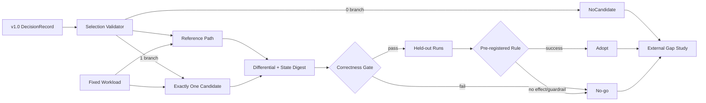

# iLLM v1.1.0 Profile-Gated Performance Season SPEC

```yaml
status: draft # deprecated validator mirror; MUST equal spec_status
spec_status: draft
release_stage: dev_snapshot
qualification_tier: unqualified
qualification_profiles:
  - profile_id: offline-profile-analysis-v1
    result: not_run
    reason: spec_not_implemented
  - profile_id: single-gpu-performance-season-v1
    result: not_run
    reason: spec_not_implemented
  - profile_id: external-gap-equal-budget-v1
    result: not_run
    reason: spec_not_implemented
performance_outcome: pending
lts_state: not_applicable
spec_version: 1
target_release: v1.1.0
release_type: performance
depends_on: [v1.0.0]
project_plan: ../../../AI_INFERENCE_ENGINE_PROJECT_PLAN.md
previous_spec: ./v1.0-stable-single-gpu.md
owners: [project-owner]
created: 2026-08-20
last_updated: 2026-08-20
```

> v1.1.0 不是“把所有性能技巧做一遍”。`selected_branch` 基数必须是 `0..1`：为 0 时结果是 `NoCandidate`，只发布 Profile Gate 与在本 SPEC accepted 时冻结的 vLLM/SGLang 等预算公平 gap report，不实现 fast path；为 1 时只执行选中的 M7a/M7b/M7c/M7d 分支，结果是 `Adopt` 或 `No-go`。三种结果都可形成完整、合法的 v1.1.0 发布，且不要求 iLLM 胜出外部对照。

## 1. 本版本学习目标

### 1.1 必须掌握

- 能从 CPU/GPU critical path、profile 占比、shape/bucket 覆盖和端到端 guardrail 中选择一个可行动瓶颈，而不是按流行度选择技术。
- 能为单一优化建立 immutable reference path、capability check、显式 fallback 和 differential suite。
- 能根据所选分支实现并解释以下一种机制：persistent input、compile/CUDA Graph、CPU/GPU overlap 或 attention/kernel backend。
- 能执行 tuning/held-out 分离、等预算调优、噪声研究、五次确认和 bootstrap 95% CI。
- 能区分 microbenchmark 收益与系统净收益，并在假设不成立时产出 No-go，而不是修改 SLO、held-out 或 baseline。
- 能把优化结论映射回 request、scheduler、KV、CPU launch 与 GPU kernel 证据，同时维持 v1.0 的资源和回放不变量。
- 能在完全冻结版本、容器、模型、硬件、workload、调优预算和 metric registry ID 后公平比较 iLLM、vLLM 与 SGLang，并把 gap 当作诊断事实而不是发布胜负门。

### 1.2 建议先修

- v1.0.0 的 release qualification、三个核心视图、R0/R1 replay 和 Profile Gate 已完成。
- 能使用 PyTorch Profiler/Perfetto；只有 M7d 才要求 Triton/Compute Sanitizer/Nsight Compute，只有 M7b 才要求 CUDA Graph 生命周期知识。
- 能解释 `AttentionPlan`、`KVLayoutSpec`、`DeviceBufferLease`、`ExecutionTicket`、`CompletionFence`、`GraphKey` 和 `MemoryPlan`。

### 1.3 预热与进入门槛（Warm-up / Entry Gate）

- 预计用时 30～45 分钟；只验证 profile gate、外部基线选择规则与预算账本，不开始 candidate 实现。
- v1.0 `DecisionRecord`、raw profile、noise study、reference config digest 与有限 qualification matrix 已通过独立校验；缺任一项都不能开始 candidate 实现。
- 在本 SPEC 从 draft 进入 accepted 的同一事务中，按“截止日最新、目标硬件可安装、与冻结 CUDA/PyTorch/驱动矩阵共同受支持”的规则各选择一个 vLLM 与 SGLang release；`ExternalBaselineManifestV1` 随即冻结 tag、commit、容器 digest、依赖锁与选择证据。接受之后不得追随 latest 或因结果不利而换版本。
- 预热练习已完成：对一段固定 trace 计算四个 M7 trigger；给出一个 `selected_branch=null` 和一个非空选择的机械判定示例，并核对等预算账本。

### 1.4 Teach-back 产物

- `release/v1.1.0/teach-back.md`：一页说明“证据 → 0..1 分支 → 实现/跳过 → 端到端结果 → NoCandidate/Adopt/No-go”，并写出至少一个反例。
- 一段复现实验演示：加载 v1.0 baseline 与 v1.1 candidate capture，定位 critical path，切换 reference/candidate，最后展示 held-out 决策。
- 若 Adopt，提供该 fast path 的 correctness/fallback 教程；若 No-go，提供“为什么局部更快仍未改善系统”的归因教程；若 NoCandidate，提供“为何证据不足以新增 fast path”的决策教程。
- 无论 outcome，为固定版本 vLLM/SGLang gap report 做一次口径讲解：逐项核对 server/client 时间边界、request/token weighting 与 accepted request failure 分母。

## 2. 用户可观察的成果

### 2.1 Release demo

先生成冻结环境 manifest，再在控制终端执行共同验证。External Gap runner 必须从冻结 manifest 启动三个隔离 adapter，使用独立端口，并在结束或异常时回收全部子进程：

```text
python scripts/bootstrap.py --profile release-verify --locked --artifact release/v1.1.0/dist/illm-1.1.0-py3-none-any.whl --artifact-manifest release/v1.1.0/dist/artifact-manifest.json --write-manifest out/v1.1/toolchain.json
python scripts/in_env.py --manifest out/v1.1/toolchain.json -- python -m illm release verify release/v1.1.0/manifest.json
python scripts/in_env.py --manifest out/v1.1/toolchain.json -- python -m illm benchmark reproduce --study release/v1.1.0/external-gap/study-manifest.json --engine all
```

`selected_branch=null` 的 NoCandidate 路径不得引用 candidate。终端 A 启动前台 reference 服务并保持运行：

```text
python scripts/in_env.py --manifest out/v1.1/toolchain.json -- python -m illm serve --config examples/v1.1/reference.yaml --host 127.0.0.1 --port 8110 --control-file out/v1.1/no-candidate-reference.control.json
```

终端 B 验证 skip 证明、readiness、reference 请求与显式 shutdown；服务关闭后再打开离线 UI：

```text
python scripts/in_env.py --manifest out/v1.1/toolchain.json -- python -m illm experiment verify-skip release/v1.1.0/no-candidate.json
python scripts/in_env.py --manifest out/v1.1/toolchain.json -- python -m illm server wait-ready --control-file out/v1.1/no-candidate-reference.control.json --timeout-s 180
python scripts/in_env.py --manifest out/v1.1/toolchain.json -- python -m illm completions --endpoint http://127.0.0.1:8110 --prompt "Explain the selected performance branch." --max-tokens 48 --capture out/v1.1/no-candidate-reference
python scripts/in_env.py --manifest out/v1.1/toolchain.json -- python -m illm server shutdown --control-file out/v1.1/no-candidate-reference.control.json --deadline-s 60
python scripts/in_env.py --manifest out/v1.1/toolchain.json -- python -m illm ui --capture out/v1.1/no-candidate-reference --offline
```

`verify-skip` 必须验证 candidate code、artifact 与 dispatch 数均为 0；shutdown 必须等待终端 A 以 0 退出并写出无泄漏资源终态。

`selected_branch` 非空的 Adopt/No-go 路径先在控制终端验证实验卡与 held-out study。study runner 必须在同一张冻结 GPU 上按预注册顺序串行运行 reference/candidate（正式重复采用预注册的交替顺序），每个阶段结束后完成 shutdown、显存回到基线，才可进入下一阶段：

```text
python scripts/in_env.py --manifest out/v1.1/toolchain.json -- python -m illm experiment verify release/v1.1.0/experiment-card.yaml
python scripts/in_env.py --manifest out/v1.1/toolchain.json -- python -m illm benchmark reproduce --study release/v1.1.0/study-manifest.json --suite held-out
```

随后用同一张 GPU 做可视化演示。阶段一由终端 A 前台启动 reference（端口 8110）并保存 capture：

```text
python scripts/in_env.py --manifest out/v1.1/toolchain.json -- python -m illm serve --config examples/v1.1/reference.yaml --host 127.0.0.1 --port 8110 --control-file out/v1.1/reference.control.json --capture out/v1.1/reference
```

终端 B 等待 reference ready、发送冻结请求并显式 shutdown：

```text
python scripts/in_env.py --manifest out/v1.1/toolchain.json -- python -m illm server wait-ready --control-file out/v1.1/reference.control.json --timeout-s 180
python scripts/in_env.py --manifest out/v1.1/toolchain.json -- python -m illm completions --endpoint http://127.0.0.1:8110 --fixture release/v1.1.0/demo-request.json --capture out/v1.1/reference-request
python scripts/in_env.py --manifest out/v1.1/toolchain.json -- python -m illm server shutdown --control-file out/v1.1/reference.control.json --deadline-s 60
```

只有终端 A 以 0 退出、reference shutdown report 通过且 GPU 显存回到冻结基线后，阶段二才由终端 A 在同一张 GPU 上启动 candidate（端口 8111）：

```text
python scripts/in_env.py --manifest out/v1.1/toolchain.json -- python -m illm serve --config examples/v1.1/candidate.yaml --host 127.0.0.1 --port 8111 --control-file out/v1.1/candidate.control.json --capture out/v1.1/candidate
```

终端 B 等待 candidate ready、发送同一冻结请求并显式 shutdown；随后在两个服务都已退出的条件下离线比较 capture、打开 UI：

```text
python scripts/in_env.py --manifest out/v1.1/toolchain.json -- python -m illm server wait-ready --control-file out/v1.1/candidate.control.json --timeout-s 180
python scripts/in_env.py --manifest out/v1.1/toolchain.json -- python -m illm completions --endpoint http://127.0.0.1:8111 --fixture release/v1.1.0/demo-request.json --capture out/v1.1/candidate-request
python scripts/in_env.py --manifest out/v1.1/toolchain.json -- python -m illm server shutdown --control-file out/v1.1/candidate.control.json --deadline-s 60
python scripts/in_env.py --manifest out/v1.1/toolchain.json -- python -m illm compare --reference-capture out/v1.1/reference --candidate-capture out/v1.1/candidate --study release/v1.1.0/study-manifest.json --offline
python scripts/in_env.py --manifest out/v1.1/toolchain.json -- python -m illm ui --compare out/v1.1/reference out/v1.1/candidate --offline
```

任一阶段失败都必须用该阶段带 identity 校验的 control file 显式 shutdown，不能依赖关闭窗口或 stale PID；严禁 reference/candidate 两个完整服务同时占用资格矩阵中的单卡，也不能用并发运行结果作为等预算证据。若结论为 No-go，`candidate.yaml` 只用于复现实验，`release verify` 必须证明发布默认配置仍是 v1.0 reference path；不得把 rejected candidate 标成 recommended。三种 outcome 均必须生成外部 gap report。除第一次 bootstrap 外，本 demo 的所有项目命令都必须经过 `scripts/in_env.py`。

### 2.2 用户故事

| ID | 用户故事 | 可观察结果 |
|---|---|---|
| US-1101 | 当我查看 v1.0 Profile Gate | 我能看到零或一个 selected branch、触发阈值、反证和冻结的实验预算；没有合格候选时明确为 NoCandidate |
| US-1102 | 当 candidate 不支持某 shape/layout/runtime | 请求在任何 KV/RNG 副作用前显式 fallback，并记录稳定 reason |
| US-1103 | 当我比较 reference 与 candidate | 我能同时看到 correctness、goodput/SLO、尾延迟、峰值显存、failure 与观测开销 |
| US-1104 | 当局部 microbenchmark 变快但端到端不变 | 报告会给出归因并以 No-go 正常结束，不隐藏负结果 |
| US-1105 | 当候选被 Adopt | 只有 capability 与 guardrail 全满足的请求使用候选；reference flag 可一键回退 |
| US-1106 | 当候选引发取消、OOM、动态 shape 或异步错误 | 我能看到 fallback/fail-stop、ticket/fence 和资源回收证据，而不是错误输出 |
| US-1107 | 当我查看外部 gap report | 我能看到固定 vLLM/SGLang/iLLM 版本、相同预算与 metric registry ID、所有失败分母及差距归因；iLLM 未胜出也不阻塞发布 |

### 2.3 发布资产

- v1.0.0 固定 baseline 的 binary/config/capture，以及 v1.1.0 candidate 的 git SHA、构建和 feature flag。
- `SelectionManifest`、预注册 `ExperimentCard`、tuning/held-out suite digests、合法 search space 和等预算记录。
- 全部 trial 的 raw JSONL，包括失败、OOM、timeout、实际 GPU-hour 与选中配置理由。
- reference/candidate differential、branch-specific fault/stress、MemoryPlan 和观测开销报告。
- Profile/Compare 学习故事、NoCandidate/Adopt/No-go DecisionRecord、revisit trigger 和 release notes。
- 每次发布都必须包含固定版本 vLLM、SGLang 与 iLLM 的 External Gap Study：镜像/commit digest、等预算调优账本、同 workload 与同 metric registry 口径、全部 raw runs、差距与限制；它不是胜负 release gate。
- 两类不可混用的 study 对象：branch 非空时 `CandidateStudyManifestV1` 绑定 ExperimentCard、candidate、tuning/held-out 与预算；`ExternalGapStudyManifestV1` 无条件绑定三引擎、`ExternalBaselineManifestV1`、公平性口径与 adapter。两者都只描述运行计划，不承载最终 outcome。

## 3. Scope

### 3.1 本版本新增

- 从 v1.0 `DecisionRecord` 绑定 `selected_branch: null | m7a | m7b | m7c | m7d`，并机械验证基数为 `0..1`；`null` 进入 NoCandidate 路径而不是阻止 accepted。
- 当且仅当 selected_branch 非空时，交付所选分支的最小 candidate、capability contract、显式 feature flag、immutable reference path 和 branch-specific differential/fault suite。
- candidate study 的预注册、等预算 tuning、held-out qualification、端到端 Pareto 分析和 Adopt/No-go 双退出；NoCandidate 不创建 candidate study。
- Performance Investigation Story：把 Profile Gate、候选实现、critical path、fallback 和最终结果连接到 canonical capture。
- Adopt 时发布受 capability 保护的 fast path；No-go 时发布完整负结果并保持 reference 为唯一推荐路径；NoCandidate 时发布冻结 Profile Gate、缺口说明和重新进入 trigger。
- 无条件执行 External Gap Study：用固定 vLLM/SGLang/iLLM 版本、相同模型/硬件/workload/SLO、等调优预算与精确 registry ID 生成公平差距报告；不要求 iLLM 优于任一外部引擎。

四个互斥分支的可选工作如下：

| 分支 | 唯一允许的实现范围 | 必须保留的 reference | 进入 trigger |
|---|---|---|---|
| M7a Persistent input | 固定 state rows、预分配 input/output/metadata buffer、shape bucket 更新 | 每 step eager materialization | host prepare ≥10% step time 且与 GPU idle 稳定相关 |
| M7b Compile/Graph | 三种且仅三种合法 candidate mode：`compile_only`、`compiler_cudagraph`、`manual_cudagraph`，每个 candidate 只能取其中一个；同时固定 `GraphKey`、bucket/pinned pool | `eager` reference（不属于三种 M7b candidate mode） | CUDA API/launch/gap ≥10%，且 ≤8 buckets 覆盖 ≥80% target tokens |
| M7c Overlap | prepare/launch/resolve pipeline、ticket/fence、delayed result 与版本重验 | sync scheduler/executor | scheduler+prepare ≥10%，相关 GPU idle ≥5% |
| M7d Kernel/backend | 一个 attention backend 或一个已证明为热点的 Triton/CUDA/custom op | PyTorch/reference backend | 单 op/kernel ≥20% GPU time，现成 backend/compile 不满足目标 |

### 3.2 本版本保持不变

- v1.0 的模型支持范围、单进程单 worker 单 GPU、OpenAI-compatible completions 子集、SamplingSpec v1 和 R0/R1 replay。
- sync/eager/Python reference 永久可运行，消耗相同 `SchedulePlan`、`AttentionPlan`、SamplingSpec 与 state digest contract。
- paged KV、prefix、chunk、preemption、admission、terminal、lease/fence、MemoryPlan 与隐私语义不因性能分支放宽。
- correctness gate 永远先于 performance gate；外部 vLLM/SGLang 对比是每次发布的强制证据，但 iLLM 胜出不是发布条件。
- v1.0 event schema 仅做向后兼容扩展，记录 branch/candidate/fallback，不改变历史 reason 语义。

### 3.3 Feature flags 与 fallback

| 能力 | 默认值 | Reference/fallback | 失败时行为 |
|---|---|---|---|
| `optimization.selected_branch` | release manifest 固定 `null` 或一个分支 | `null` 走 NoCandidate 且不加载 candidate | 与 manifest 不一致或出现多个值时启动失败 |
| `optimization.candidate_enabled` | qualification 前 off；Adopt 后可 on；No-go 永远 off | v1.0 sync/eager path | capability/guardrail 不满足时显式 fallback |
| `executor.mode` | 仅 M7b 可改变 | `eager` | mode 非互斥、GraphKey miss 或 capture unsafe 时 fallback/reject |
| `scheduler.overlap` | 仅 M7c candidate 可 on | `sync` | ticket/version 冲突时 rollback/replan；状态不可信则 fail-stop |
| `attention.backend` | 仅 M7d candidate 可改变 | v1.0 reference | unsupported shape/layout 在副作用前 fallback |
| `input.persistence` | 仅 M7a candidate 可 on | eager materialization | row/bucket/lease 不满足则走 reference，不复用脏 slot |

当 selected_branch 非空时，同一次 request/step 只能走所选分支或 reference，不能串联两个 M7 分支。selected_branch 为空时 candidate flags 必须被 schema 拒绝。第三方库内部可能包含优化不算新增分支，但其版本和启用状态必须冻结，且不得在 candidate 与 baseline 间无意改变。

## 4. Non-goals

- 不同时实现、调优或发布两个及以上 M7 分支；不把第二个热点作为“顺手优化”。
- 不引入 structured outputs、grammar、speculative decoding；structured outputs 属于 v1.2，speculative decoding 属于 v1.3。
- 不引入多 GPU、TP/DP/PD、多进程 worker、Rust 大规模迁移、量化、LoRA、MoE 或多模态。
- 不扩大模型架构、API 字段、sampling processor 或 replay 等级，以免污染单一性能假设。
- 不要求 candidate 必须 Adopt；No-go、无显著差异或复杂度/显存抵消收益都是有效结论。
- 不用 full trace 数据代表正式延迟，不用 microbenchmark 单独证明 release success，不在看到 held-out 后修改 search space/SLO。

任何新增需求若改变 Non-goals、`selected_branch`、公开契约或 DoD，必须新建后续版本 spec；不能在 v1.1 amendment 中把 `null` 偷换为分支或追加第二个分支。

## 5. Architecture Delta

### 5.1 相对上一版本的变化

```text
v1.0 stable single-GPU reference system
  + signed Profile Gate DecisionRecord
  ↓ bind zero or one branch
NoCandidate: publish gate + external gap; implement no fast path
or
v1.1 reference path + one isolated candidate adapter
  + capability/fallback contract
  + branch-specific correctness and fault gates
  + pre-registered held-out study
  ↓
Adopt: candidate may become guarded default
or
No-go: reference remains default, evidence and revisit trigger are released

all three outcomes → fixed-version equal-budget vLLM/SGLang/iLLM gap report
```

### 5.2 新增或修改的模块

| 模块 | 变化 | 责任边界 | 禁止事项 |
|---|---|---|---|
| `optimization/selection` | add | 校验 v1.0 gate、selected branch 基数 `0..1`、outcome 与 candidate identity | 不运行时自动改选分支；NoCandidate 不创建 adapter |
| `optimization/adapter` | add | 在统一 domain ABI 上切换 candidate/reference | 不让 candidate 对象泄漏到 Engine Core |
| `executor/input_rows` | conditional M7a | 固定 row、脏位清零、buffer lease 与 bucket | 不按 request ID 永久持有无界 tensor |
| `executor/graph` | conditional M7b | 单一 execution mode、GraphKey、pinned buffers、invalidation | 不混合 compiler/manual graph，不在 captured region 分配/host sync |
| `engine/pipeline` | conditional M7c | prepare/launch/resolve、ticket、version revalidation | 不在 fence 前发布输出/复用资源 |
| `backends/optimized` | conditional M7d | capability、workspace、execute、conformance | 不猜测 mask/position/layout，不静默 cast |
| `benchmark/study` | change | 预算、trial、held-out、统计和 outcome | 不让 benchmark 修改 engine config |
| `benchmark/external_gap` | add | 冻结三引擎 identity、等预算、同 workload/metric IDs 和 raw evidence | 不把“iLLM 胜出”写成 gate，不隐藏失败 |
| `web/performance_story` | add | baseline/candidate critical-path 与证据解释 | 不把相关性写成确定因果 |

最多允许表中一个 conditional 模块有 candidate 代码路径；`selected_branch=null` 时四个 conditional 模块都必须与 v1.0 相同且不得存在 candidate dispatch。

### 5.3 数据流与状态迁移



每次 candidate dispatch 都生成 `OptimizationDecision{branch, candidate_id, capability, fallback_reason}`。NoCandidate 路径必须证明 dispatch 数为 0。M7c 额外使用 `ExecutionTicket: PREPARED → LAUNCHED → RESOLVED → RECLAIMED`；M7b 使用 `GraphInstance: WARMING → READY → IN_FLIGHT → INVALID/DESTROYED`；M7a row 与 M7d workspace 也必须由 lease/fence 保护。No-go/NoCandidate 是 release study 终态，不是 request 终态。

## 6. Contracts

### 6.1 API/CLI contract

- v1.0 public completions/SSE 行为完全兼容；candidate 不得改变 token、usage、finish reason、错误、取消或 chunk 顺序。
- 性能路径由 server config/manifest 选择，普通客户端不需要知道 branch。诊断响应 metadata 可暴露 `execution_path=reference|candidate|fallback` 和稳定 fallback reason，但不得泄露内部地址。
- `illm benchmark reproduce` 必须验证 study、suite、baseline/candidate、hardware 与 config digest 后才运行；digest 不匹配直接失败。
- `illm compare` 使用 frozen metric contract，默认显示全部失败/OOM/timeout，不允许通过 UI filter 改变 primary metric 分母；`--offline` 只接受已由同一 study manifest 绑定的 reference/candidate capture，拒绝缺 digest、不同 workload 或不同 qualification hardware 的组合。
- `illm benchmark reproduce --engine all` 必须核验 vLLM/SGLang/iLLM 的 tag/commit/image digest、模型/tokenizer/weights、GPU/driver、调优 GPU-hour/config 上限、workload/SLO 与 registry schema digest 完全匹配；不匹配直接标 invalid，不能归一化后宣称公平。
- No-go release 中请求 `candidate_enabled=true` 只能用于标记为 experimental 的复现实验配置；production/recommended 配置验证必须拒绝。
- NoCandidate release 中任何 `candidate_enabled=true` 或 candidate-specific key 都是 config error；只能运行 v1.0 reference path。
- 对 candidate 的运行时 fallback 只能发生在 KV/RNG/graph/ticket 副作用前；副作用后错误必须 rollback/replan 或显式失败，不能重复输出 token。

### 6.2 Config/manifest contract

| 字段/对象 | 稳定性 | 兼容规则 |
|---|---|---|
| `SelectionManifest.selected_branch` | stable | 每个 release 内不可改写；值为 `null` 或 m7a/m7b/m7c/m7d，基数 `0..1`；改变需新 release |
| `candidate_id` | stable | 仅 branch 非空时必需；code/config/compiler/backend 任一变化生成新 digest；NoCandidate 时字段禁止 |
| `outcome` | stable | branch 为空时只能 `NoCandidate`；非空时只能 `Adopt` 或 `No-go`；签发后不可改写，大小写与连字符均属于 schema |
| `reference_config_digest` | stable | 必须指向 v1.0 accepted baseline，不可在 study 中更新 |
| `ExperimentCard` | stable | branch non-null 时预注册后 immutable；suite/SLO/metric/budget/search space 改变创建新 study ID；NoCandidate 不创建 candidate card |
| `CandidateStudyManifestV1` | stable | 仅 branch 非空时存在；绑定 SelectionManifest、ExperimentCard、reference/candidate digest、tuning/held-out suite 与预算，签发后不可改写 |
| `CapabilityManifest` | stable | 仅对声明 branch 生效；shape/dtype/layout/bucket/runtime 未声明即 unsupported |
| `MemoryPlan` | stable | 每个 config 独立；reference/candidate 分开生成，额外 pool/workspace 必须显式计量 |
| `RevisitTrigger` | stable | 属于签发 evidence；No-go/NoCandidate 后只有新 workload/hardware/runtime evidence 达到 trigger 才重开新版本 study |
| `ExternalBaselineManifestV1` | stable | 在 SPEC accepted 时按选择规则冻结 vLLM/SGLang 的 tag、commit、image/lock digest 与选择证据；接受后不得改写或追随 latest |
| `ExternalGapStudyManifestV1` | stable | 引用 ExternalBaselineManifestV1，并固定三引擎 identity、adapter、等预算、suite/SLO、metric registry schema 与 failure denominator；任何漂移使比较 invalid |

branch 非空时附加键必须完整：M7a 固定 row/bucket/layout；M7b 的 `candidate_mode` 只能是三种互斥值之一：`compile_only | compiler_cudagraph | manual_cudagraph`，`eager` 仅是 reference fallback 且不属于该 enum，同时固定完整 `GraphKey`；M7c 固定 stream/ticket/fence contract version；M7d 固定 backend/op、source digest、compiler flags 和 capability matrix。branch 为空时所有附加键均禁止。

### 6.3 Event/capture/replay contract

- 新增 `OptimizationSelected`、`CandidateDispatched`、`CandidateFallback`、`CandidateError`、`StudyRunStarted/Finished`、`OptimizationOutcome`、`ExternalGapRunStarted/Finished`；NoCandidate 也必须生成 outcome 事件，分支事件使用向后兼容 schema 扩展。
- 每个 dispatch 记录 branch、candidate ID、support result、fallback reason、conversion cost 和 reference/candidate 标识。
- R1 reducer 不依赖 wall-clock completion 顺序；M7c 必须记录 prepare/launch/resolve ticket 与 commit 顺序，回放得到相同 domain state digest。
- M7b capture 记录 GraphKey、bucket、warmup/capture/replay/fallback；M7a 记录 row generation/valid mask；M7d 记录 backend selection/workspace。
- baseline/candidate capture 使用相同 input privacy mode；比较页面不得因一侧缺字段推断差异，必须显示 incomplete/unknown。
- profiler capture 与正式 latency run 分离；每次只启用一种主 CUDA collector并记录其扰动。

### 6.4 资源、并发与失败 contract

- reference 与 candidate 分别生成 `MemoryPlan`；candidate 的 graph pool、persistent buffers、extra streams 或 custom workspace 不能挤占未声明的 KV headroom。
- M7a row 在最后 reader fence 前不可改写；generation/valid mask 防止 row reuse 读取旧 metadata。
- M7b graph-pinned 地址在 GraphInstance 销毁前不得进入普通 pool；bucket miss/graph invalidation 在 launch 前 fallback。
- M7c cancel 先逻辑屏蔽，in-flight ticket 仍 resolve/reclaim；snapshot version 变化导致 rollback/replan，不能 commit stale plan。
- M7d custom kernel/backend 若产生 async error，当前 ticket 失败；内存可信性未知时 worker fail-stop。所有自写 GPU 代码需 sanitizer。
- fallback storm、compile storm、bucket explosion 或 candidate error rate 超过预注册 guardrail 时熔断 candidate，后续请求走 reference，并保留事件。

## 7. Implementation Slices

| Slice | 垂直成果 | depends_on | 主要文件/模块 | 完成证据 |
|---|---|---|---|---|
| S1 | 校验 v1.0 Profile Gate，冻结 `0..1` branch、baseline、suite、budget 与 search space | v1.0.0 | selection, benchmark manifests | signed SelectionManifest；null 时签发 NoCandidate |
| S2 | branch 非空时建立 candidate adapter、feature flag、capability/fallback 与 differential 骨架；为空时证明无 candidate code path | S1 | optimization adapter, engine/executor | candidate tests 或 no-dispatch proof |
| S3 | branch 非空时只实现 selected branch 的最小端到端 candidate；为空时跳过 | S2 | branch-specific module | micro profile + clean capture，或 skip record |
| S4 | branch 非空时完成 boundary/cancel/OOM/error/stress 与 resource plan；为空时跳过 | S3 | tests, MemoryPlan, fault injector | differential/fault evidence，或 skip record |
| S5 | branch 非空时在 tuning suite 内等预算搜索并冻结唯一 candidate config；为空时跳过 | S4 | benchmark/study | all-trials raw data + selected digest，或 skip record |
| S6 | branch 非空时 held-out 五次确认并签发 Adopt/No-go；为空时保持 NoCandidate | S5 if non-null, else S1 | statistics, compare UI | immutable outcome DecisionRecord |
| S7 | 三种引擎执行固定版本等预算 External Gap Study，输出同 metric registry ID 的公平 gap report | S1 | benchmark/external_gap | manifests + budget ledger + raw runs + gap report |
| S8 | 发布 guarded default、no-go evidence 或 NoCandidate gate，验证 rollback 和文档 | S6, S7 | release, docs, examples | release verify + teach-back + rollback drill |

若 branch 非空且 S4 correctness 未通过，直接 No-go，不进入 held-out；若 S6 无显著收益或 guardrail 失败，也以 No-go 结束。NoCandidate 只执行适用的 S1/S2/S6/S7/S8。External Gap Study 无论三种 outcome 都不可跳过，差距大小不改变 outcome。任何阶段发现第二热点，只记录到下一版本候选清单。

## 8. Correctness and Invariants

### 8.1 Golden/differential

- reference/candidate 对固定真实/tiny suite 比较 logits tolerance、greedy token 完全一致、sampling RNG stream/分布 contract、usage 与 terminal outcome。
- 覆盖 batch grow/shrink、ragged mixed prefill/decode、page/chunk/prefix 边界、preemption、row reuse、cancel、OOM 和 fallback。
- M7a 对每种 row/bucket 验证 eager-materialized inputs 与 persistent inputs byte/semantic 等价，poison 无效 slot。
- M7b 对 bucket 边界、GraphKey invalidation、valid mask、dynamic metadata、compile/graph warmup 与 eager fallback 做 differential。
- M7c 对 sync/overlap 的 `SchedulePlan`、commit order、selected token、state digest 做 differential，并随机化 completion delay。
- M7d 与 PyTorch reference 覆盖最短/最大/非整除/随机 shape、FP16/BF16、GQA/page 边界、NaN/Inf 和 poison padding。

### 8.2 Property/state invariants

- `selected_branch` 基数恒为 `0..1`；为空时 candidate dispatch 恒为 0，非空时运行过程中不可自动切换到另一个 candidate 分支。
- candidate 关闭时行为和 v1.0 baseline 一致；fallback 不改变请求的 RNG counter、KV version 或 terminal count。
- 每个 candidate-owned buffer/page/workspace/graph/ticket 在最后 fence 前不能复用或销毁。
- reference/candidate 均遵守同一 MemoryPlan 容量事实源和 admission 上限；candidate 不可通过减少可服务容量伪造延迟收益。
- 所有 trial（含失败/OOM/timeout）都消耗预算并进入报告；held-out 只运行冻结配置。
- `NoCandidate | Adopt | No-go` 恰好一个且与 branch cardinality 匹配，签发后不可改写；新证据必须新建 study/release。
- External Gap Study 三个引擎使用同一 workload digest、SLO、硬件类、等 GPU-hour/config-count tuning budget 与 metric registry schema；失败、取消、timeout 均按 `illm.request.terminal.failure_rate.accepted_request_weighted.v1` 的 accepted-request 分母入账。
- 性能统计不得把取消、失败和未完成请求静默移出已声明分母。

### 8.3 Failure/stress matrix

| 场景 | 注入方式 | 必须结果 | 禁止结果 |
|---|---|---|---|
| unsupported capability | shape/dtype/layout/bucket 越界 | launch 前显式 fallback + reason | 运行“最接近”的 candidate、silent cast |
| candidate mid-flight cancel | launch 后断连 | 逻辑取消，fence 后回收，唯一 terminal | 提前改写 row/page、重复 token |
| candidate OOM/workspace failure | 压低 headroom/注入 allocation error | rollback 或 fail-stop；reference 容量不被污染 | 半初始化 pool、自动缩小 workload |
| stale snapshot/ticket | M7c 延迟 resolve 并改变 state version | validate 失败、rollback/replan | commit stale `SchedulePlan` |
| graph invalidation | M7b 改 backend/layout/bucket/runtime | 销毁/重建或 eager fallback | 复用旧 GraphKey/脏 metadata |
| custom kernel fault | M7d 注入 misalignment/async error | sanitizer/test 捕获；worker 受控失败 | corrupted output 继续 streaming |
| fallback/compile storm | 大量 unsupported shape 或 recompile | 熔断 candidate、计数并转 reference | 无界编译/日志/显存增长 |
| misleading speedup | candidate 降低容量或丢请求 | guardrail 失败并 No-go | 报告为 Success |

数字阈值、fixture、seed、硬件和命令在 ExperimentCard 冻结；修改必须创建新 study。

## 9. Visualization Learning Story

### 9.1 本版本必须回答的问题

1. Profile Gate 的 critical path 证据为何足以选择这个分支而不是另外三个？
2. candidate 在哪一段时间线上减少了工作，代价转移到了哪里？
3. 哪些请求走 candidate、reference 或 fallback，选择理由是什么？
4. microbenchmark 改善是否转化为同 SLO 下的端到端 goodput/latency 改善？
5. candidate 增加了多少显存、warmup、compile、复杂度和失败面？
6. 最终为什么是 NoCandidate、Adopt 或 No-go，哪些新证据才值得重开研究？
7. 若没有候选，哪些 trigger 未满足；外部 vLLM/SGLang 差距是否来自实现、配置、能力边界或仍未知？

### 9.2 视图与证据映射

| 视图 | 事实源 | 交互 | measured/estimated 边界 |
|---|---|---|---|
| Profile Gate | v1.0 DecisionRecord、profiler manifest | hotspot/filter/反证/branch link | collector window 外为 unknown |
| Candidate Path | dispatch/fallback/branch events | 按 request/shape/bucket/path 筛选 | capability 是 declared；实际 dispatch 是 measured |
| Compare Runs | frozen metric registry、raw runs、state digests | offered-load、CI、guardrail、failure overlay | bootstrap CI 标 statistical；不推断未跑配置 |
| Resource Cost | MemoryPlan、warmup/compile/workspace events | reference/candidate reserve diff | static bytes 为 declared/estimated，峰值为 measured |
| Decision Story | ExperimentCard、all trials、Outcome | 从假设跳到证据与 revisit trigger | 结论只适用于固定 manifest |
| External Gap | 三引擎 manifest、预算账本、raw runs | 用相同 registry ID 对齐 server/client、request/token weighting 与 failure denominator | 公平性是 verified；差距原因无证据时标 unknown |

若为 No-go，UI 仍必须完整展示 candidate；不得只保留“最好的一次”或隐藏失败 trial。若为 NoCandidate，UI 必须展示未满足 trigger、no-dispatch proof 与外部 gap，不能伪造空 candidate 曲线。

## 10. Performance Hypothesis

### 10.1 本版本性能立场

这是一个 profile-gated `0..1` 假设优化版本。NoCandidate、Adopt 和 No-go 权重相同：NoCandidate 不实现 fast path；Adopt 允许在声明 capability 内启用；No-go 保持 v1.0 reference 默认并沉淀证伪。固定版本外部 gap report 是证据资产，不是要求 iLLM 胜出的排名赛。不得以完成代码代替端到端证据。

### 10.2 Experiment card

```yaml
question: 若 Profile Gate 选中一个 critical-path 分支，它能否在固定单 GPU held-out workload 上改善预注册主指标；若未选中，证据是否足以机械签发 NoCandidate？
hypothesis: selected candidate removes the measured bottleneck without changing semantics or violating memory/failure/observability guardrails; null selection implements no candidate
primary_metric: illm.benchmark.request_goodput.slo.v1
guardrails: [illm.correctness.request_result.v1, illm.server.ttft.request_weighted.p99.v1, illm.server.itl.token_weighted.p99.v1, illm.client.e2e.request_weighted.p99.v1, illm.gpu.memory.peak_bytes.v1, illm.request.terminal.failure_rate.accepted_request_weighted.v1]
tuning_suite: benchmark/suites/v1.1-selected-branch-tuning.yaml; immutable digest in CandidateStudyManifestV1
held_out_suite: benchmark/suites/v1.1-selected-branch-held-out.yaml; opened only after config freeze
budget: branch timebox 3 weeks; equal max 8 GPU-hours, 12 candidate configs, 3 pilots and 5 confirmation runs
outcome_no_candidate: selected_branch is null; publish Profile Gate, revisit trigger and External Gap Study; candidate implementation count must be zero
outcome_adopt: selected_branch is non-null and median illm.benchmark.request_goodput.slo.v1 improves at least 10%, or one separately preregistered fully-qualified latency registry metric improves at least 10%, with 95% CI beyond noise and every guardrail passing
outcome_no_go: selected_branch is non-null and correctness fails, trigger disappears, effect is below threshold/noise, a guardrail fails, or complexity/warmup/memory cost offsets end-to-end value by timebox
```

正式结果包含 low/medium/high offered load、cold/controlled-warm/steady cache 的适用子集、全部 failure/OOM/timeout、median 与 bootstrap 95% CI。所有图表只能引用 registry schema 中的 fully-qualified ID，并同时注明 server/client、request/token weighting 和 accepted request failure 分母。candidate 若只在 microbenchmark 达标而端到端不达标，必须 No-go。

External Gap Study 使用在本 SPEC accepted 时签发的 `ExternalBaselineManifestV1`，不得在实验期追随 latest；它把冻结的 vLLM、SGLang 与本次 iLLM v1.1.0 RC 置于相同的 `illm.benchmark.request_goodput.slo.v1`、`illm.server.ttft.request_weighted.p99.v1`、`illm.server.itl.token_weighted.p99.v1`、`illm.client.e2e.request_weighted.p99.v1` 与 `illm.request.terminal.failure_rate.accepted_request_weighted.v1` 下比较。vLLM/SGLang adapter 只能把原始时间戳映射到这些定义，不得用引擎自报的不同口径 percentile 直接比较。三方各有相同 tuning GPU-hour、candidate-config count 和 pilot/confirmation 上限；外部引擎不支持某能力时标记 unsupported，不能降低 workload 后仍写成同一比较。报告必须给 absolute value、相对 gap、CI、失败分母与公平性审计；任一方胜负均不影响 v1.1.0 可发布性。

## 11. Compatibility and Migration

### 11.1 Compatibility matrix

| Artifact | 读取上一版本 | 写入格式 | Breaking 条件 | 迁移/降级 |
|---|:---:|---|---|---|
| config | 是 | v1.1 config + one `optimization` block | 多分支、默认路径/错误语义改变 | 删除 optimization block 即回 v1.0 reference |
| public API/CLI | 是，行为不变 | v1.0 protocol + optional execution metadata | token/chunk/terminal/error 改变 | 视为 correctness failure，不提供迁移 |
| event/capture | 是 | schema 1 compatible branch events | 改写旧字段、缺 candidate identity | 老 UI 忽略新事件；新 UI 显示 capability |
| model/weight manifest | 是且不改变 | 同 v1.0 target manifest | 模型/weights/layout 改变 | 禁止在本 study 中改变；新建版本 |
| cache/graph artifact | prefix 仅同 digest 复用 | branch-specific artifact manifest | candidate/config/runtime/GraphKey 改变 | 清空 candidate artifact，回 reference/warmup |

### 11.2 Rollback

运行时回退先将 `candidate_enabled=false`，新 request 走 reference；in-flight candidate ticket 按原 fence/resolve 完成或受控失败，不能热切换其内部 buffer。Adopt release 必须演练回退到 v1.0 config 和 binary；candidate-specific graph/persistent/workspace artifact 不向 v1.0 复用。No-go release 的推荐配置本来就是 reference，实验 candidate 仅保留在 evidence 中；NoCandidate 没有 candidate artifact，只演练 reference config/binary rollback。rollback 不能覆盖 `CandidateStudyManifestV1`、`ExternalBaselineManifestV1`、`ExternalGapStudyManifestV1`、external raw runs 或 Outcome。

## 12. Definition of Done

### 12.1 Must

- [ ] v1.0 Profile Gate、SelectionManifest 和本 spec 绑定零或一个 M7a/M7b/M7c/M7d branch；schema 拒绝多个分支。
- [ ] branch 非空时 ExperimentCard 在实现/正式运行前冻结 baseline、candidate identity、suite digests、search space、预算、fully-qualified primary metric、SLO、guardrails 与 Adopt/No-go 规则；为空时签发 NoCandidate 且 candidate implementation/dispatch 数均为 0。
- [ ] branch 非空时 candidate 通过统一 adapter/capability/fallback 接入；无论 outcome，reference path 可独立运行且默认不被删除。
- [ ] branch 非空时 selected branch 的全部 golden/differential/property/fault/stress 通过或据此 No-go；未选择分支没有新增 candidate path。
- [ ] reference/candidate `MemoryPlan`、额外显存/warmup/compile/维护成本均进入报告。
- [ ] tuning 只访问 tuning suite；冻结唯一 config 后才执行 held-out，全部 trial 包括失败/OOM/timeout 均公开。
- [ ] branch 非空时至少 5 次 held-out 独立确认，报告 median、bootstrap 95% CI、offered-load→goodput/SLO、fully-qualified 尾延迟 ID 和 accepted-request 失败分母；为空时此项有结构化 not-applicable 证据。
- [ ] `OptimizationOutcome` 恰好为 NoCandidate、Adopt 或 No-go，并与 branch cardinality 及预注册规则机械一致；不得以主观解释覆盖规则。
- [ ] External Gap Study 使用在本 SPEC accepted 时按规则签发的 `ExternalBaselineManifestV1`，固定 vLLM、SGLang 与 iLLM v1.1.0 RC 的 tag/commit/image/lock digest，以同模型/硬件/workload/SLO、等 GPU-hour/config-count 预算执行；raw runs、选择证据、unsupported/失败、registry schema digest、公平性审计和 gap report 完整，且无“必须胜出”条件。
- [ ] Performance Investigation Story 可从瓶颈证据跳到 dispatch/fallback、资源成本、raw run 与最终结论。
- [ ] v1.0 API、R0/R1、三核心视图、30 分钟/1,000 请求 stress 和 observability overhead 无非预期回归。
- [ ] release verify、reference demo、rollback drill、teach-back、known limitations 与 release notes 完成；branch 非空时还需 candidate demo，NoCandidate 时必须提供结构化 skip/no-dispatch 证据。
- [ ] scope/config/artifact audit 证明本版仍是单进程、单 worker、单 GPU；多卡/分布式、structured grammar、draft/speculative/accept-residual 与其他 advanced-generation key 在 admission/config 时 fail closed，且没有出现在 candidate search space。

### 12.2 Conditional

- [ ] Outcome=Adopt 时，candidate 仅在完整 capability 内成为 guarded default；fallback、熔断、reference rollback 和性能回归门全部通过。
- [ ] Outcome=No-go 时，recommended config 保持 reference；发布完整差距归因、timebox/预算消耗和可量化 revisit trigger。
- [ ] Outcome=NoCandidate 时，recommended config 保持 reference、candidate code/dispatch 为 0，并发布冻结 Profile Gate、外部 gap report 和可量化进入 trigger。
- [ ] selected=M7a 时，row generation、valid mask、地址复用和双 stream stress 通过。
- [ ] selected=M7b 时，execution mode 互斥、完整 GraphKey、bucket/invalidation、pinned pool 和 graph differential 通过。
- [ ] selected=M7c 时，sync/overlap differential、ticket/fence、stale snapshot、cancel/finish race 与 delayed-result stress 通过。
- [ ] selected=M7d 时，多 shape/dtype 数值、Compute Sanitizer、Nsight 归因和端到端净收益/No-go 证据完成。

### 12.3 Evidence bundle

```text
release/v1.1.0/
├─ manifest.json
├─ checksums.txt
├─ commands.txt
├─ dist/{illm-1.1.0-py3-none-any.whl,artifact-manifest.json,signatures/}
├─ selection-manifest.json
├─ experiment-card.yaml
├─ study-manifest.json
├─ optimization-outcome.json
├─ external-gap/
│  ├─ external-baseline-manifest.json
│  ├─ study-manifest.json
│  ├─ equal-budget-ledger.json
│  ├─ metric-registry-schema.json
│  ├─ raw/
│  └─ gap-report.md
├─ test-report.json
├─ memory-plan-diff.json
├─ qualification/
│  ├─ release-state.json
│  └─ profiles/
├─ rollback/
│  ├─ manifest.json
│  ├─ commands.txt
│  └─ rollback-report.md
├─ baseline/
├─ candidate/                  # branch non-null only
├─ benchmark/
│  ├─ tuning-all-trials/
│  ├─ held-out-raw/
│  └─ report.md
├─ capture/
├─ screenshots/
├─ teach-back.md
├─ known-limitations.md
└─ release-notes.md
```

## 13. Known Limitations

- 本版本最多改进一个已测瓶颈；其他热点即使明显也只记录，不在同一 release 继续优化。
- Adopt 只对 CapabilityManifest、固定模型/硬件/workload 和 SLO 有效，不代表普遍快于其他引擎。
- No-go release 可能没有任何默认 runtime 性能变化，其价值是可复现证伪和避免维护无收益 fast path。
- NoCandidate release 刻意没有新增 fast path，其价值是证明 Profile Gate 未满足并提供公平外部差距与重入条件。
- v1.0 单进程、单 worker、单 GPU、模型/API/sampling/replay 支持范围保持不变。
- candidate 可能增加 warmup、compile 或显存；不在 capability 内的 shape 始终回到 reference。
- structured outputs 和 speculative decoding 明确不在本版本，不能作为候选分支或 benchmark 变量。

### 13.1 下一版本输入

- Adopt 的 fast path 只有通过 v1.2 structured-output capability tests 后才能继续启用；不兼容时必须显式回退 reference。
- No-go/NoCandidate 的 revisit trigger 进入 backlog，不自动在 v1.2 重开；v1.2 只扩展 structured-output 语义。
- v1.0/v1.1 的 API terminal、SamplingSpec v1、R0/R1、MemoryPlan、lease/fence 和 reference path 是 v1.2 structured-output correctness oracle；v1.3 才引入 speculative transaction。
- 所有第二热点、更多 M7 分支、Rust 迁移和多卡工作继续留在后续独立版本。

---

## Appendix A. Requirement Traceability

| Requirement | Design/contract | Test/evidence | DoD item |
|---|---|---|---|
| R11.1 选择零或一个分支 | §3.1, §6.2 | SelectionManifest cardinality validator | §12.1 item 1 |
| R11.2 三种合法 outcome | §5.3, §10 | NoCandidate/Adopt/No-go rule verifier | §12.1 items 2, 8 |
| R11.3 reference 永久保留 | §3.2-3.3, §6.1 | feature-off differential、rollback | §12.1 items 3, 12 |
| R11.4 candidate correctness | §8.1-8.2 | branch differential/property suite | §12.1 item 4 |
| R11.5 异步/资源安全 | §6.4, §8.3 | fault/stress、MemoryPlan diff | §12.1 items 4-5 |
| R11.6 公平调优 | §7 S5-S6, §10 | all trials、suite access audit | §12.1 items 6-7 |
| R11.7 capability/fallback | §3.3, §6.1-6.2 | unsupported matrix、fallback events | §12.1 item 3 |
| R11.8 可解释性能故事 | §9 | compare UI smoke、raw evidence links | §12.1 item 10 |
| R11.9 v1.0 无语义回归 | §3.2, §11 | compatibility + regression suite | §12.1 item 11 |
| R11.10 branch-specific release gate | §12.2 | selected conditional report | §12.2 items 1-7 |
| R11.11 单卡且无高级生成 | §4 | config/scope audit | §12.1 item 13 |
| R11.12 固定外部公平差距报告 | §3.1, §6.1-6.2, §10 | equal-budget audit、raw runs、gap report | §12.1 item 9 |

## Appendix B. Open Questions

| Question | Owner | Resolve before | Resolution artifact |
|---|---|---|---|
| v1.0 Profile Gate 最终选择哪一个分支 | performance-owner | v1.1 spec accepted | signed v1.0 DecisionRecord + SelectionManifest |
| selected branch 的 minimum effect 是否需要高于通用 10% release target | performance-owner | first tuning run | noise study + frozen ExperimentCard |
| fixed runner 是否支持严格的功耗/温度控制和 profiler 权限 | project-owner | held-out qualification | runner capability ADR |
| Adopt candidate 是否默认 on 或仅 opt-in | project-owner | release candidate | Outcome DecisionRecord + compatibility report |
